# DNS Service Posture

Probe DNS nameservers for AXFR/IXFR zone transfer acceptance, UDP ANY amplification reflector status, open recursive resolver status, EDNS0 COOKIE support source-port predictability indicator, BIND version disclosure via CHAOS class query, and DNS-over-TLS DoT, TCP/853 and DNS-over-HTTPS (DoH) encrypted resolver exposure: via `modules/streaming_enum.py` `probe_dns_zone_transfer()`, `probe_dns_recursion()`, and `probe_dns_dot_doh()`.

---

## Why this exists

1. `probe_dns_zone_transfer()` tests whether a nameserver permits unauthenticated AXFR/IXFR: zone transfer `AXFR`, DNS type 252 transfers every DNS record in a zone over TCP/53. When a nameserver returns a non-empty AXFR response, every A, AAAA, MX, CNAME, SRV, and TXT record in the zone is disclosed to the requester. `probe_dns_zone_transfer()` also checks IXFR type 251 as a fallback and tests UDP ANY QTYPE 255 amplification: a response exceeding 512 bytes confirms the nameserver is usable as a DNS amplification reflector in DDoS attacks.

2. `probe_dns_recursion()` detects open recursive resolvers: a resolver that sets both the Recursion Desired (RD) and Recursion Available (RA) flags in response to an external-domain query is an open recursive resolver. Open resolvers are both an information disclosure risk internal resolver reveals which external domains internal hosts query and an amplification attack resource. `probe_dns_recursion()` also queries `version.bind CHAOS TXT` to extract BIND version strings and checks EDNS0 COOKIE support: the primary defense against DNS source-port spoofing attacks.

3. `probe_dns_dot_doh()` tests whether the target exposes a DNS-over-TLS or DNS-over-HTTPS resolver: DoT (TCP/853) and DoH (HTTPS `/dns-query`) are encrypted DNS transports. An open resolver over encrypted transport extends the amplification and information-disclosure risk to encrypted channels that bypass traditional UDP/53 firewall rules.

---

## How it works

```mermaid
flowchart TD
    A(["probe_dns_zone_transfer(host, port=53) → list\n  _dns_extract_zone(host) → zone name\n  AXFR (type=252) over TCP/53:\n    _dns_query_msg(0xA001, 0x0000, zone, 252)\n    _dns_tcp(host, port, msg) → response\n    ancount > 0 → DNS_AXFR_ALLOWED (CRITICAL)\n  IXFR (type=251) with SOA serial=0:\n    ancount > 0 → DNS_IXFR_ALLOWED (HIGH)\n  UDP ANY (QTYPE=255) for google.com:\n    response > 512 bytes → DNS_ANY_AMPLIFICATION (HIGH)\n  → [{severity, title, detail, host, port}]"]):::input --> B["probe_dns_recursion(host, port=53) → list\n  A query for google.com with RD=1:\n    RA bit + rcode=0 + ancount > 0 → DNS_OPEN_RESOLVER (HIGH)\n    EDNS0 OPT record in response → EDNS0 supported\n    COOKIE absent → DNS_NO_EDNS_COOKIE (MEDIUM)\n  version.bind CHAOS TXT query:\n    non-empty answer → DNS_VERSION_DISCLOSURE (LOW)\n    version string exposed\n  → [{severity, title, detail, host, port}]"]:::primary
    B:::primary --> C["probe_dns_dot_doh(host, port=853) → list\n  DoT: TCP/853 TLS handshake\n    TLS connect success → DNS_OVER_TLS_PORT_OPEN (HIGH)\n    A query over DoT → ancount > 0\n      → DNS_OVER_TLS_OPEN_RESOLVER (CRITICAL)\n  DoH: HTTPS GET /dns-query?dns=<b64url-encoded-wire-query>\n    Accept: application/dns-message\n    HTTP 200 with dns content-type\n      → DNS_OVER_HTTPS_ENDPOINT (HIGH)\n  → [{severity, title, detail, host, port}]"]:::secondary
    C:::secondary --> D(["PCAPAnalyzer.extract_dns() → list\n  From captured PCAP (offline analysis):\n  Scan UDP port 53 packets in PCAP file\n  Parse DNS header: txid, flags, qdcount\n  Decode QNAME label encoding\n  Return queries + NXDOMAIN responses\n  → [{query: str, type: str, src: str, rcode: int, qr: str}]"]):::output
    classDef input     fill:#0d47a1,stroke:#1565c0,color:#fff
    classDef primary   fill:#e65100,stroke:#bf360c,color:#fff
    classDef secondary fill:#004d40,stroke:#00695c,color:#fff
    classDef tertiary  fill:#4a148c,stroke:#6a1b9a,color:#fff
    classDef neutral   fill:#37474f,stroke:#546e7a,color:#fff
    classDef output    fill:#1b5e20,stroke:#2e7d32,color:#fff
    linkStyle 0 stroke:#bf360c,stroke-width:2px
    linkStyle 1 stroke:#00695c,stroke-width:2px
    linkStyle 2 stroke:#2e7d32,stroke-width:3px
```



---

## Usage

```python
from modules.streaming_enum import (
    probe_dns_zone_transfer,
    probe_dns_recursion,
    probe_dns_dot_doh
)
from modules.network_analyze import PCAPAnalyzer

# Zone transfer test
for finding in probe_dns_zone_transfer('ns1.target.example'):
    print(f"  [{finding['severity']}] {finding['title']}: {finding['detail'][:80]}")

# Open resolver + version disclosure
for finding in probe_dns_recursion('resolver.target.example'):
    print(f"  [{finding['severity']}] {finding['title']}: {finding['detail'][:80]}")

# DoT/DoH encrypted resolver
for finding in probe_dns_dot_doh('resolver.target.example', port=853):
    print(f"  [{finding['severity']}] {finding['title']}")

# DNS query extraction from captured PCAP
analyzer = PCAPAnalyzer('/path/to/capture.pcap')
for record in analyzer.extract_dns():
    # record keys: 'query', 'type', 'src', 'rcode', 'qr'
    if record['qr'] == 'query':
        print(f"  DNS query from {record['src']}: {record['query']} ({record['type']})")
    elif record['rcode'] == 3:
        print(f"  NXDOMAIN: {record['query']}  (domain-flux indicator)")
```

---

## Example output

The following is a schematic example showing output structure and field names. Values are illustrative.

```
probe_dns_zone_transfer: ns1.target.example

  [CRITICAL] DNS_AXFR_ALLOWED — full zone transfer
    detail: AXFR for zone=target.example returned 47 record(s); SOA_present=True;
            full zone contents readable without authentication

probe_dns_recursion: resolver.target.example

  [HIGH] DNS_OPEN_RESOLVER — recursive resolver open
    detail: A query for google.com answered (RA=1, rcode=0, ancount=1); open
            recursive resolver usable as amplification source

  [LOW] DNS_VERSION_DISCLOSURE — BIND version.bind
    detail: version.bind CHAOS TXT → "9.16.1-Ubuntu"

probe_dns_dot_doh: resolver.target.example:853

  [HIGH] DNS_OVER_TLS_PORT_OPEN — DoT server
    detail: TLS handshake succeeded on TCP/853; DoT endpoint confirmed

PCAPAnalyzer.extract_dns: capture.pcap

  query from <src-ip>: internal-service.corp.example (A)
  query from <src-ip>: db.prod.example (A)
  NXDOMAIN: random-label-1a2b.example (rcode=3)  [domain-flux indicator]
```

---

## False positives

**AXFR REFUSED is not a finding**: a nameserver that responds `REFUSED` (rcode=5) to an AXFR request is correctly configured. `probe_dns_zone_transfer()` only adds a finding when `ancount > 0` actual zone records returned. A REFUSED response produces an empty findings list.

**`DNS_ANY_AMPLIFICATION` rate limiting**: some nameservers rate-limit UDP ANY responses to under 512 bytes even when they would normally return larger responses. A nameserver that does not generate an amplification finding may still be a reflector for non-rate-limited sources. Test from multiple source IPs when rate limiting is suspected.

**`probe_dns_dot_doh()` self-signed TLS**: both DoT and DoH probes disable certificate verification (`CERT_NONE`). A TLS handshake that succeeds with a self-signed certificate is still flagged as an open DoT endpoint. This is intentional: from an attacker's perspective, the certificate validity is irrelevant; what matters is whether the resolver answers queries.

---

## Pipeline position

Run DNS zone transfer first on any newly identified authoritative nameserver, it is the fastest path to a complete internal namespace map. Run `probe_dns_recursion()` on any discovered DNS resolver IP. DoT/DoH probing applies when DNS ports are firewalled but HTTPS and TLS connections are permitted.

---

## Reading findings

DNS probe functions return `List[{severity, title, detail, host, port}]`:

| Field | Content |
|:---|:---|
| `severity` | `CRITICAL` / `HIGH` / `MEDIUM` |
| `title` | Finding code for example `DNS_ZONE_TRANSFER_ALLOWED`, `DNS_OPEN_RESOLVER`, `DNS_ANY_AMPLIFICATION` |
| `detail` | Zone name, record count, or amplification factor |
| `host` | Target nameserver |
| `port` | UDP/TCP 53, 853, or 443 |

`probe_dns_zone_transfer()` also returns the raw zone data in `detail` when a transfer succeeds.

---

## See also

- [PCAP Inspection](pcap-inspection.md): `PCAPAnalyzer.extract_dns()` for offline DNS query history from packet captures
- [Local Network Inventory](local-network-inventory.md): interface and routing table analysis identifying DNS server IPs
