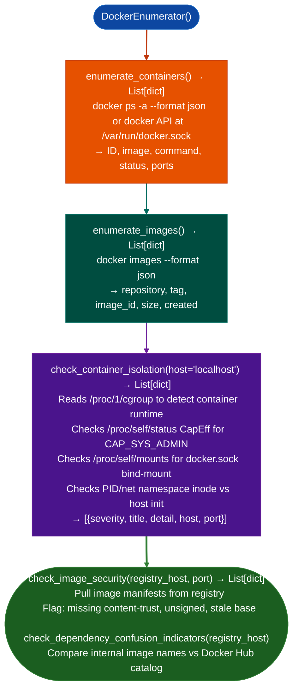

# Docker Inventory and Posture

Enumerate running Docker containers, images, volumes, and network configurations, and assess container isolation posture socket exposure, privileged flags, capability grants, image security: from a compromised host with Docker socket access, via `modules/docker_enum.py`.

---

## Why this exists

1. **Docker socket exposure (`/var/run/docker.sock` mounted in a container) is a direct host escape.** `DockerEnumerator` checks for socket accessibility and, if found, enumerates all containers and images on the host: providing the attack surface inventory needed to plan lateral movement from a compromised container to the underlying host.

2. **`check_container_isolation()`** enumerates the cluster's exposed Docker daemon API port 2375 TCP, unauthenticated by default on misconfigured deployments and `unix:///var/run/docker.sock`. It checks for containers running with `--privileged`, `--cap-add SYS_ADMIN`, `--net=host`, and `--pid=host`: each of which enables a distinct container escape path.

3. **`check_dependency_confusion_indicators()`** queries the registry for image tags that conflict with public Docker Hub names: a dependency confusion attack surface where an internal image name that is also a public Docker Hub name will pull the public image if the internal registry is unavailable. This is distinct from supply chain analysis (`CompilerSecurityGate`) and operates at the registry pull policy level.

---

## How it works



---

## Usage

```python
from modules.docker_enum import DockerEnumerator, check_container_isolation

# Enumerate from host or compromised container with socket
enumerator = DockerEnumerator()
containers = enumerator.enumerate_containers()
images = enumerator.enumerate_images()

print(f"Containers: {len(containers)}  Images: {len(images)}")
for c in containers:
    print(f"  {c['id'][:12]}  {c['image']}  {c['status']}")

# Check isolation posture — each finding: {severity, title, detail, host, port}
findings = check_container_isolation('localhost')
for f in findings:
    print(f"  [{f['severity']}] {f['title']}: {f['detail'][:80]}")
```

---

## Example output

The following illustrates Docker inventory output format.

```
DockerEnumerator: localhost

Containers: <N>
  <id> nginx:1.25  Up 3 days  0.0.0.0:80->80/tcp
  <id> redis:7.0   Up 3 days  127.0.0.1:6379->6379/tcp

Images: <M>

check_container_isolation():
  [CRITICAL] CAP_SYS_ADMIN_IN_CONTAINER — escape possible
             CapEff bit 21 (CAP_SYS_ADMIN) is set inside the container.
  [CRITICAL] DOCKER_SOCKET_MOUNTED — container escape
             /var/run/docker.sock is mounted inside the container.
```

---

## False positives

**`check_container_isolation()` flags `--net=host` as a finding**: host networking does not by itself enable container escape, but it removes the network namespace isolation that limits lateral movement. The finding is a posture note, not a confirmed escape primitive.

**Docker socket enumeration requires the socket to be accessible**: from outside the host, socket access is only possible if the Docker daemon is exposed on TCP port 2375 or the socket is bind-mounted into the analysis container. If neither is true, `DockerEnumerator` falls back to `docker ps` subprocess invocation.

---

## Pipeline position

Run `DockerEnumerator` after gaining shell access to a host or container. Use `check_container_isolation()` findings to identify escape primitives; use `enumerate_containers()` to discover lateral movement targets database containers, secrets managers, internal APIs.

---

## Reading findings

`check_container_isolation()` returns `List[{severity, title, detail, host, port}]`:

| Field | Content |
|:---|:---|
| `severity` | `CRITICAL` / `HIGH` |
| `title` | Finding code for example `CAP_SYS_ADMIN_IN_CONTAINER`, `DOCKER_SOCKET_MOUNTED` |
| `detail` | Evidence capability bit, mount path |
| `host` | `localhost` |
| `port` | `0` |

`enumerate_containers()` returns `List[{id, image, status, ports}]`. `enumerate_all()` returns a keyed dict: see the constructor section for all keys.

---

## See also

- [Kubernetes Inventory](kubernetes-inventory.md): `K8sEnumerator` for cluster-level inventory after container-level access
- [Cluster Management Exposure](cluster-management-exposure.md): combined Docker + Kubernetes management API surface
