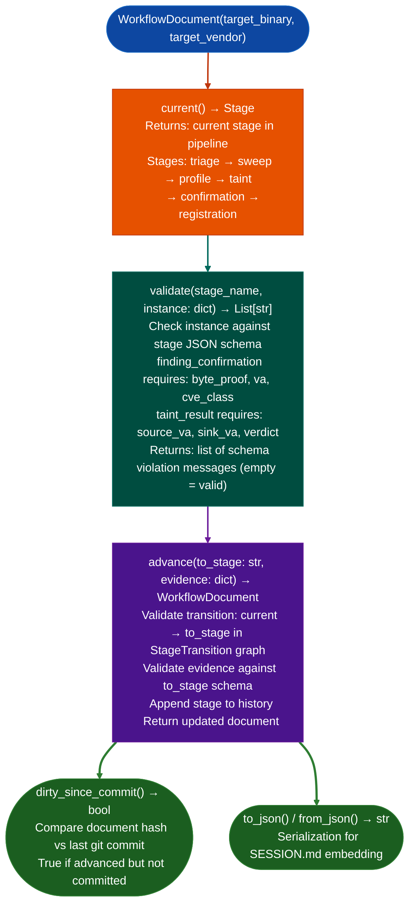

# Workflow Document

Provide schema-validated stage output and deterministic routing for the Ablation analysis workflow: ensuring that `finding_confirmation` stages include required `byte_proof`, that stage transitions follow the defined pipeline order, and that uncommitted session state is detected before context compaction.

---

## Why this exists

1. `SESSION.md` is human-maintained flat markdown with no schema validation: a `finding_confirmation` missing `byte_proof` is not caught until `FORGE.audit_module()` runs at commit time. `WorkflowDocument.validate()` catches schema violations immediately when a stage is completed, before the analyst proceeds to the next stage.

2. **Stage routing is implicit in prose**, there is no machine-checkable transition rule between triage, sweep, profile, taint, confirmation, and registration. `WorkflowDocument.advance()` enforces that each stage transition follows the defined `StageTransition` graph: `triage → sweep → profile → taint → confirmation → registration`. Attempting to skip a stage raises a `WorkflowError` with the required intermediate step.

3. **`WorkflowDocument.dirty_since_commit()` detects uncommitted session state**, it compares the current document hash against the last git commit hash, returning `True` if the document has been advanced but not committed. This surfaces the compaction warning: if context fills before a commit, the current stage evidence is lost. `dirty_since_commit()` is called by the session-end hook.

---

## How it works



---

## Usage

```python
from ablation.analyzers.workflow_document import WorkflowDocument

doc = WorkflowDocument(
    target_binary='/path/to/httpd',
    target_vendor='FortiGate'
)

# Validate stage output before advancing
errors = doc.validate('confirmation', {
    'va': 0x12340,
    'cve_class': 'CWE-78',
    # Missing byte_proof!
})
if errors:
    print(f"Schema violations: {errors}")
    # ['byte_proof: required field missing']

# Advance with complete evidence
doc = doc.advance('confirmation', {
    'va': 0x12340,
    'cve_class': 'CWE-78',
    'byte_proof': b'\x48\x8b\x07\xff\xd0',
})

# Check for uncommitted state
if doc.dirty_since_commit():
    print("WARNING: uncommitted stage evidence — commit before compaction")

# Serialize to SESSION.md
print(doc.to_json())
```

---

## Example output

The following illustrates workflow document state output format.

```
WorkflowDocument: httpd  (FortiGate)

Current stage: taint
History:
  triage      → sweep        (completed)
  sweep       → profile      (completed)
  profile     → taint        (in progress)

validate('confirmation', missing byte_proof):
  ['byte_proof: required field missing']

dirty_since_commit(): True  (advance() not yet committed)
```

---

## False positives

**`dirty_since_commit()` compares document JSON hash against git object store**: if the SESSION.md file is not tracked in the git repository for example in a non-git working directory, `dirty_since_commit()` always returns `False`. This is the expected behavior for one-off analysis sessions without a git repo.

**Stage transition enforcement uses the defined `StageTransition` graph**: if the analyst needs to revisit a previous stage for example re-run sweep after finding a new pattern, `advance()` will reject a backward transition. Use `WorkflowDocument.from_json()` to reload a previous state and branch a new document from there.

---

## Pipeline position

`WorkflowDocument` is an optional quality gate layer over the standard Ablation analysis pipeline. Use it on engagements where schema-validated evidence chains are required formal disclosures, PSIRT submissions. It does not replace `SESSION.md`, it augments it with machine-checkable evidence validation.

---

## Reading output

`WorkflowDocument` methods:

| Method | Return |
|:---|:---|
| `current_stage()` | Current stage name string for example `triage`, `sweep`, `taint`, `confirmation` |
| `history()` | `List[from_stage, to_stage, status]`: stage transition history |
| `validatestage, evidence_dict` | `List[str]`: list of validation errors; empty if valid |
| `dirty_since_commit()` | `True` if `advance()` has been called but not yet committed |
| `advancenext_stage, evidence_dict` | Moves to next stage; raises `ValidationError` if evidence is invalid |

---

## See also

- [Function Identity Database](function-identity-database.md): `FindingRegistry` where confirmed findings are registered at the `registration` stage
- [Persistent Analysis Context](persistent-analysis-context.md): `BinaryContext` that provides the binary surface `WorkflowDocument` tracks
