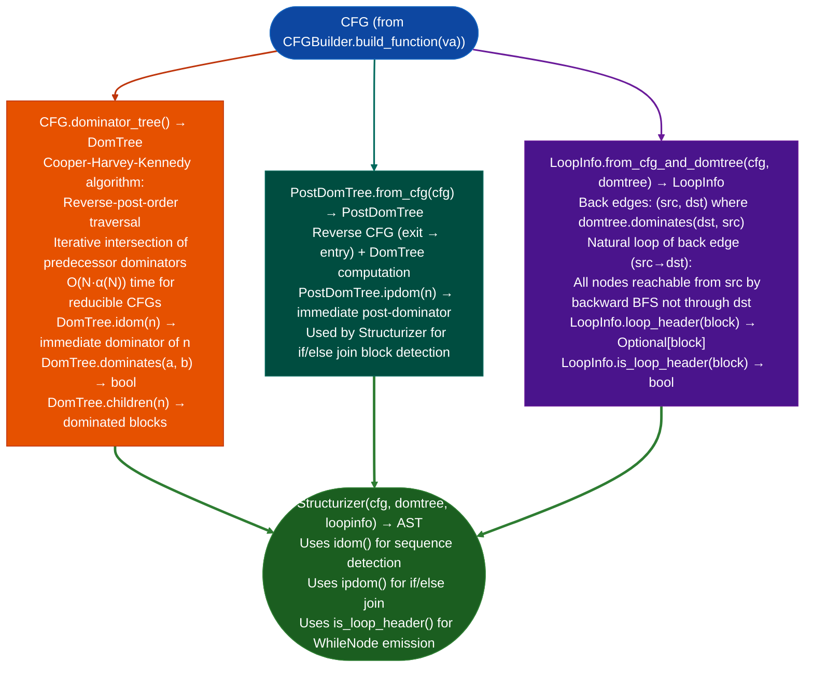

# Dominators and Loop Analysis

Build dominator tree, post-dominator tree, and identify natural loops from a CFG: providing the structural information required for structured control-flow recovery (`Structurizer`), join-block detection at if/else merge points, and loop back-edge identification for fixpoint iteration termination.

---

## Why this exists

1. **Structured control-flow recovery (`Structurizer`) requires a dominator tree to identify the join block of an if/else: the post-dominator of the branch head is the block where both branches merge, which becomes the `IfNode.join` in the recovered AST.** Without the dominator tree, the `Structurizer` cannot determine whether to emit `if/else` or `while` nodes, making firmware disassembly non-human-readable.

2. **Loop natural analysis identifies back edges edges where the successor dominates the predecessor, these are the loop headers for Relooper `WhileNode` construction.** Identifying back edges from the dominator tree rather than cycle detection is more reliable for reducible CFGs: a function with multiple natural loops produces a correct `WhileNode` for each loop header, while a cycle detector may merge nested loops incorrectly.

3. **`CFG.dominator_tree()` and `CFG.reaching_defs()` are the two structural analysis methods on `CFG`**: dominator tree provides structural shape, reaching definitions (used by `ReachingDefsAnalysis`) provide the data-flow lattice required for `ConstPropAnalysis` and `SCCPAnalysis`. Together they enable the MFP worklist to terminate at the correct fixpoint without over-approximation.

---

## How it works



---

## Usage

```python
from ablation.analyzers.cfg_builder import CFGBuilder
from ablation.analyzers.dataflow_engine import ReachingDefsAnalysis, ConstPropAnalysis
from ablation.analyzers.structurizer import Structurizer
from ablation.analyzers.binary_context import BinaryContext

ctx = BinaryContext.load_or_build('/path/to/target.elf')
builder = CFGBuilder(ctx)

# Build CFG and dominator structures
cfg = builder.build_function(0x1000)
domtree = cfg.dominator_tree()

# Reaching definitions (used by ConstPropAnalysis)
rda = ReachingDefsAnalysis(cfg)
rda_result = rda.run()

# Constant propagation (needs domtree for proper lattice initialization)
cp = ConstPropAnalysis(cfg, domtree)
cp_result = cp.run()

# Structured control-flow recovery
from ablation.analyzers.structurizer import Structurizer, PostDomTree
from ablation.analyzers.dataflow_engine import LoopInfo

postdom = PostDomTree.from_cfg(cfg)
loopinfo = LoopInfo.from_cfg_and_domtree(cfg, domtree)

structurizer = Structurizer(cfg, domtree, loopinfo, insn_emitter=ctx)
ast = structurizer.structurize()
print(ast.emit())
```

---

## Example output

The following illustrates dominator tree and loop detection output. Actual block VAs are function-specific.

```
DomTree for function at <va>:
  entry dominates all blocks
  block <va_a> dominates: [<va_b>, <va_c>, <va_d>]
  block <va_b> dominates: [<va_c>]

LoopInfo:
  back edge: <va_x> → <va_y>  (loop header at <va_y>)
  natural loop: {<va_y>, <va_z>, <va_x>}
```

---

## False positives

**Loop analysis requires a reducible CFG: an irreducible CFG one with two distinct entry paths to the same block, common in some hand-written assembly or obfuscated code will produce incorrect `LoopInfo`.** `CFG.is_reducible()` checks for reducibility; if `False`, use `cfg.stats()` to understand the structure before running `Structurizer`.

**`PostDomTree.ipdom()` may return `None` for blocks with no post-dominator**: blocks on infinite loops have no post-dominator. The `Structurizer` handles this via `BreakNode` emission.

---

## Pipeline position

These analyses are internal to the `CFGBuilder` → `Structurizer` pipeline. They are not typically called directly by analysis scripts: `Structurizer` calls them internally. Call `cfg.dominator_tree()` directly only when implementing a new analysis that needs the dominator relation, such as a new loop pattern detector or a custom reaching definitions variant.

---

## Reading output

`DomTree.idom(va)` returns the immediate dominator block VA (`int`) for block `va`, or `None` for the entry block.

`LoopInfo` object returned by `cfg.loops()`:

| Attribute | Content |
|:---|:---|
| `header` | Block VA of the loop header the block that dominates all loop body blocks |
| `body` | `Set[int]`: block VAs in the loop body |
| `back_edges` | List of `tail, header` back-edge tuples |

`PostDomTree.ipdom(va)` returns the immediate post-dominator block VA, or `None` for exit blocks and infinite-loop blocks.

---

## See also

- [Control-Flow Graph Construction](control-flow-graph-construction.md): `CFGBuilder` that produces the `CFG` input
- [CFG Fixpoint Dataflow](cfg-fixpoint-dataflow.md): `ConstPropAnalysis`/`SCCPAnalysis` that consume the dominator tree
- [Structured Control-Flow Recovery](structured-control-flow-recovery.md): `Structurizer` that uses all three: domtree, postdomtree, loopinfo
