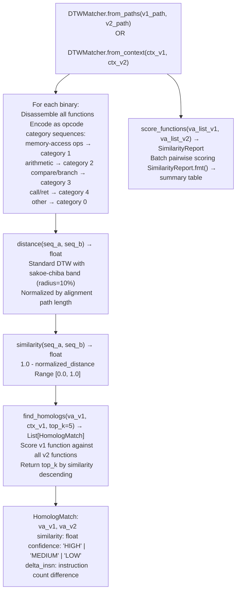

# DTW Function Homolog Matching

Find cross-version function homologs using Dynamic Time Warping on opcode category sequences — tolerating basic-block insertions and deletions that 4-gram Jaccard similarity penalizes unfairly, enabling accurate identification of where a function moved or was split between firmware versions.

---

## Why this exists

1. **Cross-version patch analysis requires finding the same function across firmware versions — but functions that gain or lose one validation block between versions have low 4-gram Jaccard similarity even though the core logic is identical.** `DTWMatcher` uses DTW on opcode category sequences instead of n-gram bags: DTW is warp-invariant and handles insertions/deletions by aligning non-identical-length sequences, achieving ~0.91 similarity for a function with one inserted block versus Jaccard's ~0.65 for the same pair.

2. **DTW similarity is calibrated: ≥0.85 is a reliable homolog, 0.70-0.85 is a candidate worth manual review, <0.70 is a different function.** The `HomologMatch.similarity` field gives the DTW-derived score (0.0–1.0) alongside `confidence` label (`HIGH`/`MEDIUM`/`LOW`) so triage is immediate without threshold tuning.

3. **`DTWMatcher` is the first step in the three-step cross-version patch analysis workflow**: `DTWMatcher.score_functions()` identifies whether two functions are from the same era (whether they are homologs at all), `MatrixProfileDiff.diff_functions()` then pinpoints exactly which instructions changed within the confirmed homolog pair, and `VersionTracker.find_homolog()` searches the version DB for where the function first appeared.

---

## How it works



---

## Usage

```python
from ablation.analyzers.dtw_matcher import DTWMatcher
from ablation.analyzers.binary_context import BinaryContext

# From file paths
matcher = DTWMatcher.from_paths(
    v1_path='/firmware/v1/libfoo.so',
    v2_path='/firmware/v2/libfoo.so',
)

# Find top-5 homologs for a specific function
matches = matcher.find_homologs(va_v1=0x4000, ctx_v1=ctx1, top_k=5)
for m in matches:
    print(m)

# Batch scoring: are two function lists from the same era?
va_list_v1 = [0x4000, 0x4200, 0x4500]
va_list_v2 = [0x5000, 0x5200, 0x5500]
report = matcher.score_functions(va_list_v1, va_list_v2)
print(report.fmt())

# From existing BinaryContext objects
ctx1 = BinaryContext.load_or_build('/firmware/v1/libfoo.so')
ctx2 = BinaryContext.load_or_build('/firmware/v2/libfoo.so')
matcher2 = DTWMatcher.from_context(ctx1, ctx2)
```

---

## Example output

The following illustrates the matching output format. Actual similarity scores and addresses are binary-specific.

```
HomologMatch:
  v1 VA: <va>    v2 VA: <va>
  Similarity: <score>  Confidence: HIGH
  delta_insn: +<N>  (function grew by N instructions)

SimilarityReport (batch):
  VA_v1      VA_v2      Similarity  Confidence
  <va>       <va>        0.91       HIGH
  <va>       <va>        0.74       MEDIUM
  <va>       (no match)  --         --
```

---

## False positives

**Short functions (fewer than ~15 instructions) produce unreliable DTW similarity scores — two unrelated short functions can score HIGH simply because both are short.** Filter `HomologMatch` results with `delta_insn < 3` for very short functions and require manual confirmation before using them as homolog anchors.

**DTW with sakoe-chiba band (radius 10%) can miss heavily-restructured functions** — a function that was split into two functions or merged from two will score below the HIGH threshold. If `DTWMatcher` returns no HIGH-confidence match, use `SubsequenceSearcher` to search for a sub-sequence match instead.

---

## Pipeline position

Step 1 of the three-step cross-version patch analysis workflow in `CLAUDE.md`: `DTWMatcher.score_functions()` first (same era?), `MatrixProfileDiff.diff_functions()` second (what changed?), `VersionTracker.find_homolog()` third (first appearance). Run `DTWMatcher` before `MatrixProfileDiff` — only confirmed homologs are worth the full instruction-level diff.

---

## Reading output

`DTWMatcher.score_functions(va_a, binary_b)` returns a list of match dicts sorted by score descending:

| Field | Content |
|:---|:---|
| `va_b` | VA of the candidate homolog in `binary_b` |
| `score` | DTW similarity score (0.0–1.0; ≥0.85 = HIGH confidence homolog) |
| `seq_len_a` | Instruction count for function `va_a` |
| `seq_len_b` | Instruction count for the candidate |

`DTWMatcher.find_homolog(va, binary_b, threshold=0.85)` returns the highest-scoring match dict above the threshold, or `None` if no match exceeds the threshold.

---

## See also

- [Matrix Profile Patch Diff](matrix-profile-patch-diff.md) — instruction-level change localization within confirmed homologs
- [Behavioral Subsequence Search](behavioral-subsequence-search.md) — find split/merged functions that DTW misses
- [Function Corpus Builder](function-corpus-builder.md) — corpus required for homolog matching against unlabeled binaries
