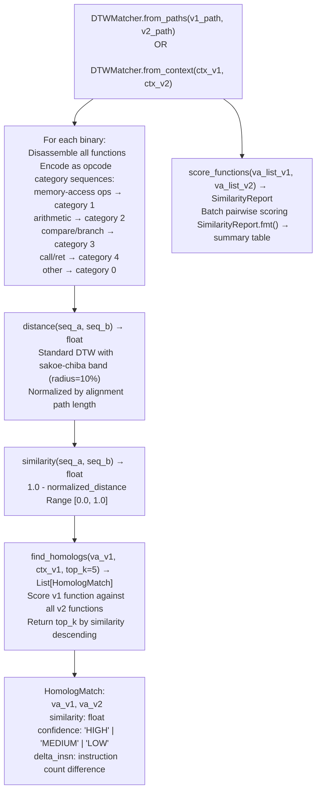

# DTW Function Homolog Matching

Find cross-version function homologs using Dynamic Time Warping on opcode category sequences: tolerating basic-block insertions and deletions that 4-gram Jaccard similarity penalizes unfairly, enabling accurate identification of where a function moved or was split between firmware versions.

---

## What is Dynamic Time Warping

Dynamic Time Warping is a sequence alignment algorithm that measures similarity between two sequences that may differ in length or timing. The name comes from speech recognition, where the same spoken word takes a different number of milliseconds depending on the speaker and pace. A naive comparison that lines up elements position-by-position gets the wrong answer because it penalizes timing differences that have nothing to do with whether the content is the same.

DTW solves this by allowing each position in one sequence to align against a range of positions in the other rather than forcing a strict one-to-one positional match. The algorithm finds the path through a cost matrix that minimizes total distance while still requiring the path to advance forward in both sequences. The result is a single distance score that reflects how similar two sequences are regardless of where individual elements appear.

For assembly comparison, position-to-position matching fails because a compiler can insert a bounds check, a vendor can add a logging block, or a security patch can insert two instructions between two existing ones. Any of those changes shift every subsequent instruction's position by the length of the insertion. An n-gram Jaccard or Euclidean measure sees large differences throughout the sequence because of one local change. DTW stretches the alignment to accommodate the insertion and scores the unchanged portions as matching because they still line up under the warped path.

The Sakoe-Chiba band constrains how far the alignment is allowed to warp at any position. Without a band, DTW allows arbitrarily large warps so two structurally different functions can find a low-cost alignment by skipping most of their content. A 10% radius band limits the warp to within 10% of the sequence length at each step. This prevents false matches between unrelated functions while still tolerating the small insertions and deletions that appear between firmware versions of the same function.

---

## Why this exists

1. **Cross-version patch analysis requires finding the same function across firmware versions, but functions that gain or lose one validation block between versions have low 4-gram Jaccard similarity even though the core logic is identical.** `DTWMatcher` uses DTW on opcode category sequences instead of n-gram bags: DTW is warp-invariant and handles insertions/deletions by aligning non-identical-length sequences, achieving ~0.91 similarity for a function with one inserted block versus Jaccard's ~0.65 for the same pair.

2. **DTW similarity is calibrated: ≥0.85 is a reliable homolog, 0.70-0.85 is a candidate worth manual review, <0.70 is a different function.** The `HomologMatch.similarity` field gives the DTW-derived score (0.0–1.0) alongside `confidence` label (`HIGH`/`MEDIUM`/`LOW`) so triage is immediate without threshold tuning.

3. **`DTWMatcher` is the first step in the three-step cross-version patch analysis workflow**: `DTWMatcher.score_functions()` identifies whether two functions are from the same era whether they are homologs at all, `MatrixProfileDiff.diff_functions()` then pinpoints exactly which instructions changed within the confirmed homolog pair, and `VersionTracker.find_homolog()` searches the version DB for where the function first appeared.

---

## How it works



---

## Usage

```python
from ablation.analyzers.dtw_matcher import DTWMatcher
from ablation.analyzers.binary_context import BinaryContext

# From file paths
matcher = DTWMatcher.from_paths(
    v1_path='/firmware/v1/libfoo.so',
    v2_path='/firmware/v2/libfoo.so',
)

# Find top-5 homologs for a specific function
matches = matcher.find_homologs(va_v1=0x4000, ctx_v1=ctx1, top_k=5)
for m in matches:
    print(m)

# Batch scoring: are two function lists from the same era?
va_list_v1 = [0x4000, 0x4200, 0x4500]
va_list_v2 = [0x5000, 0x5200, 0x5500]
report = matcher.score_functions(va_list_v1, va_list_v2)
print(report.fmt())

# From existing BinaryContext objects
ctx1 = BinaryContext.load_or_build('/firmware/v1/libfoo.so')
ctx2 = BinaryContext.load_or_build('/firmware/v2/libfoo.so')
matcher2 = DTWMatcher.from_context(ctx1, ctx2)
```

---

## Example output

The following illustrates the matching output format. Actual similarity scores and addresses are binary-specific.

```
# SimilarityReport.fmt() for a single pair:
DTW 0x22ccc0 vs 0x23a010
  dtw_similarity : 0.9142
  dtw_distance   : 8.7500
  jaccard_4gram  : 0.8730
  lengths        : 312 vs 318
  verdict        : same_era

# DTWFunctionMatch.__str__() per entry in score_functions() batch:
0x22ccc0  httpsd_v1  dtw_sim=0.914  dtw_dist=8.7500  jaccard=0.873  len=312
0x23a010  httpsd_v2  dtw_sim=0.831  dtw_dist=14.2100  jaccard=0.742  len=344
```

---

## False positives

**Short functions fewer than ~15 instructions produce unreliable DTW similarity scores: two unrelated short functions can score `same_era` simply because both are short.** Filter `SimilarityReport` results where `len_a < 15` and require manual confirmation before using them as homolog anchors.

**DTW with sakoe-chiba band radius 10% can miss heavily-restructured functions**: a function that was split into two functions or merged from two will score `rewritten` or `different`. If `DTWMatcher` returns no `same_era` match, use `SubsequenceSearcher` to search for a sub-sequence match instead.

---

## Pipeline position

Step 1 of the three-step cross-version patch analysis workflow in `CLAUDE.md`: `DTWMatcher.score_functions()` first same era?, `MatrixProfileDiff.diff_functions()` second what changed?, `VersionTracker.find_homolog()` third first appearance. Run `DTWMatcher` before `MatrixProfileDiff`: only confirmed homologs are worth the full instruction-level diff.

---

## Reading output

`DTWMatcher.score_functionsva_a, va_b` scores one function pair and returns a `SimilarityReport`:

| Attribute | Content |
|:---|:---|
| `va_a` / `va_b` | VAs of the two functions being compared |
| `similarity` | DTW similarity score (0.0–1.0; ≥0.85 = HIGH confidence homolog) |
| `dtw_dist` | Raw DTW distance (lower = more similar) |
| `jaccard` | Jaccard similarity on the mnemonic sets |
| `len_a` / `len_b` | Instruction counts for each function |
| `verdict` | `'HOMOLOG'` / `'SIMILAR'` / `'DIFFERENT'`: summary classification |

`DTWMatcher.find_homologs(va, binary_b, threshold=0.85)` scans all functions in `binary_b` and returns `List[HomologMatch]` of candidates above the threshold, sorted by `similarity` descending:

| Attribute | Content |
|:---|:---|
| `va` | VA of the matching function in `binary_b` |
| `binary` | Path string of `binary_b` |
| `similarity` | DTW similarity score |
| `dtw_dist` | Raw DTW distance |
| `jaccard` | Jaccard similarity |
| `seq_len` | Instruction count of the matching function |

---

## See also

- [Matrix Profile Patch Diff](matrix-profile-patch-diff.md): instruction-level change localization within confirmed homologs
- [Behavioral Subsequence Search](behavioral-subsequence-search.md): find split/merged functions that DTW misses
- [Function Corpus Builder](function-corpus-builder.md): corpus required for homolog matching against unlabeled binaries
