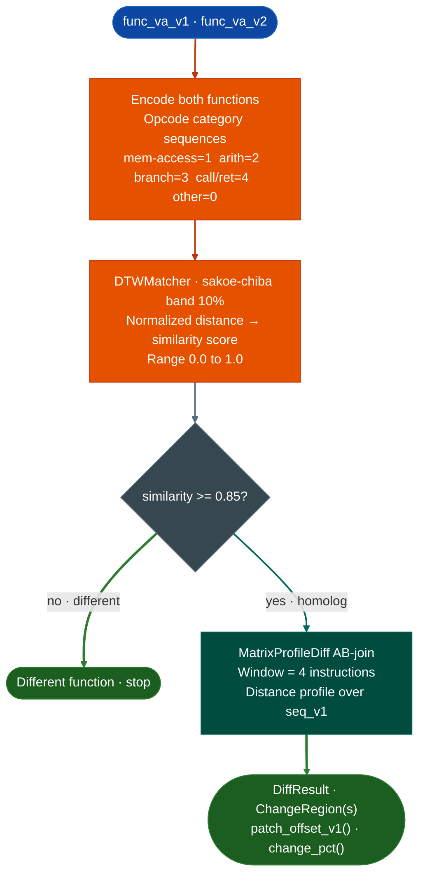

<a id="dtw--matrix-profile-similarity"></a>
# Sequence-Based Function Matching

`DTWMatcher` scores similarity between opcode category sequences across two firmware versions to determine whether two functions are homologs. `MatrixProfileDiff` then localizes exactly which instruction window changed within a confirmed homolog pair. Running both in sequence answers two questions: is this the same function, and what specifically was patched.

---

## What is Dynamic Time Warping

Dynamic Time Warping is a sequence alignment algorithm that measures similarity between two sequences that may differ in length or timing. The name comes from speech recognition, where the same spoken word takes a different number of milliseconds depending on the speaker and pace. A naive comparison that lines up elements position-by-position gets the wrong answer because it penalizes timing differences that have nothing to do with whether the content is the same.

DTW solves this by allowing each position in one sequence to align against a range of positions in the other rather than forcing a strict one-to-one positional match. The algorithm finds the path through a cost matrix that minimizes total distance while still requiring the path to advance forward in both sequences. The result is a single distance score that reflects how similar two sequences are regardless of where individual elements appear.

For assembly comparison, position-to-position matching fails because a compiler can insert a bounds check, a vendor can add a logging block, or a security patch can insert two instructions between two existing ones. Any of those changes shift every subsequent instruction's position by the length of the insertion. An n-gram Jaccard or Euclidean measure sees large differences throughout the sequence because of one local change. DTW stretches the alignment to accommodate the insertion and scores the unchanged portions as matching because they still line up under the warped path.

The Sakoe-Chiba band constrains how far the alignment is allowed to warp at any position. Without a band, DTW allows arbitrarily large warps so two structurally different functions can find a low-cost alignment by skipping most of their content. A 10% radius band limits the warp to within 10% of the sequence length at each step. This prevents false matches between unrelated functions while still tolerating the small insertions and deletions that appear between firmware versions of the same function.

---

## What is Matrix Profile

The Matrix Profile is a data structure that records, for every subsequence in a time series, the distance to its nearest neighbor elsewhere in the same series or in a second series. The term "profile" refers to the array of those nearest-neighbor distances indexed by position. A low value at position k means the subsequence starting at k has a close match somewhere. A high value means it does not.

The AB-join variant computes this between two separate sequences rather than within one. For every subsequence window in sequence A, it finds the closest matching window in sequence B. The result is a distance profile over A: each position shows how well that region of A is represented in B. Positions with high distance have no counterpart in B, which means they were added, removed, or substantially rewritten between the two versions.

This property makes Matrix Profile well suited for patch localization. A security patch typically changes one tight region of a function and leaves the rest intact. The distance profile for the patched function will show a spike at exactly that region and near-zero values everywhere else. A refactor produces multiple spikes spread across the profile. A complete rewrite produces uniformly high distances. The shape of the profile distinguishes these cases without requiring the analyst to read the full disassembly of both versions.

The window size controls the granularity of detection. A window of 4 instructions finds patches that touch as few as 4 consecutive opcodes. Smaller windows catch finer changes but also fire on noise from compiler rescheduling. The default window of 4 is tuned for the size of a typical security check: one compare instruction and one conditional branch, with context instructions on either side.

---

## Why this exists

1. **Cross-version patch analysis requires finding the same function across firmware versions, but functions that gain or lose one validation block between versions have low 4-gram Jaccard similarity even though the core logic is identical.** `DTWMatcher` uses DTW on opcode category sequences instead of n-gram bags: DTW is warp-invariant and handles insertions and deletions by aligning non-identical-length sequences, achieving ~0.91 similarity for a function with one inserted block versus Jaccard's ~0.65 for the same pair.

2. **DTW similarity is calibrated: >= 0.85 is a reliable homolog, 0.70-0.85 is a candidate worth manual review, <0.70 is a different function.** The `HomologMatch.similarity` field gives the DTW-derived score (0.0-1.0) alongside a `confidence` label (`HIGH`/`MEDIUM`/`LOW`) so triage is immediate without threshold tuning.

3. **Once `DTWMatcher` confirms homologs, the next question is exactly what changed.** `MatrixProfileDiff` answers this at instruction-level precision by computing the AB-join distance profile between the two versions' opcode category sequences. High distance at position k means there is no close match for that subsequence in the other version so that region was changed. This points directly to the patched instruction window without requiring manual comparison of the full disassembly.

4. **Matrix Profile AB-join avoids the false-change problem of naive instruction diffing.** Naive diff on disassembly text reports every instruction that moved due to a non-local code change: a function growing by one instruction shifts all subsequent instruction offsets. Matrix Profile is shift-invariant so an unchanged block that shifted by N bytes still reports as unchanged. The `ChangeRegion.is_insertion_shift` flag distinguishes true changes from shift artifacts.

---

## How they work together



---

## Usage

```python
from ablation.analyzers.dtw_matcher import DTWMatcher
from ablation.analyzers.matrix_profile_diff import MatrixProfileDiff
from ablation.analyzers.binary_context import BinaryContext

ctx_v1 = BinaryContext.load_or_build('/firmware/v1/libfoo.so')
ctx_v2 = BinaryContext.load_or_build('/firmware/v2/libfoo.so')

# Step 1: find homologs with DTW
matcher = DTWMatcher.from_context(ctx_v1, ctx_v2)

matches = matcher.find_homologs(va_v1=0x4000, ctx_v2=ctx_v2, top_k=5)
for m in matches:
    print(m)
# HomologMatch(va_v1=0x4000, va_v2=0x41800, similarity=0.914, confidence='HIGH', delta_insn=6)

# Score specific pairs
report = matcher.compare_all([(0x4000, 0x5000), (0x4200, 0x5200)])
for match in report:
    print(match)

# Step 2: localize the patch within a confirmed homolog pair
diff = MatrixProfileDiff.from_paths(
    '/firmware/v1/libfoo.so',
    '/firmware/v2/libfoo.so',
)

result = diff.diff_functions(
    va_v1=0x4000, end_va_v1=0x4143f,
    va_v2=0x41800, end_va_v2=0x41980,
)
print(result.fmt())
print(result.change_summary())

# Quick patched/not-patched verdict
if result.is_likely_patched(threshold=15.0):
    patch_va = result.patch_offset_v1()
    print(f"Patched: change starts at v1 offset {patch_va:#x}")

# Automated triage across many versions
for v in firmware_versions:
    diff = MatrixProfileDiff.from_paths(baseline_path, v.path)
    result = diff.diff_functions(
        va_v1=target_va_v1,
        va_v2=v.target_va,
        end_va_v1=end_va_v1,
        end_va_v2=v.end_va,
    )
    print(f"  {v.label}: {result.change_pct():.1f}% changed, patched={result.is_likely_patched()}")
```

---

## Example output

```
# DTWMatcher: SimilarityReport.fmt() for a single pair
DTW 0x22ccc0 vs 0x23a010
  dtw_similarity : 0.9142
  dtw_distance   : 8.7500
  jaccard_4gram  : 0.8730
  lengths        : 312 vs 318
  verdict        : same_era

# MatrixProfileDiff: DiffResult.fmt() for the confirmed homolog pair
MatrixProfileDiff  v1=0x22ccc0 (312 insns)  v2=0x23a010 (318 insns)  window=4  change=14.4%
  [CHANGED  ]  v1[42:58]   v2[42:61]   discord=3.82
  [UNCHANGED]  v1[58:312]  v2[61:318]  discord=0.14

# change_summary():
change=14.4%  changed:16
```

---

## False positives

**Short functions fewer than ~15 instructions produce unreliable DTW similarity scores.** Two unrelated short functions can score `same_era` simply because both are short. Filter `SimilarityReport` results where `len_a < 15` and require manual confirmation before using them as homolog anchors.

**DTW with sakoe-chiba band radius 10% can miss heavily-restructured functions.** A function that was split into two functions or merged from two will score `rewritten` or `different`. If `DTWMatcher` returns no `same_era` match, use `SubsequenceSearcher` to search for a sub-sequence match instead.

**`is_likely_patched(threshold=15.0)` fires if more than 15% of the opcode sequence has no close match in the other version.** A function that was heavily refactored will also exceed the threshold. Use `change_pct()` and manual inspection of the identified `ChangeRegion` to distinguish a targeted security patch (one tight change region) from a refactor (many spread-out change regions).

**STUMPY is optional: the numpy fallback uses the same math but is slower on sequences longer than ~2000 instructions.** Install STUMPY for firmware-wide batch triage: `pip install stumpy`.

---

## Pipeline position

Step 1 and Step 2 of the three-step cross-version patch analysis workflow. `DTWMatcher.score_functions()` runs first to answer same era? `MatrixProfileDiff.diff_functions()` runs second on confirmed homologs to answer what changed? Step 3 is `VersionTracker.find_homolog()` to identify the earliest unpatched version. Run `DTWMatcher` before `MatrixProfileDiff` because only confirmed homologs are worth the full instruction-level diff.

---

## Reading output

`DTWMatcher.score_functions(va_a, va_b)` returns a `SimilarityReport`:

| Attribute | Content |
|:---|:---|
| `va_a` / `va_b` | VAs of the two functions being compared |
| `similarity` | DTW similarity score (0.0-1.0; >= 0.85 = HIGH confidence homolog) |
| `dtw_dist` | Raw DTW distance (lower = more similar) |
| `jaccard` | Jaccard similarity on the mnemonic sets |
| `len_a` / `len_b` | Instruction counts for each function |
| `verdict` | `'HOMOLOG'` / `'SIMILAR'` / `'DIFFERENT'` |

`MatrixProfileDiff.diff_functions(va_v1, va_v2)` returns a `DiffResult`:

| Attribute | Content |
|:---|:---|
| `va_v1` / `va_v2` | VAs of the two functions being compared |
| `regions` | `List[ChangeRegion]`: classified regions of the alignment |
| `window` | Matrix-profile window size used |
| `change_pct` | Float percentage of the function that changed |
| `is_likely_patched()` | `True` if `change_pct` exceeds the configured threshold |
| `patch_offset_v1()` | VA of the first modified region start in version 1 |

Each `ChangeRegion` has:

| Attribute | Content |
|:---|:---|
| `kind` | `'unchanged'` / `'modified'` / `'inserted'` / `'deleted'` |
| `v1_start` / `v1_end` | Index range in `seq_v1` (`-1` if inserted) |
| `v2_start` / `v2_end` | Index range in `seq_v2` (`-1` if deleted) |
| `max_discord` | Maximum matrix-profile distance value within this region |

---

## See also

- [Cross-Version Diffing Workflow](../workflows/cross-version.md): full three-step workflow using DTW, MatrixProfile, and VersionTracker together
- [Behavioral Subsequence Search](behavioral-subsequence-search.md): find split or merged functions that DTW misses
- [Function Corpus Builder](function-corpus-builder.md): corpus required for homolog matching against unlabeled binaries
- [CFG Fixpoint Dataflow](cfg-fixpoint-dataflow.md): semantic analysis of the changed region identified by the diff
