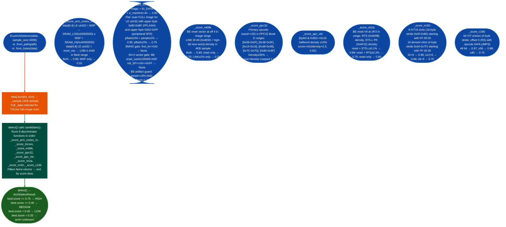

<a id="ecu-architecture-detector"></a>
# ECU Architecture Detection

Fingerprint the ISA of flat ECU ROM images: scoring ARM Cortex-M, Infineon TriCore AURIX, M68K/CPU32, PowerPC 32-bit Book E, PowerPC VLE, Renesas SH-2A, M32R, and Infineon/Siemens C166/C167 candidates using reset vectors, opcode density statistics, and pointer address-range analysis without requiring an ELF header.

---

## Why this exists

1. **Automotive ECU firmware ships as raw flat binaries with no format metadata: file(1), binwalk, and LIEF all return "data" or fail to identify the architecture.** A stripped Bosch ME17 TriCore dump, a Honda SH7058 ROM, and a BMW MS43 C166 image are all `file: data`. Without ISA identification, Capstone cannot be configured, disassembly cannot start, and semantic analysis never happens. `EcuArchDetector` uses architecture-specific structural signatures that are present in every ROM regardless of how the firmware was packaged.

2. **Each supported ECU ISA has a distinct structural signature at ROM offset 0 that acts as a near-definitive discriminator.** Cortex-M ROMs begin with an initial MSP in SRAM range (`0x20000000–0x3FFFFFFF`) and a Thumb-mode reset handler (LSB=1) in flash range. M68K/CPU32 ROMs begin with a big-endian supervisor stack pointer and big-endian reset vector. SH-2A ROMs have a big-endian reset PC at offset 0 and an initial SP of `0xFFFFxxxx` at offset 4. C166/C167 ROMs have 64 consecutive 4-byte IVT entries all starting with opcode `0xFA` (JMPS). These signatures produce HIGH confidence without any opcode decode.

3. **TriCore AURIX flat ROM detection requires full-image pointer density scanning, not just the first 4096 bytes, but the scanner must guard against big-endian ROM false positives.** AURIX startup code is sparse in absolute-address literals in the first 64KB; the PFLASH LE-pointer density (values with upper byte `0x80–0xBF`) only becomes significant after the first several function bodies. Gap-9 2026-10-11 confirmed that GM CPU32 ROMs were misidentified as TriCore because M68K instruction bytes, read as little-endian 32-bit words, accidentally have high PFLASH-range density. The BMHD gate (`first_le == 0x00000000`) blocks this: valid AURIX ROMs never have a zero STAD at offset 0, but CPU32 ROMs frequently have `0x00000000` as the supervisor stack pointer.

---

## How it works



### Confidence thresholds

| Score | Confidence | Interpretation |
|---|---|---|
| ≥ 0.75 | HIGH | Structural signature matched: reliable for tool selection |
| 0.40 – 0.74 | MEDIUM | Multiple signals agree: confirm with additional analysis |
| 0.20 – 0.39 | LOW | Weak signal: treat as hypothesis only |
| < 0.20 |: | `arch='unknown'` returned |

---

## Usage

```python
from ablation.analyzers.ecu_arch_detector import EcuArchDetector, ArchDetectResult
from pathlib import Path

rom = Path('/media/cowboy/research/ECU/bosch_me17_tcx.bin').read_bytes()

# Quick: detect best match
det = EcuArchDetector(rom)
result = det.detect()
print(f"Architecture: {result.arch}")
print(f"Confidence:   {result.confidence}")
print(f"Score:        {result.score:.2f}")
print(f"Reason:       {result.reason}")

# All candidates (useful when two architectures score similarly)
for cand in det.candidates():
    print(f"  {cand.arch:<12s}  {cand.score:.2f}  {cand.reason}")

# From path
det2 = EcuArchDetector.from_path('/media/cowboy/research/ECU/honda_cbr_sh7058.bin')
r2 = det2.detect()
print(f"\n{r2.arch}  {r2.confidence}  {r2.reason}")

# Increase sample size for large ROMs with sparse prologues
det3 = EcuArchDetector(rom, sample_size=16384)
r3 = det3.detect()

# Guard before selecting Capstone config
if not result.is_confident:
    print(f"[WARN] Low confidence ISA detection — verify before disassembly")
else:
    print(f"[OK] Proceeding with {result.arch} disassembler")
```

---

## Example output

```
Architecture: tricore
Confidence:   HIGH
Score:        0.85
Reason:       TriCore AURIX: PFLASH LE-ptr density 3.72% + peripheral SFR density 1.18%

All candidates:
  tricore       0.85  TriCore AURIX: PFLASH LE-ptr density 3.72% + peripheral SFR density 1.18%
  ppc32         0.41  PPC32: opcode density 41.2% in Book E primary-opcode ranges

# Honda CBR SH7058:
sh2a  HIGH  SH-2A: reset vector 0x00001000 in-range, STS.L PR density 0.124%

# GM P12 CPU32 (Gap-9 scenario — correctly rejected):
m68k  HIGH  M68K: BE reset vector 0x00000000 in-range, LINK.W A6 density 1.82%
# (TriCore scored 0.0 — BMHD gate blocked the PFLASH density false positive)

# C166/C167 BMW MS43:
c166  HIGH  C166/C167: 64/64 IVT slots begin with JMPS opcode 0xFA (definitive)
```

---

## False positives

**TriCore PFLASH density fires on M68K/CPU32 ROMs when the BMHD gate cannot distinguish them.** The BMHD gate blocks CPU32 ROMs with `0x00000000` at offset 0 the SSP pattern. CPU32 ROMs where the SSP is a non-zero value (some GM P12b variants use `0xFFFF0000` as SSP) have a non-zero first LE word and pass the BMHD gate. For these ROMs, the M68K discriminator's reset vector and LINK.W A6 density scores should both be higher than the TriCore PFLASH density: check `det.candidates()` for the M68K score and confirm it exceeds TriCore before selecting TriCore.

**PPC32 and PPC VLE discriminators both fire on VLE ROMs.** The PPC32 opcode density heuristic uses primary opcode ranges that overlap with VLE 32-bit instruction encodings. A VLE ROM will produce non-zero PPC32 density, potentially scoring close to or above the PPC VLE score. The PPC VLE discriminator uses a dedicated halfword pattern `(byte0 & 0x90) == 0x10` that is specific to VLE encodings: if both fire, prefer the higher-scoring one but verify by checking whether the ROM contains an ELF header with e_flags indicating VLE.

**M32R false positive risk exists for PPC32 ROMs with dense `0xFF` bytes.** The M32R discriminator looks for `FF 00 00` at IVT positions 0x00–0x80. A PPC32 ROM where the first 256 bytes happen to contain opcode-byte `0xFF` at those positions very uncommon would trigger a false M32R score. In practice, confirmed PPC32 Book E ROMs have reset handler addresses at offset 0x100 RSTI vector that do not begin with `0xFF`.

---

## Pipeline position

**Before this module:** Obtain the raw ROM bytes from a device dump, a vendor SDK, or a firmware extraction step. Do not attempt to run `EcuArchDetector` on ELF-wrapped binaries or Intel HEX files: the discriminators assume flat binary layout. For TriCore ELF binaries, the ELF e_machine check handles them correctly, but the flat-binary path runs unnecessarily.

**After this module:** Use `result.arch` to select the correct Capstone architecture: `arm_cm` → `capstone.CS_ARCH_ARM + capstone.CS_MODE_THUMB`; `tricore` → no Capstone support: use the GHS RE reference; `m68k` → `capstone.CS_ARCH_M68K`; `ppc32` or `ppc_vle` → `capstone.CS_ARCH_PPC + capstone.CS_MODE_32`; `sh2a` → `capstone.CS_ARCH_SH`; `rh850`/`m32r` → use ISA-specific modules. Pass `result.arch` to `BinaryContext.load_or_build()` when the binary has no ELF header.

---

## Reading findings

| Field | Content |
|:---|:---|
| `result.arch` | ISA name string: `arm_cm`, `tricore`, `m68k`, `ppc32`, `ppc_vle`, `sh2a`, `m32r`, `c166`, or `unknown` |
| `result.confidence` | `HIGH` / `MEDIUM` / `LOW`: use `result.is_confident` to gate downstream analysis |
| `result.score` | 0.0–1.0 numeric score for best match |
| `result.reason` | One-sentence explanation with the specific signals that fired |
| `result.candidates` | All scoring candidates: check when confidence is MEDIUM for competing hypotheses |

---

## See also

- [RH850 Taint Analysis](rh850-taint-analysis.md): taint tracker for RH850 ECU targets after architecture identification
- [Firmware Analysis](firmware-analysis.md): full pipeline from raw ROM dump to findings
- [Binary Context](binary-context.md): load a raw ROM into BinaryContext once architecture is confirmed
