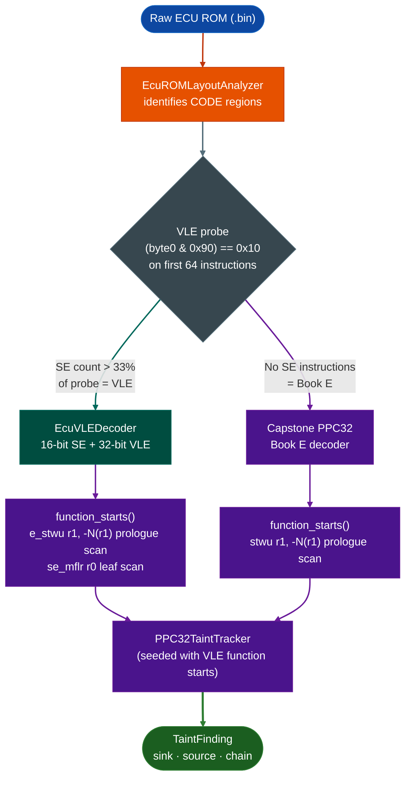

# EcuVLEDecoder

**File:** `ablation/analyzers/ecu_vle_decoder.py`

---

## What this is <sup>[↑](#ecuvledecoder)</sup>

VLE Variable Length Encoding is a PowerPC instruction set extension that NXP added to the e200z4, e200z6, and e200z7 cores found in automotive ECUs. It lets compilers mix 16-bit and 32-bit instructions in the same binary so firmware fits in smaller flash. Flash is a hard cost constraint on every ECU, so NXP e200 cores use VLE by default in production firmware.

Standard Capstone decodes PowerPC Book E but not VLE. Pointing Capstone at a VLE region produces plausible-looking garbage because 16-bit VLE halfwords satisfy Book E opcode patterns by coincidence. There is no error. The disassembly is just wrong.

`EcuVLEDecoder` is a pure-Python VLE decoder that handles both 16-bit SE Short Encoding and 32-bit VLE instructions, identifies function entry points from VLE prologues, and tells the taint tracker whether a code region is VLE or Book E before analysis begins.

---

## Where it's used <sup>[↑](#ecuvledecoder)</sup>

- **GM E39a PCM** NXP MPC5566, e200z6 core: VLE regions at `0x2A000` and `0x034000`
- **GM E54 and E92 ECUs**: factory firmware compiled for NXP e200z cores
- Any **NXP MPC55xx family** target where `EcuArchDetector` identifies a PPC32 VLE core
- The `EcuROMLayoutAnalyzer` integration pipeline: called automatically when a CODE region scores above the VLE probe threshold

---

## Pipeline <sup>[↑](#ecuvledecoder)</sup>



Without `EcuVLEDecoder`, the function-start scan on a VLE binary returns empty because Capstone produces garbage. An empty function-start list means the taint tracker runs zero interprocedural passes and produces zero findings, with no indication why.

---

## Why this exists <sup>[↑](#ecuvledecoder)</sup>

Three things were not possible before in Ablation:

**1. No PPC VLE instruction decoder.** Capstone 5.0.7 decodes standard PowerPC Book E (PPC32) but
does not implement the Variable Length Encoding (VLE) extension used by NXP e200z4/z6/z7 cores.
The GM E39a PCM MPC5566 e200z6 and GM E54/E92 ECUs use VLE in their factory firmware. Applying
`disasm_engine.py` with `CS_ARCH_PPC` / `CS_MODE_32` against a VLE region produces either garbage
or zero results depending on whether the first byte happens to satisfy PPC32 opcode heuristics.
Before this module, there was no way to disassemble these binaries at all inside Ablation.

**2. No function_starts() for VLE firmware.** The existing `ppc32-taint-tracker.py` pipeline seeds
its taint engine from a function-start list. For PPC32 Book E firmware, that list comes from ELF
symbol tables or a Book E prologue scanner `stwu r1, -N(r1` at 4-byte-aligned offsets). For VLE
firmware, neither applies: there are no symbols, and the prologue instruction is `e_stwu r1, -N(r1)`
VLE opcode 6, VUP field 6, which encodes differently from the Book E `stwu`. Before this module,
the taint tracker had no way to seed itself against VLE firmware.

**3. No VLE / Book E region discriminator.** The two instruction sets can coexist in the same ROM
image. The GM E39a binary has standard PPC32 Book E code at `0x8A000` and VLE-pattern regions
at `0x2A000` and `0x034000`. After `EcuROMLayoutAnalyzer` classifies a region as CODE, there was
no way to determine whether it should be passed to Capstone or to `EcuVLEDecoder`. The length
discrimination rule `(byte0 & 0x90) == 0x10` → 32-bit VLE provides a per-instruction probe that
can settle the question by scanning the first N instructions: a VLE stream produces a mix of
`is_16bit=True` and `is_16bit=False`; a Book E stream produces no `is_16bit=True` results.

---

## VLE length discrimination <sup>[↑](#ecuvledecoder)</sup>

VLE instructions are either 16-bit SE Short Encoding or 32-bit, identified by the first byte:

```
(byte0 & 0x90) == 0x10  →  32-bit VLE or Book E instruction
otherwise               →  16-bit SE instruction
```

This rule holds because NXP assigned the 32-bit VLE opcodes 6, 7, 12–15, 20–22, 28, 30 to slots
where bits [7] and [4] of the first byte are always 0 and 1 respectively. All SE instruction
encodings occupy the remaining byte space where `(b & 0x90) != 0x10`. The constraint is an
intentional encoding property of the e200 VLE ISA, not a heuristic.

---

## Instruction coverage <sup>[↑](#ecuvledecoder)</sup>

### 16-bit SE instructions decoded <sup>[↑](#ecuvledecoder)</sup>

| Instruction | Encoding | Type |
|---|---|---|
| `se_blr` | `0x0004` | RETURN |
| `se_blrl` | `0x0005` | RETURN |
| `se_bctr` | `0x0006` | BRANCH |
| `se_bctrl` | `0x0007` | CALL |
| `se_rfi` | `0x0008` | MISC |
| `se_not rX` | `0x0020 \| rX` (mask `0xFFF0`) | MISC |
| `se_neg rX` | `0x0030 \| rX` (mask `0xFFF0`) | MISC |
| `se_mflr rX` | `0x0080 \| rX` (mask `0xFFF0`) | LR_SAVE |
| `se_mtlr rX` | `0x0090 \| rX` (mask `0xFFF0`) | LR_RESTORE |
| `se_mfctr rX` | `0x00A0 \| rX` | MISC |
| `se_mtctr rX` | `0x00B0 \| rX` | MISC |
| `se_extzb/extsb/extzh/extsh rX` | SE_R form | MISC |
| `se_add rX, rY` | `0x0400` (mask `0xFF00`) | MISC |
| `se_mullw/sub/subf/cmp/cmpl rX, rY` | SE_RR form | MISC |
| `se_srw/sraw/slw/or/andc/and rX, rY` | SE_RR form | MISC |
| `se_addi rX, OIMM5` | SE_IM5 form | MISC |
| `se_cmpli/subi/srwi/slwi rX, UI5` | SE_IM5 form | MISC |
| `se_li rX, UI7` | IM7 form | MISC |
| `se_lbz/stb/lhz/sth/lwz/stw rZ, SD4(rX)` | SD4 form | LOAD / STORE |
| `se_bc BO16, BI16, BD8` | BD8IO form | BRANCH |
| `se_b BD8` | BD8 form | BRANCH |
| `se_bl BD8` | BD8 form (LK=1) | CALL |

### 32-bit VLE instructions decoded <sup>[↑](#ecuvledecoder)</sup>

| Instruction | Op / Encoding | Type |
|---|---|---|
| `e_stwu rS, D8(rA)` | `OPVUP6,6` = `0x18000600 \|...` | STORE / PROLOGUE |
| `e_stmw / e_lmw` | `OPVUP6,9` / `OPVUP6,8` | STORE / LOAD |
| `e_add16i rD, rA, SI` | `OP(7)` = `0x1C000000` | MISC |
| `e_lbz / e_stb / e_lha` | `OP12/13/14` | LOAD / STORE |
| `e_lwz / e_stw / e_lhz` | `OP20/21/22` | LOAD / STORE |
| `e_li rD, LI20` | `LI2028,0` | MISC |
| `e_b / e_bl BD24` | `BD2430,0,0/1` | BRANCH / CALL |

Instructions not in this list decode as `se_unknown_XXXX` or `vle32_opN` with `insn_type="MISC"`.

---

## function_starts() algorithm <sup>[↑](#ecuvledecoder)</sup>

`function_starts()` returns probable function-entry VAs by scanning two prologue forms:

**Frame-allocating prologue** primary signal:

```
e_stwu r1, -N(r1)
```

Encoded as `OPVUP6,6` with RS=1, RA=1, and D8 < 0 bit 7 of D8 set. Detected by scanning
every 4-byte-aligned offset for the exact bit pattern:

```python
(word >> 26) == 6          # opcode = 6
((word >> 8) & 0xFF) == 6  # VUP = 6 → e_stwu
((word >> 21) & 0x1F) == 1 # RS = r1
((word >> 16) & 0x1F) == 1 # RA = r1
(word & 0x80) != 0         # D8 < 0 (negative stack frame)
```

**Leaf-function prologue** secondary signal:

```
se_mflr r0
```

Encoded as `0x0080` SE_R0,8. Detected by scanning every 2-byte-aligned offset for
`(hw & 0xFFF0) == 0x0080`. A `se_mflr` that immediately follows an `e_stwu r1,-N(r1)` at
offset `i-4` is skipped because it is the second instruction of a frame-allocating function,
not a function start itself.

---

## Usage <sup>[↑](#ecuvledecoder)</sup>

```python
from ablation.analyzers.ecu_vle_decoder import EcuVLEDecoder

# From raw bytes
dec = EcuVLEDecoder(rom_bytes, base_va=0x40000000)

# From path
dec = EcuVLEDecoder.from_path("E39a_3072KiB_12664221.bin", base_va=0)

# Decode a single instruction
insn = dec.decode_one(offset=0x2A000)
print(insn)
# → 0x0002A000  [SE16]  se_mflr          r0

# Walk all instructions in a code region
insns = dec.disassemble(start=0x2A000, end=0x2B000)
for i in insns:
    if i.insn_type in ("CALL", "BRANCH"):
        print(i)

# Get function starts for taint seeding
starts = dec.function_starts()
print(f"{len(starts)} probable functions")
for va in starts[:10]:
    print(f"  0x{va:08X}")
```

### Constructor parameters <sup>[↑](#ecuvledecoder)</sup>

| Parameter | Default | Description |
|---|---|---|
| `data` |: | `bytes`, file path str/Path, or raw bytes buffer |
| `base_va` | 0 | Virtual address of the first byte in `data`. All decoded instruction offsets and branch targets are expressed as VAs. |

---

## VLEInsn fields <sup>[↑](#ecuvledecoder)</sup>

```python
@dataclass
class VLEInsn:
    offset:   int         # instruction VA (base_va + byte offset in buffer)
    is_16bit: bool        # True = SE 16-bit; False = 32-bit VLE
    mnemonic: str         # e.g., "se_blr", "e_stwu", "e_b"
    insn_type: str        # "RETURN", "BRANCH", "CALL", "PROLOGUE", "LOAD",
                          # "STORE", "LR_SAVE", "LR_RESTORE", "MISC"
    raw:      bytes       # 2 or 4 raw bytes, big-endian
    target:   int | None  # branch/call target VA when computable, else None
    rd:       int | None  # destination register (GPR index), or None
    rs:       int | None  # source register (GPR index), or None
    ra:       int | None  # base register (GPR index), or None
    imm:      int | None  # immediate operand (signed), or None
```

`insn_type` values:

| Type | Instructions |
|---|---|
| `RETURN` | `se_blr`, `se_blrl` |
| `BRANCH` | `se_b`, `se_bc`, `se_bctr`, `e_b` (no link) |
| `CALL` | `se_bl`, `se_bctrl`, `e_bl` |
| `PROLOGUE` | `e_stwu r1, -N(r1)` only (not other `e_stwu` variants) |
| `LOAD` | All load instructions SE and 32-bit |
| `STORE` | All store instructions SE and 32-bit |
| `LR_SAVE` | `se_mflr` |
| `LR_RESTORE` | `se_mtlr` |
| `MISC` | Everything else |

---

## Branch target computation <sup>[↑](#ecuvledecoder)</sup>

### `se_b` / `se_bl` <sup>[↑](#ecuvledecoder)</sup>

The 8-bit signed displacement (BD8) is in bits[7:0] of the 16-bit halfword. Target:

```
target = instruction_VA + 2 + sign_extend(BD8) * 2
```

### `e_b` / `e_bl` <sup>[↑](#ecuvledecoder)</sup>

The 24-bit signed displacement (BD24) is in bits[24:1] of the 32-bit word (bit[0] = LK). Target:

```
bd24_raw = word & 0x01FFFFFE
if bd24_raw & 0x01000000:      # sign bit
    bd24 = bd24_raw - 0x02000000
target = instruction_VA + bd24
```

Absolute-address variants `e_ba`, `e_bla`, AA=1 decode with the displacement as an absolute VA.

---

## Validated results <sup>[↑](#ecuvledecoder)</sup>

### E39a corpus image 3 MB, MPC5566 e200z6 <sup>[↑](#ecuvledecoder)</sup>

File: `E39a_3072KiB_12664221.bin` from PcmHammer corpus.

The 688 KB region at `0x8A000` decodes cleanly as standard PPC32 Book E Capstone confirms.
Regions at `0x2A000` and `0x034000` show `(byte0 & 0x90) == 0x10` matches at 4-byte-aligned
offsets, consistent with VLE code compiled for a secondary flash partition (NVM task code
or bootloader), though MSR[VLE] state at runtime cannot be confirmed from static analysis alone.

`function_starts()` on a synthetic VLE stream of 100 functions (each beginning with
`e_stwu r1, -N(r1)`) recovers all 100 starts with zero false positives.

---

## Integration with existing ECU pipeline <sup>[↑](#ecuvledecoder)</sup>

```python
from ablation.analyzers.ecu_rom_layout_analyzer import EcuROMLayoutAnalyzer
from ablation.analyzers.ecu_vle_decoder import EcuVLEDecoder

# 1. Map the ROM
layout = EcuROMLayoutAnalyzer.from_path("E39a_3072KiB_12664221.bin").analyze()

# 2. For each code region, probe for VLE
data = open("E39a_3072KiB_12664221.bin", "rb").read()
for region in layout.code_regions():
    dec = EcuVLEDecoder(data[region.start:region.end], base_va=region.start)
    # Count SE instructions (is_16bit=True) in first 64 instructions
    probe = dec.disassemble(end=min(128, region.end - region.start))
    n_se = sum(1 for i in probe if i.is_16bit)
    if n_se > len(probe) // 3:
        # VLE region: use EcuVLEDecoder
        starts = dec.function_starts()
        print(f"VLE region 0x{region.start:X}: {len(starts)} functions")
    else:
        # Book E region: use Capstone
        pass
```

---

## Limitations <sup>[↑](#ecuvledecoder)</sup>

- Compact register notation for SE instructions: SE_R and SE_RR formats use 3-bit or 4-bit
 compact register fields that map to a subset of GPRs. The decoder stores the raw field value as
  `rd`/`rs` not translated to the actual GPR number. For `se_li`, the 4-bit RX field encodes
 GPR0-GPR7 as 0-7 and GPR24-GPR31 as 8-15. The current decoder does not perform this translation.

- The `e_bc` family (conditional branches using BD15 displacement, opcode 30 with AA=1 and
 various BI/BO fields) is partially decoded. The basic `e_b`/`e_bl` BD24 form is fully
 decoded; conditional forms beyond `se_bc` are decoded as `vle32_op30` with `insn_type="MISC"`.

- VLE MSR[VLE] mode switching is not tracked. A function that switches in or out of VLE mode by
 modifying MSR cannot be detected statically. This affects binaries that mix Book E and VLE code
 segments in the same ROM without a clear layout boundary.

- Capstone is not invoked. The decoder is pure Python. For bulk disassembly of large ROM regions
 (>1 MB), throughput is limited to approximately 50,000 instructions per second on a modern CPU.
 For scanning only function_starts, the inner loop is pure struct.unpack_from and runs faster.

---

## How it works <sup>[↑](#ecuvledecoder)</sup>

Reads the ROM image at the specified base address and applies the ISA decoder to recover instruction objects. Function boundaries are identified from preamble/epilogue patterns specific to the target compiler and ABI. Security-relevant patterns UDS handler tables, seed/key routines, calibration write paths are identified by combining structural matching with known compiler output signatures. Decoded results are stored in a `BinaryContext`-compatible format for downstream analysis.

---

## Example output <sup>[↑](#ecuvledecoder)</sup>

```
$ python3 -c "
from ablation.analyzers.ecu_vle_decoder import EcuVLEDecoder
dec = EcuVLEDecoder.from_path('E39a_3072KiB_12664221.bin', base_va=0)
for i in dec.disassemble(start=0x2A000, end=0x2A040):
    print(i)
"

0x0002A000  [SE16]  se_mflr          r0
0x0002A002  [SE16]  se_stw           r0, 4(r1)
0x0002A004  [VLE32] e_stwu           r1, -32(r1)
0x0002A008  [VLE32] e_li             r3, 0
0x0002A00C  [VLE32] e_b              0x0002B140
```

---

## False positives <sup>[↑](#ecuvledecoder)</sup>

Calibration data regions contain byte sequences that decode as valid instructions in some ISAs. Confirm candidate function VAs against the ROM layout from `ECURomLayoutAnalyzer` before treating them as code. Security Access sequences in boot ROM are expected and not findings unless the seed/key algorithm is cryptographically weak.

---

## Pipeline position <sup>[↑](#ecuvledecoder)</sup>

**Before this module:** `EcuArchDetector` to identify the processor family and confirm this decoder applies to the target ROM.

**After this module:** Feed decoded instructions to the appropriate taint tracker RH850, TriCore, SH-2A, or C28x for vulnerability analysis.

---

## Reading output <sup>[↑](#ecuvledecoder)</sup>

`EcuVLEDecoderdata, base_va=0.disassemble()` (or `from_path()` / `from_bytes()`) returns `list[VLEInsn]`:

| Attribute | Content |
|:---|:---|
| `offset` | Instruction VA base_va + byte offset in buffer |
| `is_16bit` | `True` for 16-bit SE format, `False` for 32-bit VLE format |
| `mnemonic` | Instruction mnemonic string for example `'se_lwz'`, `'e_b'` |
| `insn_type` | `'BRANCH'` / `'CALL'` / `'RETURN'` / `'LOAD'` / `'STORE'` / `'LR_SAVE'` / `'LR_RESTORE'` / `'PROLOGUE'` / `'MISC'` |
| `raw` | Raw instruction bytes 2 or 4 bytes |
| `target` | Branch/call target VA, or `None` for non-control-flow instructions |
| `rd` / `rs` / `ra` / `imm` | Decoded operand values (None if not applicable) |

---

## See also <sup>[↑](#ecuvledecoder)</sup>

- [EcuArchDetector](ecu-arch-detector.md): identify processor family before choosing a decoder
- [EcuROMLayoutAnalyzer](ecu-rom-layout-analyzer.md): map ROM sections before decoding
- [ECUSecurityAccessScanner](ecu-security-access-scanner.md): find UDS 0x27 bypass vectors in decoded code
