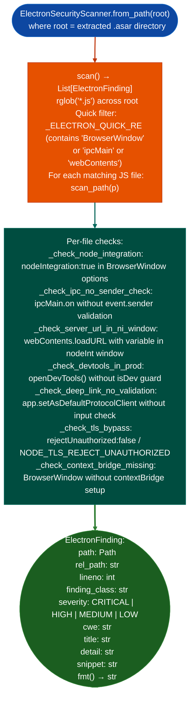

# Electron Application Auditing

Scan Electron application JavaScript source for security misconfigurations: detecting `nodeIntegration` enabled in renderer processes, missing IPC sender validation, `contextIsolation` disabled, TLS bypass flags, DevTools enabled in production builds, and missing `contextBridge` isolation patterns across extracted `.asar` archives.

---

## Why this exists

1. **FortiFone Desktop v8.0 Electron/Chromium SIP phone client required reading the Electron security model from scratch for each finding during manual review of `app.asar` JS.** Seven confirmed findings emerged: all of which would have been caught by automated pattern matching. `ElectronSecurityScanner` encodes these patterns so they apply automatically to all Electron-based targets FortiFone, FortiClient desktop integrations, FPAM browser extension host, any vendor Electron app without repeated manual effort.

2. **Electron's security model is systematically different from web browsers: `nodeIntegration: true` in a renderer process gives loaded web content full Node.js system access.** Combining this with an unvalidated IPC handler that accepts renderer-initiated navigation (`webContents.loadURL(userInput)`) or a deep link without scheme validation creates a Remote Code Execution path from a malicious URL opened by the app. `ElectronSecurityScanner` detects these patterns and their combinations.

3. **`scan()` returns typed `ElectronFinding` objects with CWE classification and severity**: findings map directly to standard CWE entries CWE-78 for `nodeIntegration` + `loadURL`, CWE-295 for TLS bypass, CWE-749 for exposed dangerous APIs, enabling consistent severity triage aligned with how the findings are reported downstream.

---

## How it works



---

## Usage

```python
from ablation.analyzers.electron_security_scanner import ElectronSecurityScanner

# Scan extracted .asar contents
scanner = ElectronSecurityScanner.from_path('/tmp/fortifone_extracted/app')
findings = scanner.scan()
print(ElectronSecurityScanner.report(findings))

# Scan a single JS file
single = ElectronSecurityScanner.scan_file('/tmp/main.js')
for f in single:
    print(f.fmt())

# Filter by severity
critical = [f for f in findings if f.severity == 'CRITICAL']
print(f"Critical: {len(critical)}  Total: {len(findings)}")
```

To extract an `.asar` before scanning:
```bash
# npm install -g asar  (one-time setup)
asar extract /path/to/app.asar /tmp/app_extracted/
```

---

## Example output

The following illustrates the Electron scanner output format. Actual paths and line numbers are app-specific.

```
ElectronSecurityScanner: /tmp/fortifone_extracted/app  (<N> JS files)

[CRITICAL] node-integration-rce  main/window.js:<line>
  CWE: CWE-78
  nodeIntegration enabled in BrowserWindow
  renderer process has full Node.js access; combined with loadURL(userInput) → RCE

[HIGH] tls-bypass  renderer/network.js:<line>
  CWE: CWE-295
  rejectUnauthorized: false — TLS certificate validation disabled

[MEDIUM] devtools-in-prod  main/index.js:<line>
  CWE: CWE-749
  openDevTools() without isDev guard — DevTools accessible in production build

Total: <N> findings  (<C> critical, <H> high, <M> medium)
```

---

## False positives

**`_check_node_integration` fires on any `nodeIntegration: true` string**: some apps use `nodeIntegration: true` in the main window deliberately and safely for example loading only trusted local content. Validate by checking whether the same `BrowserWindow` also calls `loadURL` with user-controlled or network-sourced URLs.

**`_check_ipc_no_sender_check` is a pattern match**, it detects `ipcMain.on(...)` without `event.sender` in the handler body. Large handler functions that perform sender validation in a helper call will be flagged as false positives. Inspect the handler for indirect sender validation before reporting.

---

## Pipeline position

Run `ElectronSecurityScanner` after extracting the `.asar` archive from the Electron app bundle. This is a JavaScript-layer scan, independent of the binary analysis pipeline. Feed `CRITICAL` and `HIGH` findings to manual verification, referencing the Electron security documentation https://www.electronjs.org/docs/latest/tutorial/security.

---

## Reading findings

`ElectronSecurityScanner.from_path(root).scan()` returns `List[ElectronFinding]`:

| Attribute | Content |
|:---|:---|
| `rel_path` | Source file path relative to the app root |
| `lineno` | Line number of the finding |
| `finding_class` | Finding code for example `node-integration-rce`, `tls-bypass`, `context-isolation-disabled` |
| `severity` | `CRITICAL` / `HIGH` / `MEDIUM` / `LOW` |
| `cwe` | CWE identifier for example `CWE-78`, `CWE-295` |
| `title` | Short description of the misconfiguration |
| `detail` | Explanation of the attack vector |

`ElectronFinding.fmt()` returns a formatted multi-line string for direct display.

---

## See also

- [Source Dangerous Sink Detection](source-dangerous-sink-detection.md): `SourceSinkScanner` for dangerous patterns in source-level JavaScript
- [Firmware Extraction](firmware-extraction.md): extracting `.asar` and Electron bundles from firmware images
