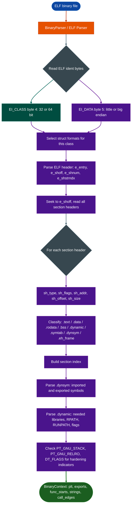

# ELF Internals and Hardening

Parse ELF32 and ELF64 binaries without external dependencies: extracting section headers, symbol tables, entry points, and architecture metadata, and surface the hardening indicators that determine whether mitigations like NX, PIE, RELRO, and stack canaries are present.

---

## Why this exists

1. **Every Ablation analysis tool runs on top of ELF structure.** `BinaryContext`, `TaintTracker`, `SemanticSearcher`, and every scanner in the framework need to know where the binary's code lives, what its imports are, and where function starts can be found. Rather than depending on `readelf`, `pyelftools`, or `lief` being present in every deployment, Ablation includes a zero-dependency ELF parser that provides a consistent interface regardless of environment.

2. **Hardening state is part of vulnerability triage.** Whether a buffer overflow is exploitable depends heavily on whether the binary was compiled with stack canaries, whether the stack is non-executable, whether position-independent code is enabled, and whether GOT/PLT entries are protected by RELRO. These are not afterthoughts: they determine severity, exploitability, and what kind of mitigation bypass is required. Surfacing them at parse time puts them in front of the analyst before any deeper work begins.

3. **ELF covers the full target landscape.** Fortinet firmware FortiOS, FortiAP, Cisco IOS/IOS-XE userspace, Huawei HarmonyOS native code, TencentOS system binaries: everything in Ablation's real-world target set is ELF. Getting this right is not optional.

---

## How it works

The ELF format is a structured binary container. Every ELF file starts with a 64-byte header that identifies the architecture, bitness, endianness, and entry point, then carries a table of section headers that index the binary's code, data, symbol tables, dynamic linking metadata, and debug information.



**Bitness and endianness detection** comes from two bytes in the ELF identification area: `EI_CLASS` at offset 4 `0x01` = ELF32, `0x02` = ELF64 and `EI_DATA` at offset 5 `0x01` = little-endian, `0x02` = big-endian. All subsequent struct reads use the correct format string.

**Entry point** is at offset 24 in the ELF header: a 4-byte value for ELF32 and an 8-byte value for ELF64.

**Section headers** are at the file offset recorded in `e_shoff`. Each section header records its virtual address, file offset, size, type, and flags. The section name string table index (`e_shstrndx`) identifies which section header holds the `.shstrtab` section whose content provides the human-readable section names.

**Hardening indicators** are derived from:
- `PT_GNU_STACK` program header: if the execute bit is clear, NX is enabled
- `e_type == ET_DYN`: the binary is position-independent (PIE)
- `PT_GNU_RELRO` program header: RELRO is configured
- `DT_FLAGS` in the `.dynamic` section: `DF_BIND_NOW` means full RELRO
- Symbol presence of `__stack_chk_fail` in imports: stack canaries are in use

---

## BinaryParser ELF path

```python
from ablation.core.binary_parser import BinaryParser

parser = BinaryParser('/path/to/firmware.elf')
info = parser.parse()
# {
#   'format': 'ELF',
#   'bits': 64,
#   'endian': 'little',
#   'entry_point': '0x401200',
#   'sections': 28
# }

print(parser.report())
# Binary: firmware.elf
# Format: ELF
# Architecture: 64 bit
# Endianness: little
# Entry Point: 0x401200
# Sections: 28
```

For the full analysis surface PLT, exports, func_starts, call_edges, hardening checks, use `BinaryContext` on top of the ELF parser:

```python
from ablation.analyzers.binary_context import BinaryContext

ctx = BinaryContext.load_or_build('/path/to/firmware.elf')
print(ctx.summary())
# Resolved 847 PLT entries
# Recovered 1,402 function starts from .eh_frame
# Architecture: ELF64 x86_64 little-endian

# Hardening state
ctx.hardening_flags()   # {'nx': True, 'pie': False, 'relro': 'partial', 'canary': True}
```

---

## Usage

```python
from ablation.core.binary_parser import BinaryParser

# Quick format identification and section count
p = BinaryParser('/fw/fortigate/httpsd')
info = p.parse()
print(f"ELF{info['bits']} {info['endian']}-endian, entry 0x{int(info['entry_point'],16):x}, {info['sections']} sections")

# Iterate sections
for s in p.sections:
    print(f"[{s['index']:3d}] addr=0x{s['addr']:x} size={s['size']:#x} type={s['type']}")
```

---

## Example output

```
Binary: httpsd
Format: ELF
Architecture: 64 bit
Endianness: little
Entry Point: 0x402340
Sections: 31

JSON Output:
{
  "format": "ELF",
  "bits": 64,
  "endian": "little",
  "entry_point": "0x402340",
  "sections": 31
}
```

---

## False positives

**Stripped binaries with no `.symtab`.** Many production firmware binaries strip the symbol table. The parser still reads the ELF header and section headers correctly; the section count and entry point are accurate even when `p.symbols` is empty.

**Custom section names.** Some embedded firmware uses non-standard section names e.g. `.ftext`, `.iram`, `.dram0.text`. The section type (`sh_type`) is still meaningful even when the name is unfamiliar.

---

## Pipeline position

**Before this module:** File acquisition and hash verification. No other Ablation module is a prerequisite.

**After this module:** `BinaryContext.load_or_build()` takes the ELF format information and builds the full analysis context: PLT map, function starts from `.eh_frame`, call graph, string cross-references, and hardening state. Every scanner, taint tracker, and semantic searcher requires `BinaryContext`.

---

## Reading findings

| Field | Content |
|:---|:---|
| `format` | `'ELF'` |
| `bits` | `32` or `64` |
| `endian` | `'little'` or `'big'` |
| `entry_point` | Hex string of the program entry-point VA |
| `sections` | Count of section headers parsed |

---

## See also

- [Binary Context](binary-context.md): full analysis context built on top of this parser
- [PE Internals and Indicators](pe-internals-and-indicators.md): same role for Windows PE
- [Mach-O Internals](mach-o-internals.md): same role for Apple Mach-O
- [Binary Format and Platform Identification](binary-format-and-platform-identification.md): the format detection layer that selects this parser
