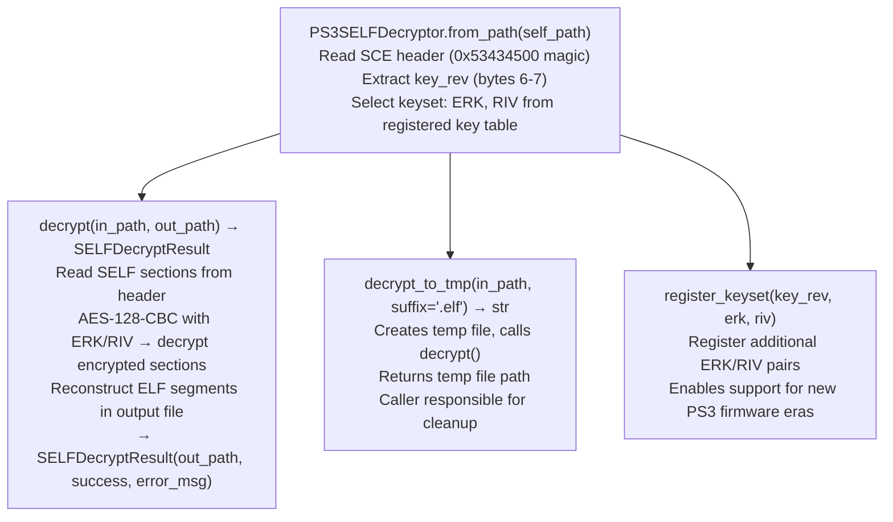

# PS3 SELF Decryption

Decrypt PS3 SELF (Signed ELF) files programmatically inside a Python pipeline — auto-detecting the correct keyset from the SCE header `key_rev` field, applying AES-128-CBC decryption with the correct ERK/RIV pair, and producing a standard ELF that `BinaryContext.load_or_build()` can parse.

---

## Why this exists

1. **`lief`, `capstone`, and `BinaryContext.load_or_build()` all fail silently on encrypted SELF format** — they see garbage or raise exceptions on the non-ELF magic bytes `0x53434500` (`SCE\0`). Before `PS3SELFDecryptor`, decryption required the external `scetool` binary (C, manual build, not importable as a Python library), invoked manually before each analysis session with the correct keyset flags.

2. **Auto-detection from `key_rev` eliminates manual keyset lookup.** The `key_rev` field at bytes 6–7 of the SCE header selects the master keyset (ERK/RIV). `PS3SELFDecryptor.from_path()` reads `key_rev` and selects the correct keyset automatically. Without this, matching `key_rev` to the right ERK/RIV required manual lookup in `scetool`'s `keys.h` for every new SELF file.

3. **`decrypt_to_tmp()` integrates directly into analysis pipelines** — it decrypts to a temporary file and returns the path, enabling `BinaryContext.load_or_build(decryptor.decrypt_to_tmp(self_path))` as a one-liner. The temporary file is managed by the caller; `decrypt()` writes to a caller-specified output path for persistent results.

---

## How it works



---

## Usage

```python
from ablation.analyzers.ps3_self_decryptor import PS3SELFDecryptor
from ablation.analyzers.binary_context import BinaryContext
import os

# Decrypt a SELF file
decryptor = PS3SELFDecryptor.from_path('/path/to/eboot.elf')

# Option 1: Persistent output
result = decryptor.decrypt('/path/to/eboot.elf', '/tmp/eboot_decrypted.elf')
if result.success:
    ctx = BinaryContext.load_or_build('/tmp/eboot_decrypted.elf')
    print(ctx.summary())

# Option 2: Temporary pipeline integration
tmp_path = decryptor.decrypt_to_tmp('/path/to/eboot.elf')
try:
    ctx = BinaryContext.load_or_build(tmp_path)
    print(ctx.summary())
finally:
    os.unlink(tmp_path)

# Register a new keyset for an unseen key_rev
PS3SELFDecryptor.register_keyset(
    key_rev=0x0004,
    erk=bytes.fromhex('<32-hex-byte-erk>'),
    riv=bytes.fromhex('<16-hex-byte-riv>')
)
```

---

## Example output

The following illustrates the SELF decryption output format. Actual key_rev and file sizes are SELF-specific.

```
PS3SELFDecryptor: eboot.elf  (SCE magic, key_rev=0x0003)

Keyset: key_rev=0x0003  (registered)
Decrypting: eboot.elf → /tmp/eboot_decrypted.elf
  Encrypted sections: <N>
  AES-128-CBC decryption: OK
  ELF reconstruction: OK

SELFDecryptResult: success=True
BinaryContext: eboot_decrypted.elf  (ELF64, PPC64)  <N> functions
```

---

## False positives

**`from_path()` raises on unknown `key_rev`** — if the SELF file uses a `key_rev` not in the registered keyset table, `PS3SELFDecryptor.from_path()` raises a `KeyError`. Use `register_keyset()` to add new ERK/RIV pairs before calling `from_path()` for new PS3 firmware eras.

**Decrypted output is only valid if the keyset is correct** — an incorrect ERK/RIV produces a file with AES output that appears syntactically valid (correct ELF magic after decryption) but contains garbage instruction bytes. Verify decryption success by checking that `BinaryContext.load_or_build()` parses correctly and `ctx.func_starts` is non-empty.

---

## Pipeline position

Run `PS3SELFDecryptor.from_path()` before any SELF file analysis. After successful decryption, feed the output path to `BinaryContext.load_or_build()` for all standard Ablation analysis. Follow with `PS3OPDVtableScanner` for vtable reconstruction and `VMXDensityScanner` for vector function labeling.

---

## Reading output

`PS3SELFDecryptor.decrypt()` returns the path to the decrypted ELF file (written to disk). No finding dict is returned. Call `BinaryContext.load_or_build(output_path)` immediately after decryption.

`PS3SELFDecryptor.header()` returns an `SELFHeader` object:

| Attribute | Content |
|:---|:---|
| `key_rev` | Key revision byte from the SELF header |
| `program_type` | SELF program type (e.g., `PPU_EXEC`, `SPU_EXEC`) |
| `app_version` | Application version field |
| `sdk_type` | SDK type identifier |

---

## See also

- [PS3 OPD Virtual Tables](ps3-opd-virtual-tables.md) — PS3 Cell PPU vtable reconstruction after SELF decryption
- [VMX/AltiVec Density Ranking](vmx-altivec-density-ranking.md) — vector function labeling for PS3 binaries
- [PPC64 ELFv1 Resolution](ppc64-elfv1-resolution.md) — PLT patching required on PS3 Cell PPU ELFv1 binaries
