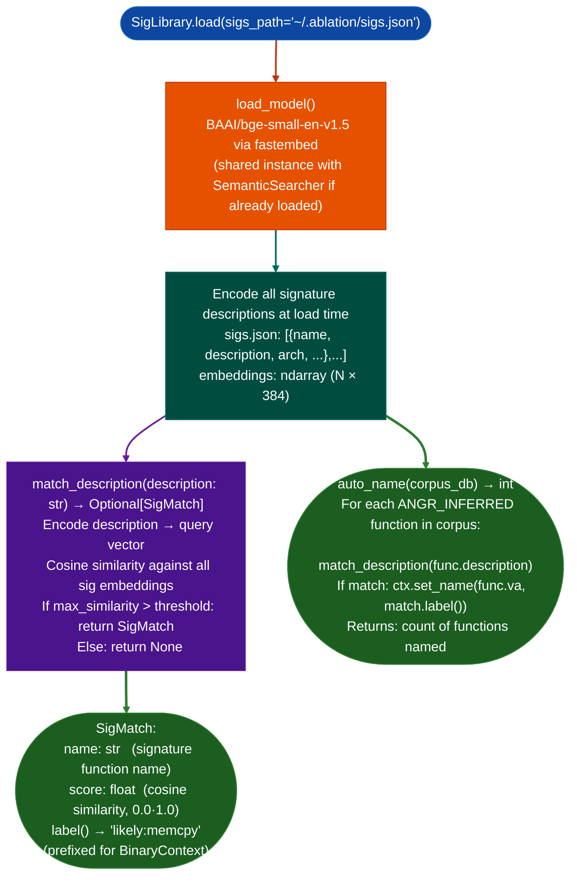

# Function Signature Library

Match unknown stripped functions against a behavioral signature library: using the same BAAI/bge-small-en-v1.5 model loaded for `SemanticSearcher`: to rename functions from `fn_0x1d700` to `likely:memcpy` when similarity exceeds a confidence threshold, without requiring symbol recovery or decompilation.

---

## Why this exists

1. **Standard library functions memcpy, strlen, sprintf compiled into stripped static binaries appear as anonymous `fn_0xVA` entries in `BinaryContext`.** `SigLibrary.auto_name()` renames them using behavioral descriptions compared against a curated signature library (`~/.ablation/sigs.json`), so that `FuncProfiler`, `WindowAnalyzer`, and `TaintTracker` output shows `likely:memcpy` instead of `fn_0x1d700`: enabling faster manual analysis and more accurate sink identification.

2. **`SigLibrary` reuses the BERT model already loaded for `SemanticSearcher`**, it calls `SigLibrary.load_model()` which shares the `BAAI/bge-small-en-v1.5` instance if `SemanticSearcher` was already loaded, adding zero startup cost when both tools are used in the same session. All signature descriptions are encoded once at load time (`SigLibrary.load()`), not per-query.

3. **`SigMatch.label()` returns `likely:<name>` rather than just `<name>`**: the `likely:` prefix distinguishes signature-matched names from confirmed symbol names or manually set names in `BinaryContext`. This distinction propagates through all downstream output: `FuncProfiler` CALLS sections show `likely:memcpy` vs confirmed `memcpy`, enabling analysts to assess confidence at a glance.

---

## How it works



---

## Usage

```python
from ablation.analyzers.sig_library import SigLibrary
from ablation.analyzers.corpus_builder import CorpusBuilder
from ablation.analyzers.binary_context import BinaryContext

ctx = BinaryContext.load_or_build('/path/to/stripped_binary')
corpus = CorpusBuilder.from_context(ctx)
corpus.build()

# Auto-name all inferred functions
sig_lib = SigLibrary.load()
n_named = sig_lib.auto_name(corpus.db_path)
print(f"Renamed {n_named} functions via signature matching")

# Check a specific function
description = "copies bytes from source to destination buffer until null terminator"
match = sig_lib.match_description(description)
if match:
    print(f"Match: {match.label()}  score={match.score:.3f}")
else:
    print("No match above threshold")
```

---

## Example output

The following illustrates the signature matching output format. Actual function counts are binary-specific.

```
SigLibrary: sigs.json  (<N> signatures loaded)
Model: BAAI/bge-small-en-v1.5  (shared from SemanticSearcher)

auto_name() results:
  fn_0x1d700  → likely:memcpy   score=0.93
  fn_0x1d850  → likely:strlen   score=0.91
  fn_0x1e000  → likely:strncpy  score=0.88
  (no match)  fn_0x21000        score=0.61 (below threshold)

Renamed: <N> functions
```

---

## False positives

**Score threshold is empirically calibrated**: the default threshold approximately 0.85 balances recall and precision for `glibc`/`musl` standard library functions. For vendor-specific utility functions that are not in `sigs.json`, `match_description()` returns `None`. Extending `sigs.json` with vendor-specific signatures improves recall for repeat engagements.

**`likely:` prefix is essential**: do not strip the prefix when calling `ctx.set_name()`. If a signature match is later disproven during manual analysis, the `likely:` prefix makes it trivial to identify which names came from signature matching vs confirmed sources.

---

## Pipeline position

Run `SigLibrary.auto_name()` after `CorpusBuilder.build()` and before `SemanticSearcher.query()` or `FuncProfiler.profile()`. Named functions appear in all downstream analysis output with `likely:` prefix. Confirmed names from manual analysis should be set with `ctx.set_name(va, name, source='confirmed')` to override the `likely:` entries.

---

## Reading output

`SigLibrary.auto_namedb_path, dry_run=False` renames all `ANGR_INFERRED` placeholder functions in the `func_id_db` SQLite database and returns `int`: the count of functions renamed.

`SigLibrary.match_functionname, call_targets, string_xrefs, notes` returns an `Optional[SigMatch]` for a single function record:

| Attribute | Content |
|:---|:---|
| `name` | Matched signature name for example `'memcpy'`, `'strlen'` |
| `aliases` | `List[str]`: alternate known names for this function |
| `category` | Vulnerability category for example `'memory-safety'` |
| `cwe_risk` | Associated CWE string, or `None` |
| `score` | Float 0.0–1.0: embedding cosine similarity |

Returns `None` when no match exceeds the threshold.

---

## See also

- [Generic Vulnerability Profile Sweeps](generic-vulnerability-profile-sweeps.md): `SemanticSearcher` that shares the same model
- [Function Corpus Builder](function-corpus-builder.md): `CorpusBuilder` that produces the corpus `auto_name()` operates on
- [Function Identity Database](function-identity-database.md): `FindingRegistry` that stores confirmed function identities
