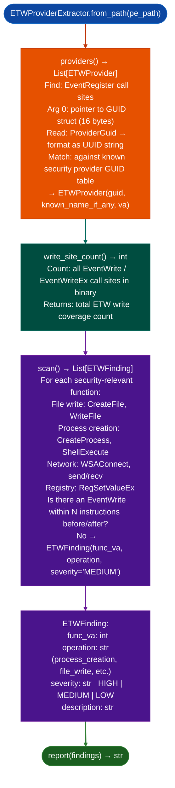

# ETW Provider Extraction

Enumerate Event Tracing for Windows (ETW) provider registrations and event write sites in a Windows PE binary: identifying security-relevant operations that produce no ETW telemetry detection gaps and reporting known security-relevant provider GUIDs.

---

## Why this exists

1. **Security products, EDRs, and Windows kernel telemetry pipelines use ETW as their primary event feed: a binary performing security-relevant operations without ETW writes is invisible to these products.** `ETWProviderExtractor.scan()` cross-references functions that perform dangerous operations file write, registry modification, process creation, network connection against nearby ETW `EventWrite` call sites, reporting functions with no ETW coverage as detection gaps.

2. `ETWProviderExtractor.providers()` extracts all ETW provider registrations from `EventRegister` call sites: reading the provider GUID from the first argument and matching against a table of known security-relevant ETW providers Microsoft-Windows-Security-Auditing, Microsoft-Antimalware-Scan-Interface, and similar. A binary that re-registers a known security provider GUID or uses `EventUnregister` immediately after registration may be evading telemetry collection.

3. `write_site_count()` returns the total number of `EventWrite` call sites: a binary with many security-relevant operations and zero `EventWrite` calls is a strong indicator of intentional telemetry evasion or an unmonitored attack surface that security products cannot observe.

---

## How it works



---

## Usage

```python
from ablation.analyzers.etw_provider_extractor import ETWProviderExtractor

extractor = ETWProviderExtractor.from_path('/path/to/windows_binary.exe')

# All registered ETW providers
providers = extractor.providers()
for p in providers:
    name = p.known_name if p.known_name else '(unknown)'
    print(f"  {p.guid}  {name}  registered at {p.va:#x}")

# Total event write coverage
n_writes = extractor.write_site_count()
print(f"Total EventWrite call sites: {n_writes}")

# Detection gap findings
findings = extractor.scan()
if findings:
    print(ETWProviderExtractor.report(findings))
else:
    print("No ETW detection gaps found")
```

---

## Example output

The following illustrates the ETW analysis output format. Actual GUIDs and addresses are binary-specific.

```
ETWProviderExtractor: windows_binary.exe

Providers registered: <N>
  <guid-1>   Microsoft-Windows-Security-Auditing   va=<va>
  <guid-2>   (unknown)   va=<va>

Total EventWrite call sites: <W>

Detection gaps (<M> findings):
  [MEDIUM] process_creation at <va>: CreateProcess with no nearby EventWrite
  [MEDIUM] file_write at <va>: WriteFile with no nearby EventWrite
```

---

## False positives

**ETW coverage proximity check is heuristic**: `EventWrite` calls in an adjacent function called from the security-relevant function count as covered if the static analysis traces the call. A function that calls `CreateProcess` and then separately calls an ETW-writing helper may be flagged as a gap if the helper is not statically traceable. Validate gap findings by inspecting the function and its callers for ETW coverage.

**Known provider GUID table is static**: vendor-defined ETW providers not in the built-in table are reported as `(unknown)`. A custom vendor security telemetry provider will not be recognized as security-relevant by `providers()`, but will still appear in the provider list for manual assessment.

---

## Pipeline position

Run `ETWProviderExtractor` as part of Windows PE initial triage alongside `RPCServerAnalyzer` and `CFGBypassDetector`. Detection gap findings (`severity='MEDIUM'`) are informational for understanding attacker visibility, not direct vulnerability indicators. Zero `write_site_count()` on a binary with many security-relevant operations warrants escalation to HIGH.

---

## Reading output

`ETWProviderExtractor.providers()` returns a list of `ETWProvider` objects:

| Attribute | Content |
|:---|:---|
| `guid` | Provider GUID string for example `'xxxxxxxx-xxxx-xxxx-xxxx-xxxxxxxxxxxx'` |
| `known_name` | Name from the known-provider table, or empty string if not recognized |
| `registration_count` | Number of `EventRegister` call sites for this GUID |
| `registration_vas` | `List[int]`: VAs of each `EventRegister` call site |

`ETWProviderExtractor.write_site_count()` returns `int`: total count of `EventWrite` call sites across all providers.

`ETWProviderExtractor.scan()` returns `list[ETWFinding]`: one finding per uncovered security-relevant function. Fields: `severity`, `va`, `detail`.

---

## See also

- [Windows RPC Server Analysis](rpc-server-analysis.md): unauthenticated RPC interface analysis for Windows targets
- [Control Flow Guard Review](control-flow-guard-review.md): CFG/XFG bypass detection complementing ETW evasion analysis
- [BYOVD Capability Detection](byovd-capability-detection.md): dangerous kernel capability detection for signed drivers
