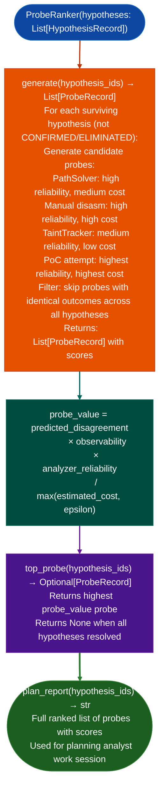

# Evidence Scoring and Probe Ranking

Rank candidate analysis probes by expected value against a set of surviving vulnerability hypotheses: computing `predicted_disagreement × observability × analyzer_reliability / estimated_cost` to select the probe most likely to resolve hypothesis uncertainty and eliminate false positives with minimum analyst effort.

---

## Why this exists <sup>[↑](#evidence-scoring-and-probe-ranking)</sup>

1. **After `SemanticSearcher` and `TaintTracker` produce a set of candidate findings, not all of them warrant the same follow-up effort: some findings are near-certainties, others are speculative.** `ProbeRanker` formalizes this by treating each candidate finding as a hypothesis with a confidence state and each possible next analysis action manual disasm, PoC attempt, PathSolver run as a probe. The probe that maximally resolves hypothesis uncertainty per unit analyst cost is ranked first.

2. `predicted_disagreement × observability × analyzer_reliability / estimated_cost` is the probe selection formula: `predicted_disagreement` is how much the probe result is expected to differ across surviving hypotheses a probe that confirms all hypotheses equally is useless; `observability` is how clearly the probe result can be observed (a PathSolver run is more observable than a fuzzing attempt); `analyzer_reliability` is the estimated false-positive rate of the analyzer performing the probe; `estimated_cost` is analyst time in minutes.

3. **`ProbeRanker.top_probe()` returns the single highest-value next action**, it is designed for use in an interactive analysis loop where the analyst completes the top probe, updates hypothesis confidence states (`HypothesisRecord.confidence`), and calls `top_probe()` again to get the next action. This loop continues until all hypotheses reach `CONFIRMED` or `ELIMINATED` confidence state.

---

## How it works <sup>[↑](#evidence-scoring-and-probe-ranking)</sup>



---

## Usage <sup>[↑](#evidence-scoring-and-probe-ranking)</sup>

```python
from ablation.analyzers.probe_ranker import ProbeRanker
from ablation.analyzers.hypothesis_models import HypothesisRecord, ConfidenceState

# Define hypotheses from TaintTracker/SemanticSearcher findings
hyps = [
    HypothesisRecord(
        id='H1',
        description='command injection in HTTP handler via path parameter',
        func_va=0x12340,
        confidence=ConfidenceState.MEDIUM,
        evidence=[]
    ),
    HypothesisRecord(
        id='H2',
        description='buffer overflow in config parser via long key name',
        func_va=0x14500,
        confidence=ConfidenceState.LOW,
        evidence=[]
    )
]

ranker = ProbeRanker(hyps)

# Get the next best probe
next_probe = ranker.top_probe(['H1', 'H2'])
if next_probe:
    print(f"Next probe: {next_probe.action}")
    print(f"  Expected value: {next_probe.score:.3f}")
    print(f"  Target: {next_probe.target_hypothesis_id}")

# Get full ranked plan
print(ranker.plan_report(['H1', 'H2']))
```

---

## Example output <sup>[↑](#evidence-scoring-and-probe-ranking)</sup>

The following illustrates the probe ranking output format. Actual scores are hypothesis-specific.

```
ProbeRanker plan (2 hypotheses):

  Rank 1: PathSolver.solve_path(H1.func_va → system_sink)
    predicted_disagreement: 0.82
    observability: 0.90
    reliability: 0.85
    estimated_cost: 5 min
    probe_value: 12.5

  Rank 2: Manual disasm review of H2.func_va
    predicted_disagreement: 0.70
    observability: 0.95
    reliability: 0.95
    estimated_cost: 30 min
    probe_value: 2.1

  Rank 3: TaintTracker.run_on_function(H2.func_va)
    ...
```

---

## False positives <sup>[↑](#evidence-scoring-and-probe-ranking)</sup>

**`ProbeRanker` does not have access to the actual binary or analysis results, it ranks probes based on estimated values, not observed outcomes.** The rankings are prioritization heuristics, not guarantees. An H1 `PathSolver` run that returns `INFEASIBLE` is still the right first probe if it resolves the hypothesis quickly, even if the outcome is not the hoped-for confirmation.

**`predicted_disagreement` assumes hypotheses are independent: in practice, confirming H1 may also confirm or eliminate H2.** `ProbeRanker` does not model inter-hypothesis dependencies. After completing a probe, update all affected hypothesis confidence states before calling `top_probe()` again.

---

## Pipeline position <sup>[↑](#evidence-scoring-and-probe-ranking)</sup>

Use `ProbeRanker` when multiple candidate findings need prioritization across a limited analyst time budget. It is most valuable at the triage-to-confirmation transition: after `SemanticSearcher` and `TaintTracker` have produced 5–20 candidates and the analyst must decide which to pursue first.

---

## Reading output <sup>[↑](#evidence-scoring-and-probe-ranking)</sup>

`ProbeRanker.rankhypotheses` returns a list of ranked probe plan dicts in priority order:

| Field | Content |
|:---|:---|
| `hypothesis` | The input `VulnHypothesis` object |
| `predicted_disagreement` | Float 0.0–1.0: how likely this probe is to change current confidence |
| `observability` | Float 0.0–1.0: how deterministic the probe result is |
| `reliability` | Float 0.0–1.0: how repeatable the probe is |
| `estimated_cost` | Estimated analyst time string for example `5 min`, `30 min` |
| `probe_value` | Composite score (`predicted_disagreement × observability / estimated_cost_minutes`) |

---

## See also <sup>[↑](#evidence-scoring-and-probe-ranking)</sup>

- [Assisted Vulnerability Hypotheses](assisted-vulnerability-hypotheses.md): produces hypotheses that `ProbeRanker` prioritizes
- [CFG Fixpoint Dataflow](cfg-fixpoint-dataflow.md): `SCCPAnalysis` can reduce hypothesis count by eliminating unreachable paths before ranking
- [Function Identity Database](function-identity-database.md): `FindingRegistry.find_similar()` for seeding initial hypothesis confidence
