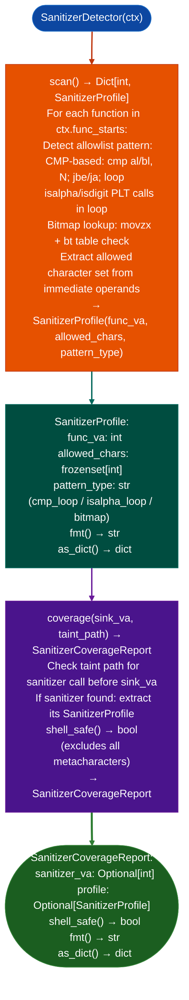

# Allowlist Sanitizer Detection

Detect allowlist-style byte-validator functions in x86-64 ELF binaries: determining whether they enforce a character set that structurally blocks shell metacharacter injection, and cross-reference these validators against TaintTracker sink findings to downgrade exploitability ratings for arguments that cannot contain metacharacters.

---

## Why this exists

1. **Stripped firmware binaries contain validator functions that enforce character allowlists on user-supplied strings before those strings reach exec-class sinks.** When an argument passes through a function that enforces `[A-Za-z0-9_-]`, shell metacharacter injection is structurally impossible regardless of the sink type. Without `SanitizerDetector`, `TaintTracker` reports these as `ARG_PROPAGATED` sinks without noting that the argument is structurally sanitized.

2. `SanitizerDetector` detects Fortinet's `is_valid_host_name` pattern in `libcmdb_plugin.so`: a loop that calls `isalpha()`/`isdigit()` or tests against a `cmp al, 0x2D` allowlist, returning early if any character is outside the set. This pattern is common in firmware that processes domain names, IP addresses, and CLI parameter values before passing them to `system()`.

3. `SanitizerCoverageReport.shell_safe()` returns `True` if the allowlist excludes all shell metacharacters: `` $ ` & | ; < > ( ) `` space and newline. This is the gating condition for downgrading a TaintTracker `ARG_PROPAGATED` finding from `HIGH` to `MEDIUM` in the session report. The downgrade is recorded in `SanitizerCoverageReport.fmt()` for the finding write-up.

---

## How it works



---

## Usage

```python
from ablation.analyzers.sanitizer_detector import SanitizerDetector
from ablation.analyzers.binary_context import BinaryContext

ctx = BinaryContext.load_or_build('/path/to/libcmdb_plugin.so')
detector = SanitizerDetector(ctx)

profiles = detector.scan()
print(f"Detected {len(profiles)} sanitizer functions")

# Check a specific taint path's sanitizer coverage
from ablation.analyzers.taint_tracker import TaintTracker
tt = TaintTracker.from_context(ctx)
findings = tt.run()

for f in findings:
    report = detector.coverage(f.sink_va, f.path)
    if report.shell_safe():
        print(f"DOWNGRADE: {f.sink_va:#x} is shell-safe via {report.sanitizer_va:#x}")
    else:
        print(f"CONFIRM: {f.sink_va:#x} — no shell-safe sanitizer on path")
```

---

## Example output

The following illustrates sanitizer detection output format. Actual VAs and character sets are binary-specific.

```
SanitizerDetector: libcmdb_plugin.so

Sanitizer profiles: <N>

  func_va=<va>  pattern=cmp_loop
    allowed_chars: [A-Za-z0-9._-]  (<N> chars)
    shell_safe(): True  (excludes $`&|;<>() space newline)

coverage for sink at <va>:
  sanitizer_va=<va>  shell_safe=True
  → downgrade ARG_PROPAGATED HIGH → MEDIUM
```

---

## False positives

**`shell_safe()` requires that the sanitizer is on every taint path to the sink**: if the sanitizer is called on only one branch and the other branch reaches the sink unsanitized, `shell_safe()` returns `True` but the sink is still exploitable. `coverage()` checks the taint path passed to it, not all paths; verify that the taint path is the only input path to the sink.

**Bitmap-based allowlists may encode a superset of the detected characters**: a 256-bit bitmap may pass `]` or `[` in addition to alphanumerics, which are shell metacharacters in glob contexts. Verify the full bitmap contents rather than relying only on `shell_safe()` for bitmap-pattern sanitizers.

---

## Pipeline position

Run `SanitizerDetector.scan()` once per binary before `TaintTracker`. After `TaintTracker` produces findings, call `detector.coveragesink_va, path` for each `ARG_PROPAGATED` finding to determine whether a sanitizer downgrade applies. Record `shell_safe=True` downgrades in the finding write-up.

---

## Reading output

`SanitizerDetector.scan()` returns a list of `SanitizerProfile` objects:

| Attribute | Content |
|:---|:---|
| `func_va` | VA of the sanitizer function |
| `score` | Detection confidence integer 0–10 |
| `allowed_bytes` | `FrozenSet[int]`: reconstructed allowed byte values |
| `blocked_bytes` | `FrozenSet[int]`: reconstructed blocked byte values |
| `shell_safe` | `True` if `allowed_bytes` does not intersect shell metacharacters |
| `verdict` | `'SHELL_SAFE'` / `'SHELL_UNSAFE'` / `'PARTIAL'` / `'UNKNOWN'` |
| `comparison_imms` | `List[int]`: raw comparison immediates observed |
| `n_byte_loads` | Count of byte-load instructions |
| `n_comparisons` | Count of comparison instructions |
| `detail` | Human-readable summary of sanitizer behavior |

`SanitizerDetector.coveragesink_va, path` returns `{sanitizer_va: int, shell_safe: bool}` if a sanitizer covers the path to `sink_va`, else `None`.

---

## See also

- [Named Taint Sources and Bounds](named-taint-sources-and-bounds.md): `TaintTracker` whose findings are evaluated for sanitizer coverage
- [CMDB Attack Surface Mapping](cmdb-to-sink-mapping.md): `CMDBSurfaceMapper` for the FortiOS CMDB input path upstream of sanitizers
