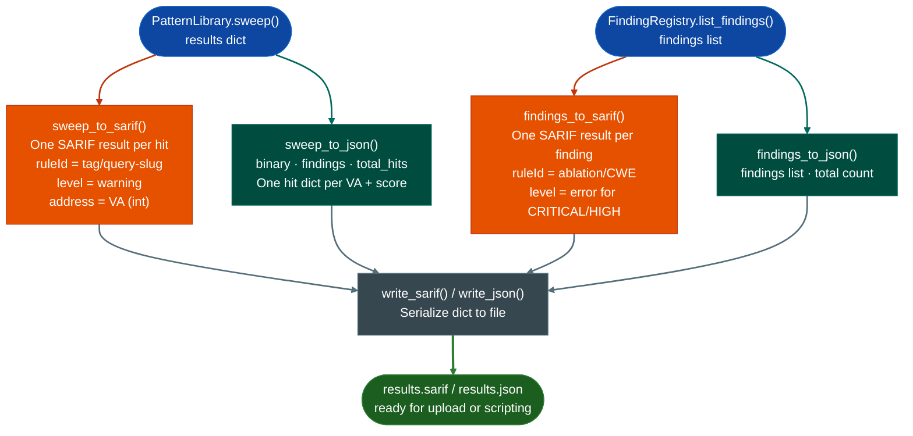

# YARA, JSON & SARIF Export

Ablation sweep results and confirmed findings export to SARIF 2.1.0, flat JSON, or YARA detection rules. All three formats are generated from the same `PatternLibrary.sweep()` or `FindingRegistry.list_findings()` output so no re-analysis is required to produce any format.

---

## What is SARIF

SARIF stands for Static Analysis Results Interchange Format. It is the OASIS standard that GitHub Code Scanning, VS Code, and most modern SAST platforms consume natively. A SARIF document is a JSON file that describes analysis results in a schema those tools understand so sweep results appear as PR annotations and Security tab findings without any custom integration work.

Each SARIF result carries a rule ID derived from the pattern tag and query, a severity level mapped from the finding's severity field (CRITICAL/HIGH become `error`, MEDIUM becomes `warning`, LOW becomes `note`), the virtual address of the hit in `physicalLocation.address.absoluteAddress`, and the cosine similarity score in `properties.score`. This structure lets GitHub Code Scanning display the hit location, severity, and evidence in the same UI as any other static analysis tool.

---

## Why this exists

1. **Confirmed findings have no operational value until they reach the systems that act on them.** A buffer overflow confirmed in firmware at VA `0x22ccc0` needs to reach GitHub Code Scanning for PR-level blocking, a SIEM for alerting, and a threat intelligence platform for indicator sharing. Each system expects a different format. This module produces all three from the same findings list so no manual translation step exists between analysis and detection.

2. **Sweep hits are evidence, not conclusions.** `sweep_to_sarif()` exports raw sweep hits with scores attached so a downstream reviewer can set a score threshold and treat the SARIF output as a triage queue rather than a confirmed finding list. `findings_to_sarif()` exports only confirmed findings from `FindingRegistry` so the distinction is preserved in the output format.

3. **YARA rules share the byte evidence from the analysis.** `generate_from_pe_findings()` builds a YARA rule from the same IOC strings, CRITICAL API imports, and anti-debug byte patterns that the PE scanner found so the rule replays against new firmware images to check whether a vulnerability was patched. See [YARA Rule Generation](yara-generator.md) for the full YARA API.

---

## How it works



---

## Usage

### SARIF export

```python
from ablation.analyzers.pattern_library import PatternLibrary
from ablation.analyzers.semantic_search import SemanticSearcher
from ablation.export.sarif import sweep_to_sarif, findings_to_sarif
from ablation.export.json_export import write_sarif

# Sweep and export hits
pl = PatternLibrary()
searcher = SemanticSearcher('~/.ablation/func_id.db')
searcher.build_corpus()
results = pl.sweep(searcher)

sarif = sweep_to_sarif(results, binary_path='firmware.so', min_score=0.30)
write_sarif(sarif, 'results.sarif')

# Export confirmed findings from FindingRegistry
from ablation.export.sarif import findings_to_sarif
sarif_findings = findings_to_sarif(findings, binary_path='/path/to/target.elf')
write_sarif(sarif_findings, 'findings.sarif')
```

### Upload to GitHub Code Scanning

```bash
gh api repos/<owner>/<repo>/code-scanning/sarifs \
    -f commit_sha=$(git rev-parse HEAD) \
    -f ref=refs/heads/main \
    -f sarif=$(gzip -c results.sarif | base64 -w0) \
    -f tool_name=ablation
```

Results appear as annotations on open PRs and in the Security tab.

### JSON export

```python
from ablation.export.json_export import sweep_to_json, findings_to_json, write_json

doc = sweep_to_json(results, binary_path='firmware.so', min_score=0.30)
write_json(doc, 'sweep.json')

findings_doc = findings_to_json(findings)
write_json(findings_doc, 'findings.json')
```

---

## Example output

### SARIF

```json
{
  "$schema": "https://json.schemastore.org/sarif-2.1.0.json",
  "version": "2.1.0",
  "runs": [{
    "tool": {"driver": {"name": "Ablation", "version": "2.57.0", "rules": [
      {
        "id": "buffer-overflow/strcpy-no-length-check",
        "shortDescription": {"text": "strcpy with user-controlled src, no length check"}
      }
    ]}},
    "results": [{
      "ruleId": "buffer-overflow/strcpy-no-length-check",
      "level": "warning",
      "message": {"text": "strcpy with user-controlled src, no length check (score=0.71)"},
      "locations": [{"physicalLocation": {"address": {"absoluteAddress": 130560, "name": "0x1fa00"}}}],
      "properties": {"score": 0.71, "va": "0x1fa00", "tag": "buffer-overflow"}
    }]
  }]
}
```

### JSON

```json
{
  "binary": "/path/to/firmware.so",
  "total_hits": 14,
  "findings": [
    {
      "tag": "buffer-overflow",
      "pattern": "strcpy with user-controlled src, no length check",
      "hits": [
        {"va": "0x1fa00", "score": 0.71},
        {"va": "0x2200c", "score": 0.63}
      ]
    }
  ]
}
```

---

## SARIF field reference

Each sweep hit becomes a SARIF `result` with:

| Field | Value |
|:---|:---|
| `ruleId` | `<tag>/<query-slug>` e.g. `buffer-overflow/strcpy-no-length-check` |
| `level` | `warning` for sweep hits; `error` for CRITICAL/HIGH confirmed findings |
| `physicalLocation.address.absoluteAddress` | Virtual address as integer |
| `physicalLocation.address.name` | VA as hex string e.g. `0x1fa00` |
| `properties.score` | Cosine similarity score |
| `properties.va` | VA as hex string |
| `properties.tag` | Pattern tag from the sweep |

---

## API reference

| Function | Returns |
|:---|:---|
| `sweep_to_sarif(sweep_results, binary_path, min_score=0.0)` | `dict`: SARIF 2.1.0 document from `PatternLibrary.sweep()` output |
| `findings_to_sarif(findings, binary_path=None)` | `dict`: SARIF 2.1.0 document from `FindingRegistry.list_findings()` output |
| `sweep_to_json(sweep_results, binary_path, min_score=0.0)` | `dict`: flat JSON with `binary`, `findings`, `total_hits` keys |
| `findings_to_json(findings)` | `dict`: flat JSON with `findings` and `total` keys |
| `write_sarif(data, path)` | Writes SARIF dict to file; returns `None` |
| `write_json(data, path)` | Writes JSON dict to file; returns `None` |

---

## False positives

`sweep_to_sarif()` and `sweep_to_json()` emit one result per hit above `min_score`. A sweep hit is a candidate, not a confirmed vulnerability. A SARIF output from sweep results should be treated as a triage queue. Use `findings_to_sarif()` when the output must represent only confirmed findings.

A SARIF output that contains no results (`"results": []`) is valid and expected when findings is empty. If `sweep_to_sarif` produces no results, verify that `PatternLibrary.sweep()` returned hits and that hit objects have non-null `func_addr` fields before calling the exporter.

---

## Pipeline position

**Before this module:** `PatternLibrary.sweep()` for sweep hits, or `FindingRegistry.list_findings()` for confirmed findings. Both produce the input lists these functions consume.

**After this module:** Upload to GitHub Code Scanning via `gh api repos/.../code-scanning/sarifs`, import into a SAST dashboard, or feed into downstream tooling. No further Ablation modules depend on export output.

---

## See also

- [YARA Rule Generation](yara-generator.md): generate YARA detection rules from the same confirmed findings
- [Finding Registry](registry.md): persistent finding storage that `findings_to_sarif()` consumes
- [Pattern Library](pattern-library.md): `PatternLibrary.sweep()` that `sweep_to_sarif()` consumes
