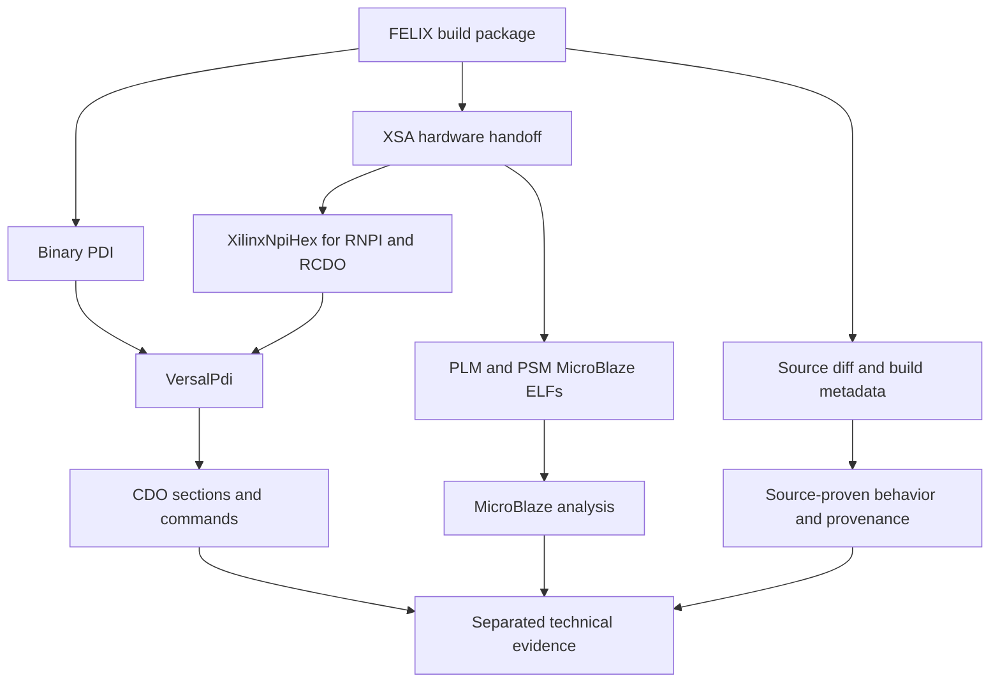

# FELIX

- [Why this exists](#why-this-exists)
- [Platform background](#platform-background)
- [How the workflow fits together](#how-the-workflow-fits-together)
- [Reusable components](#reusable-components)
- [Usage](#usage)
- [Validated FLX182 evidence](#validated-flx182-evidence)
- [What this adds](#what-this-adds)
- [Limitations](#limitations)
- [See also](#see-also)

**Reusable code:** `ablation/analyzers/xilinx_npi.py`, `ablation/analyzers/versal_pdi.py`, and `ablation/analyzers/microblaze_decoder.py`

## Why this exists

FELIX firmware packages contain several kinds of evidence: a binary PDI, an XSA hardware handoff, textual RNPI and RCDO configuration images, MicroBlaze boot ELFs, a Bootgen recipe, source changes, and build metadata. Looking at only one of these artifacts gives an incomplete picture.

FELIX Firmware Analysis is the workflow that connects those artifacts. It recovers platform initialization, configuration commands, boot firmware, hardware metadata, source provenance, and source-level behavioral changes while keeping each kind of evidence separate.

This is a composition of reusable Ablation components, not a new container format or a single `FelixAnalyzer` class. The capability is listed separately because FELIX users need a clear entry point that explains how the components work together on a real package.

## Platform background

**FELIX**, or **Front-End LInk eXchange**, is an ATLAS readout and control platform. It connects detector front-end electronics to host computers, carrying detector data, timing, trigger, configuration, and monitoring traffic.

**FLX182** identifies the card and firmware configuration examined here. It is not the FPGA part number or the PDI format. The validated build uses an `xcvm1802-vsva2197-1MP-e-S` Versal AI Core FPGA, a 24-channel Strips configuration, and the `felix_top` hardware design.

The detector-to-host path has two distinct jobs:

1. PLM, PSM, and CDO initialize the hardware platform.
2. Programmable logic decodes and transports detector data through WUPPER DMA and PCIe.

This distinction matters. Boot and power-management evidence does not explain detector decoding, and a detector decoding branch does not establish boot security policy.

### Direct and encoded input

The 8b10b paths decode transmitted symbols into 8-bit data and provide alignment and error information. Direct mode instead consumes source bytes without that decoder. DCS e-links carry slow-control information rather than collision-event payload. Changes to these paths can alter the meaning of detector data, so they require source evidence rather than raw bitstream similarity.

## How the workflow fits together



The workflow does not merge all observations into one conclusion. It records which artifact established each fact and preserves unresolved behavior.

## Reusable components

| Component | Role in FELIX analysis |
|---|---|
| `VersalPdi` | Parses binary PDI headers and CDO sections, recovers commands, markers, DMA segments, and optional Git metadata |
| `XilinxNpiHex` | Converts textual RNPI and RCDO images into validated little-endian CDO for the same binary parser |
| `MicroBlazeDecoder` | Disassembles validated MicroBlaze code from PLM, PSM, or recovered load segments |
| `MicroBlazeDecoder` CFG helpers | Recovers control flow and call arguments after code and address boundaries are established |
| `LpgbtDecoder` | Analyzes lpGBT link protocols when packet-level evidence is available |
| Build-archive analysis | Reads BIF, XSA metadata, source diffs, and timing reports without treating them as runtime observations |

The CERN FLX182 investigation adds a pinned script that applies these components to one package. That script is an example of the workflow, not a general FELIX API.

## Usage

Parse the packaged PDI:

```python
from ablation.analyzers.versal_pdi import VersalPdi

pdi = VersalPdi.from_path("felix.pdi")
print(pdi.report())
```

Decode an RCDO or RNPI member from the XSA and pass it to the same parser:

```python
import zipfile
from ablation.analyzers.xilinx_npi import XilinxNpiHex

with zipfile.ZipFile("felix.xsa") as xsa:
    text = xsa.read("pdi_files/felix_top.rcdo")

image = XilinxNpiHex.from_bytes(text, "felix_top.rcdo")
pdi = image.to_versal_pdi()
for section in pdi.cdo_sections():
    print(section.length_words, len(section.commands))
```

Use the BIF to identify boot components and the source diff to explain behavioral edits. Do not infer HDL behavior from configuration-byte differences when source evidence is available.

## Validated FLX182 evidence

The validated example is FLX182 build 637 in the CERN corpus. Its top-level PDI is byte-identical to the PDI in both the tarball and XSA.

### CDO inventory

| Offset | Payload bytes | Commands | Role |
|---:|---:|---:|---|
| `0x4D2C4` | 44,344 | 2,083 | PMC metadata and subsystem definitions |
| `0x58754` | 8,768 | 293 | LPD initialization and register configuration |
| `0x69734` | 33,927,716 | 49 | RCDO and programmable-logic configuration |
| `0x20C4974` | 1,404,400 | 34,542 | NPI initialization and memory-mapped writes |
| `0x221B784` | 4,300 | 141 | FPD initialization and register configuration |

All five streams have valid header checksums and consume their declared lengths. The large RCDO also demonstrated why CDO length must be bounded by the containing input rather than an eight-million-word cutoff.

### RCDO lineage

The source RCDO has 45 commands and 33,927,644 decoded bytes. The packaged RCDO has 49 commands. Bootgen inserts 22 metadata words and one NOP, changes four begin identifiers, and preserves every other payload word. This is an exact normalized comparison, not a similarity estimate.

### Source and build findings

The supplied diff comments out the `ME = "0000"` direct-input capture branch and changes `IncludeStripsDCSELinks` from 1 to 0. The `IncludeDirectDecoding` generic remains enabled, but that does not restore the commented implementation. No reset-related change appears in the supplied 20-file diff despite the `more_resets` branch name.

The build metadata records source commit `a1b2c2493ae3eba080cd395b337cfe7393566fc6` and uncommitted changes. The build reports `Timing met: 0` and WNS -0.025 ns. These are static build results, not dynamic hardware measurements.

### Reproduction artifacts

The detailed CERN evidence is under:

- `analysis/felix-flx182/REPORT.md`
- `analysis/felix-flx182/analyze_felix.py`
- `analysis/felix-flx182/findings.json`
- `analysis/felix-flx182/extracted/`

## What this adds

The capability gives FELIX users one place to start without hiding the underlying reusable tools. It explains which parser accepts each artifact, what the resulting evidence means, and where the analysis stops.

It also prevents common mistakes: treating FLX182 as a file format, treating boot firmware as detector logic, treating a generic as proof of an implementation, treating a branch name as evidence, or treating an ASCII-hex checksum as authenticity.

## Limitations

- There is no unified `FelixAnalyzer` API. The reusable capability is the documented composition of parsers and analysis steps.
- FLX182 build 637 is the validated example. Other FELIX cards and builds require their own evidence.
- `XilinxNpiHex` accepts hexadecimal RNPI/RCDO images, not command-script ASCII CDO.
- The FLX182 archive supplies a diff rather than complete HDL. Other direct-input paths and integrated behavior remain unresolved.
- No HDL simulation, hardware timing measurement, device-fuse read, or modified-image boot was performed.
- BIF settings and readable CDO content do not establish runtime image acceptance or protection-unit policy.

## See also

- [XilinxNpiHex](xilinx-npi-hex.md): strict RNPI/RCDO text ingestion
- [VersalPdi](versal-pdi.md): binary PDI and CDO analysis
- [MicroBlaze Decoder](microblaze-decoder.md): boot-firmware disassembly and control-flow analysis
- [LpgbtDecoder](lpgbt-decoder.md): lpGBT protocol decoding
