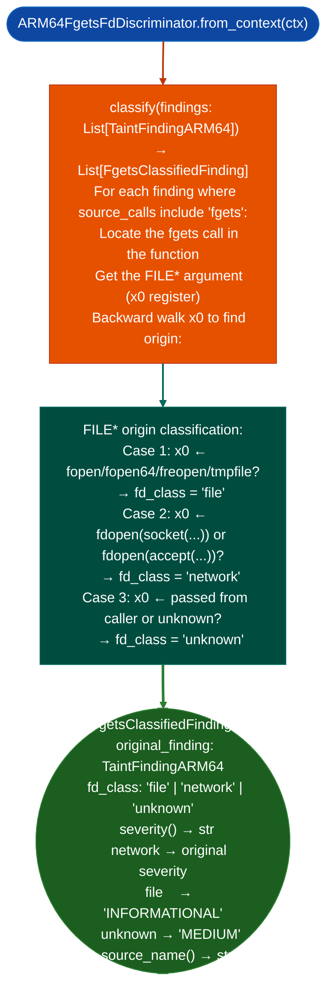

# File vs. Socket Input Discrimination

Classify `fgets`-sourced `TaintFindingARM64` results by whether the `FILE*` argument originated from a file handle (`fopen`/`fopen64`/`freopen`/`tmpfile`) or a socket (`fdopen(accept(...))`/`fdopen(socket(...))`): reducing false positives where `fgets` is used only for local config-file reads, not network input.

---

## Why this exists

1. **`TaintTracker` treats all `fgets()` calls identically as sources of tainted data, but `fgets` reading from a local config file is not exploitable from the network, while `fgets` reading from a socket-backed `FILE*` is.** `ARM64FgetsFdDiscriminator.classify()` post-processes `fgets`-sourced findings by backtracking the `FILE*` argument to its origin, reclassifying findings as `file` config read, lower severity or `network` socket read, higher severity or `unknown` origin indeterminate.

2. The three-class taxonomy prevents false positive escalation: a firmware binary with 40 config-parser uses of `fgets` and 2 socket-handler uses of `fgets` would produce 42 taint findings without discrimination; with discrimination, 40 are classified as `file` filtered out of the taint queue and 2 are classified as `network` retained for full analysis. This reduces manual review from 42 findings to 2.

3. `FgetsClassifiedFinding.severity()` adjusts severity based on FD class: `network` class findings retain their original taint severity; `file` class findings are downgraded to `INFORMATIONAL`; `unknown` are MEDIUM. This enables severity-based filtering without discarding unknown findings entirely.

---

## How it works



---

## Usage

```python
from ablation.analyzers.arm64_fgets_fd_discriminator import ARM64FgetsFdDiscriminator
from ablation.analyzers.taint_tracker_arm64 import TaintTracker
from ablation.analyzers.binary_context import BinaryContext

ctx = BinaryContext.load_or_build('/path/to/arm64_firmware.elf')
tracker = TaintTracker.from_context(ctx)

# Run taint analysis to find fgets-sourced findings
all_findings = tracker.run_interprocedural()
fgets_findings = [f for f in all_findings if 'fgets' in f.source_calls]

# Discriminate by FD class
discriminator = ARM64FgetsFdDiscriminator.from_context(ctx)
classified = discriminator.classify(fgets_findings)

# Filter to network-sourced only
network_findings = [f for f in classified if f.fd_class == 'network']
print(f"fgets network findings: {len(network_findings)}")
for f in network_findings:
    print(f"  {f.original_finding.sink_name}  severity={f.severity()}")

# All classified with severity
for f in classified:
    print(f"  {f.fd_class.upper():<8} {f.severity():<15} {f.source_name()}")
```

---

## Example output

The following illustrates the classification output format. Actual counts are binary-specific.

```
fgets findings: <N> total

Classification:
  NETWORK   HIGH            fgets(network_socket_FILE*)  → system at <va>
  FILE      INFORMATIONAL   fgets(fopen('/etc/config'))  → system at <va>
  UNKNOWN   MEDIUM          fgets(caller-provided FILE*) → system at <va>

After filter (network only): <M> findings
```

---

## False positives

**Backward walk for `FILE*` origin is bounded by the look-back window**: a `FILE*` created in a different function and passed as an argument to the current function will be classified as `unknown`, even if it originated from `fopen`. For precise classification in caller-provided `FILE*` cases, run `IPRegAnnotator.annotate_chain()` to trace the `FILE*` across function boundaries.

---

## Pipeline position

Run `ARM64FgetsFdDiscriminator.classify()` immediately after `TaintTracker` to post-process `fgets`-sourced findings on ARM64 binaries: specifically on firmware images where config-file parsing via `fgets` produces high false positive rates. It is ARM64-specific; for x86_64 binaries, a similar classification can be done manually via `RegAnnotator` backward walk.

---

## Reading output

`ARM64FgetsFdDiscriminator.classifyfindings` returns a list of classified finding dicts, extending the input `TaintTracker` findings with a `fd_type` field:

| Additional Field | Content |
|:---|:---|
| `fd_type` | `NETWORK` network socket, `FILE` filesystem path, or `UNKNOWN` caller-provided |
| `adjusted_severity` | Updated severity: `NETWORK` → original, `FILE` → `INFORMATIONAL`, `UNKNOWN` → `MEDIUM` |

Filter to `fd_type='NETWORK'` for actionable findings.

---

## See also

- [Taint Analysis](taint-analysis.md): produces the `fgets`-sourced findings this module classifies
- [Interprocedural Field Writer Discovery](interprocedural-field-writer-discovery.md): for cross-function `FILE*` origin tracing
- [ARM64 Symbolic Slicing](arm64-symbolic-slicing.md): full ARM64 taint analysis pipeline
