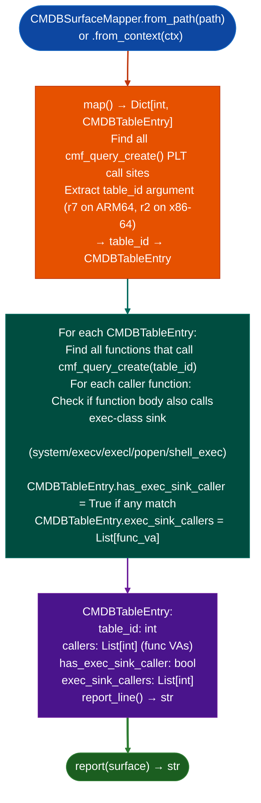

# CMDB Attack Surface Mapping

Enumerate the FortiOS/FortiWeb CMDB attack surface: finding every `cmf_query_create()` call site, identifying the CMDB table being accessed, and determining which tables have callers that also call exec-class sinks in the same function: enabling targeted `TaintTracker` runs on only the CMDB-to-sink callers instead of the full binary.

---

## Why this exists

1. **FortiOS and FortiWeb expose configuration through a CMDB Configuration and Management Database layer accessed via `cmf_query_create()`.** User-supplied configuration fields flow from CMDB reads to exec-class sinks `system()` and `execv()` in handler functions. Without `CMDBSurfaceMapper`, identifying which CMDB tables are attacker-reachable inputs requires manual search across hundreds of call sites.

2. Analysis direction is forward from CMDB field reads toward exec sinks: `CMDBSurfaceMapper` complements backward `TaintTracker` analysis by identifying which table IDs have callers that co-locate with exec sinks in the same function body. A function that reads CMDB table 0x4A and then calls `system()` is a high-priority `TaintTracker` target; a function that reads CMDB but calls only logging functions is not.

3. **`CMDBSurfaceMapper` is a Phase 0.5 triage tool, not a verified data-flow analyzer.** It identifies candidates: `CMDBTableEntry.has_exec_sink_caller` is `True` when a co-location is detected in the same function, but it does not verify that the CMDB-read value reaches the sink argument. Run `TaintTracker` on `has_exec_sink_caller=True` entries for verification.

---

## How it works



---

## Usage

```python
from ablation.analyzers.cmdb_surface_mapper import CMDBSurfaceMapper
from ablation.analyzers.binary_context import BinaryContext

ctx = BinaryContext.load_or_build('/path/to/httpd')
mapper = CMDBSurfaceMapper.from_context(ctx)

surface = mapper.map()
print(f"CMDB tables accessed: {len(surface)}")

# High-priority TaintTracker targets
for table_id, entry in surface.items():
    if entry.has_exec_sink_caller:
        print(f"  table_id={table_id:#x}  exec_sink_callers={entry.exec_sink_callers}")

print(CMDBSurfaceMapper.report(surface))
```

---

## Example output

The following illustrates CMDB attack surface mapping output format. Actual table IDs and VAs are binary-specific.

```
CMDBSurfaceMapper: httpd

CMDB tables accessed: <N>

High-priority (exec sink co-location):
  table_id=0x4a  callers=<A>  exec_sink_callers=[<va>, <va>]
  table_id=0x12  callers=<B>  exec_sink_callers=[<va>]

No co-location (lower priority):
  table_id=0x01  callers=<C>  (logging only)
```

---

## False positives

**Co-location detection requires exec sink and CMDB read in the same function body**: a wrapper function that calls a CMDB reader and then calls a sink via a helper function is not detected as a co-location. Run `TaintTracker` on all CMDB callers, not only `has_exec_sink_caller=True` entries, for complete coverage of indirect call chains.

**`table_id` extraction uses register-state analysis at the `cmf_query_create()` call site**: if the table ID is computed dynamically for example from a dispatch table, it may not be deterministic at static analysis time. Dynamic table IDs are reported as `table_id=None` and excluded from the surface map.

---

## Pipeline position

Run `CMDBSurfaceMapper` as Phase 0.5 triage immediately after `BinaryContext.load_or_build()` for any FortiOS/FortiWeb binary. Use `exec_sink_callers` VAs as the starting set for `TaintTracker` analysis rather than running `TaintTracker` across the entire binary.

---

## Reading output

`CMDBSurfaceMapper.map()` returns `Dict[int, CMDBTableEntry]` keyed by CMDB table ID:

| Attribute | Content |
|:---|:---|
| `name` | Table name string if recovered from binary or `None` |
| `callers` | Count of functions that access this table |
| `reaches_exec` | `True` if any caller reaches an exec-class sink |
| `exec_func_va` | VA of the function that co-locates the exec sink call (`None` if not found) |
| `exec_call_va` | VA of the call instruction to the exec sink (`None` if not found) |
| `exec_sink_name` | Name of the exec sink for example `'system'`, `'popen'`, or `None` |

High-priority entries are those where `reaches_exec=True`.

---

## See also

- [Named Taint Sources and Bounds](named-taint-sources-and-bounds.md): `TaintTracker` for verification of CMDB-to-sink paths
- [Pre-Authentication Route Auditing](route-authentication-classification.md): `PreAuthRouteAuditor` for complementary pre-auth surface identification
