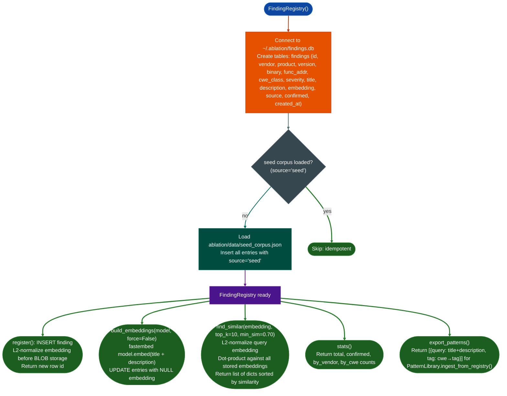

# Finding Registry

Persist every confirmed vulnerability finding from every RE engagement to a local SQLite database and retrieve embeddings of past findings as seeds for semantic search on new binaries, so each confirmed finding automatically increases detection coverage for all future targets.

---

## Why this exists

1. **Confirmed findings are the highest-quality signal in binary RE.** A human-verified vulnerability has a real embedding, a real CWE classification, a real product and version context, and a specific function description that produced a confirmed result. That information is too valuable to throw away at the end of an engagement. The Finding Registry persists it and makes it queryable for future semantic searches, meaning each new engagement starts with everything already learned from previous ones.

2. **Seed corpus coverage has gaps.** The registry ships with a pre-seeded corpus (`ablation/data/seed_corpus.json`) of patterns derived from published CVEs. These cover common patterns but cannot anticipate every vendor's internal naming conventions, proprietary protocol parsers, or custom allocators. Confirmed findings from live engagements fill those gaps incrementally. After five engagements with FortiOS targets, the registry contains confirmed patterns for every major FortiOS vulnerability class: patterns that do not exist in any public CVE corpus.

3. **Embedding-based retrieval generalizes across binary variants.** A finding registered from FortiOS 7.4.x can surface the homologous function in FortiOS 7.6.x even when the symbol table is stripped and the function was recompiled with a different optimization level. The embedding captures behavioral semantics; the SQLite record supplies the human-readable classification. Together they enable `find_similar()` to return "high confidence: matches confirmed heap overflow from FortiOS 7.4 lina" in the context line.

---

## How it works



### CWE to tag mapping

The registry automatically maps CWE codes to PatternLibrary-compatible tag strings:

| CWE | Tag |
|---|---|
| CWE-22 | `path-traversal` |
| CWE-77, CWE-78, CWE-88 | `cmd-exec` |
| CWE-119, CWE-120, CWE-121, CWE-122 | `buffer-overflow` |
| CWE-125, CWE-200 | `info-leak` |
| CWE-134 | `format-string` |
| CWE-190, CWE-191 | `integer-overflow` |
| CWE-287, CWE-306 | `auth-bypass` |
| CWE-362 | `race-condition` |
| CWE-400 | `dos` |
| CWE-415 | `double-free` |
| CWE-416 | `use-after-free` |
| CWE-476 | `null-deref` |
| CWE-502 | `deserialization` |
| CWE-611 | `xxe` |

---

## Usage

```python
from ablation.analyzers.finding_registry import FindingRegistry
import numpy as np

reg = FindingRegistry()  # opens ~/.ablation/findings.db

# Register a confirmed finding after TaintTracker confirmation
reg.register(
    vendor="fortinet",
    product="httpsd",
    version="7.4.1",
    binary="httpsd",
    func_addr=0x22ccc0,
    cwe_class="CWE-78",
    severity="CRITICAL",
    title="recv_handler command injection via SSL client cert field",
    description="CLI | calls: fadcsystem | vuln: rsi from SSL_get_peer_certificate → fadcsystem arg1",
    embedding=func_embedding,  # np.ndarray from SemanticSearcher
    confirmed=True,
)

# Build embeddings after new entries are added (fastembed model required)
from fastembed import TextEmbedding
model = TextEmbedding('BAAI/bge-small-en-v1.5')
updated = reg.build_embeddings(model)
print(f"Embeddings built for {updated} new entries")

# Find findings similar to a candidate function
query_vec = np.array(searcher.query("command injection via user-controlled format", top_k=1)[0].embedding)
similar = reg.find_similar(query_vec, top_k=8, min_sim=0.75)
for hit in similar:
    print(f"  {hit['similarity']:.3f}  {hit['severity']:8}  {hit['vendor']}/{hit['binary']}  {hit['title'][:60]}")

# Summary stats
print(reg.stats())
```

---

## Integration with PatternLibrary

```python
from ablation.analyzers.finding_registry import FindingRegistry
from ablation.analyzers.pattern_library import PatternLibrary
from ablation.analyzers.semantic_search import SemanticSearcher
from ablation.analyzers.binary_context import BinaryContext

# After completing an engagement and registering findings:
reg = FindingRegistry()
pl  = PatternLibrary()
n   = pl.ingest_from_registry(reg)
pl.save()
print(f"{n} new patterns ingested from confirmed findings")

# On the next binary: sweep includes all confirmed patterns
ctx = BinaryContext.load_or_build('/fw/next_target/httpsd')
searcher = SemanticSearcher.from_context(ctx)
searcher.build_corpus()
sweep_results = pl.sweep(searcher, top_k=5, min_score=0.65)
for query, result in sweep_results.items():
    if result.hits:
        print(f"[{result.tag}] {query[:60]}")
        for va, score in result.hits:
            print(f"  0x{va:x}  score={score:.3f}")
```

---

## Example output

```python
reg.stats()
# {'total': 127, 'confirmed': 89, 'seed': 38, 'by_vendor': {'fortinet': 52, 'cisco': 31, 'huawei': 6}, 'by_cwe': {'CWE-78': 41, 'CWE-122': 28, 'CWE-134': 19}}

reg.find_similar(query_vec, top_k=3, min_sim=0.75)
# [
#   {'id': 42, 'similarity': 0.912, 'vendor': 'fortinet', 'product': 'httpsd',
#    'cwe_class': 'CWE-78', 'severity': 'CRITICAL',
#    'title': 'recv_handler command injection via SSL client cert field', ...},
#   {'id': 31, 'similarity': 0.877, 'vendor': 'cisco', 'product': 'lina',
#    'cwe_class': 'CWE-78', 'severity': 'HIGH',
#    'title': 'http_param_handler system() with user-controlled path', ...},
#   {'id': 18, 'similarity': 0.821, 'vendor': 'generic', 'product': 'firmware',
#    'cwe_class': 'CWE-78', 'severity': 'HIGH', 'source': 'seed',
#    'title': 'CLI command execution with unvalidated user input', ...},
# ]
```

---

## False positives

**High similarity to generic patterns.** The seed corpus contains abstract pattern descriptions like "CLI command string constructed from user input." These match broadly, producing high-similarity scores for many functions that are not exploitable. The `confirmed_only=True` flag restricts `find_similar()` to only researcher-confirmed findings: seed entries are excluded: producing higher-precision results at the cost of recall on targets where no prior confirmed findings exist.

**Stale embeddings after model switch.** The embedding model (`BAAI/bge-small-en-v1.5`) encodes text into a vector space that is specific to that model. Switching to a different model after entries are already stored produces invalid similarity comparisons between old and new vectors. Call `build_embeddings(model, force=True)` to rebuild all embeddings when changing models.

---

## Pipeline position

**Before this module:** After `TaintTracker` or `PathSolver` confirms a finding, not before. Register only confirmed findings, not candidates.

**After this module:** Call `PatternLibrary.ingest_from_registry()` to promote confirmed findings to the sweep pattern list. Export to the target RE file in `re/<vendor>/<target>_re.py`.

---

## Reading the database

| Field | Content |
|:---|:---|
| `vendor` | Vendor string such as `fortinet`, `cisco`, and `generic` |
| `product` | Binary or product name such as `httpsd` and `lina` |
| `version` | Firmware version string |
| `func_addr` | VA of the confirmed vulnerable function |
| `cwe_class` | CWE code such as `CWE-78` and `CWE-122` |
| `severity` | `CRITICAL` / `HIGH` / `MEDIUM` / `LOW` |
| `title` | One-line description: what the function does and what the vulnerability is |
| `description` | Extended description used for embedding: sink type, call chain, vuln detail |
| `embedding` | L2-normalized float32 BLOB from BAAI/bge-small-en-v1.5 |
| `confirmed` | `1` = researcher-confirmed; `0` = candidate |
| `source` | `seed` for shipped corpus; empty for researcher-registered entries |

---

## See also

- [Pattern Library](pattern-library.md): sweep layer built on top of this registry
- [Semantic Code Search](semantic-code-search.md): produces embeddings for `find_similar()` queries
- [Taint Analysis](taint-analysis.md): confirms findings before registration
- [ATT&CK Labeling](attandck-labeling.md): enrich findings with technique IDs before `title` is set
