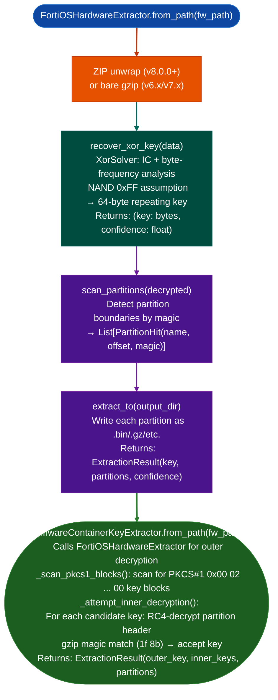

<a id="firmware-extraction"></a>
# Fortinet Firmware Analysis

Extract FortiOS hardware firmware images using a two-stage pipeline: outer 64-byte XOR key recovery via IC + frequency analysis, followed by inner partition encryption key recovery via RC4 known-plaintext attack and PKCS#1 v1.5 block scanning: making inner ELF and filesystem partitions available for static analysis.

---

## Why this exists

1. **FortiOS hardware firmware FortiGate physical appliances, FortiWiFi uses a layered encryption scheme: an outer 64-byte repeating XOR applied to a NAND flash partition image, plus an inner stream cipher on individual partitions.** `FortiOSHardwareExtractor` handles the outer XOR layer using index-of-coincidence and frequency analysis against the NAND 0xFF assumption. Without this, the firmware bytes are uninterpretable noise, no ELF headers, no filesystem magic bytes, no strings.

2. `FirmwareContainerKeyExtractor` handles the inner partition encryption: inner `rootfs.gz` and `datafs.tar.gz` partitions have a second encryption flag (`FENCRYPT`) set in the partition table. Fortinet embeds per-container encryption keys in the PKCS#1 v1.5 padding of the firmware's RSA signature block FGT7K-2 finding. `_scan_pkcs1_blocks()` locates those blocks and `_attempt_inner_decryption()` tests RC4 decryption with recovered candidate keys against known gzip magic bytes (`1f 8b`).

3. Both extractors generalize across FortiGate ARM (IPQ4019) and x86-64 hardware targets across firmware versions v5.0.9 through v8.0.0.F: the outer XOR cipher characteristics 64-byte key, NAND 0xFF assumption are confirmed stable across this entire version range, meaning recovered key derivation applies to all builds in the Fortinet firmware collection.

---

## How it works



---

## Usage

```python
from ablation.analyzers.fortios_firmware_extractor import FortiOSHardwareExtractor
from ablation.analyzers.firmware_container_key_extractor import FirmwareContainerKeyExtractor
import tempfile, os

fw_path = '/media/cowboy/research/Fortinet/FortiGate-100F/FGT_100F-v7.2.4.F.out'

# Stage 1: Outer XOR decryption only
with tempfile.TemporaryDirectory() as tmp:
    result = FortiOSHardwareExtractor.from_path(fw_path).extract_to(tmp)
    print(f"XOR key ({len(result.key)} bytes): {result.key.hex()}")
    print(f"Confidence: {result.key_confidence:.3f}")
    for p in result.partitions:
        print(f"  {p.kind:20}  offset={p.offset:#x}")

# Stage 2: Inner partition decryption (hardware FortiGate targets)
result2 = FirmwareContainerKeyExtractor.from_path(fw_path, output_dir='/tmp/fgt_extracted')
print(result2.report())
# After extraction: recovered filesystem payloads still need format-specific unpacking
try:
    result2.cleanup()  # Remove tmpdir if output_dir was not specified
except Exception:
    pass
```

---

## Example output

The following illustrates the extraction output format. Actual keys and offsets are firmware-specific.

```
FortiOSHardwareExtractor: FGT_100F-v7.2.4.F.out

XOR key (64 bytes): <hex-key>  confidence=0.94

Partitions:
  boot                 offset=0x00000  (ELF magic)
  rootfs               offset=<off>    (gzip magic)
  datafs               offset=<off>    (gzip magic — FENCRYPT set)

FirmwareContainerKeyExtractor:
  PKCS#1 key blocks found: <N>
  RC4 inner key recovered: <hex-inner-key>
  rootfs.gz: decrypted  (<N> bytes)
```

---

## False positives

**`recover_xor_key()` confidence below 0.5 indicates the firmware is not FortiOS XOR-encrypted**: a confidence of 0.3 means the IC analysis did not converge on a 64-byte key. This occurs for VM firmware `.vmdk`, `.ova` which use a different cipher scheme, or for partially downloaded firmware with an `.aria2` present (always check the Download Status table in `README.md` before analyzing).

**Inner key recovery depends on gzip header known-plaintext**: if Fortinet changes the inner cipher from RC4 or removes the PKCS#1 key embedding, `_attempt_inner_decryption()` will return no inner keys. Check the `ExtractionResult.error` field for failure details.

---

## Pipeline position

`FortiOSHardwareExtractor` is the entry point for supported Fortinet physical-appliance images. Run it first, then unpack recovered filesystem payloads with the appropriate format tool and load target ELF binaries into `BinaryContext.load_or_build()`. A gzip file is not directly mountable. Never analyze a firmware that shows an `.aria2` file: incomplete downloads produce false results. Consult `README.md` Download Status table first.

The two extractors form a compatibility pipeline rather than a universal Fortinet decoder. Their XOR, RC4, and PKCS#1 assumptions must be revalidated for new formats, VM images, and future releases. Outer-key confidence and known gzip magic provide evidence for candidate selection; they do not authenticate the resulting filesystem or prove that every partition was recovered.

---

## Reading output

`FortiOSHardwareExtractor.extract_to()` returns its own `ExtractionResult` with `key`, `key_confidence`, `partitions`, `extracted_paths`, `inner_size`, and entropy fields. Its `fmt()` method renders the result.

`FirmwareContainerKeyExtractor.from_path()` performs the full second-stage pipeline and returns a different `ExtractionResult`:

| Attribute | Content |
|:---|:---|
| `fw_path` | Path of the input firmware file |
| `outer_key` | `Optional[bytes]`: recovered outer XOR key |
| `outer_key_confidence` | Float 0.0–1.0: confidence of the outer key recovery |
| `pkcs1_candidates` | `List[bytes]`: PKCS#1-formatted key block candidates |
| `partitions` | `List[PartitionResult]`: extracted partition results |
| `datafs_path` | `Optional[str]`: path to the extracted `datafs` on disk |
| `workdir` | `Optional[str]`: temporary working directory created when no output directory was supplied |
| `error` | `Optional[str]`: error message if extraction failed partially |

Call `result2.cleanup()` only for a temporary workdir created by the second-stage extractor. Do not remove a caller-selected output directory. The current second-stage API does not expose `FirmwareContainerKeyExtractor.extract()` or return the older `{pkcs1_key_blocks, rc4_inner_key}` dictionary shown in a previous example.

---

## See also

- [Firmware Signature and Secret Triage](firmware-signature-and-secret-triage.md): key and credential extraction from decrypted partitions
- [Persistent Analysis Context](persistent-analysis-context.md): `BinaryContext` for extracted ELF analysis
- [Global Symbol and BSS Tracking](global-symbol-and-bss-tracking.md): `BssTaintTracker` for initrd-based kernel decrypt patterns
