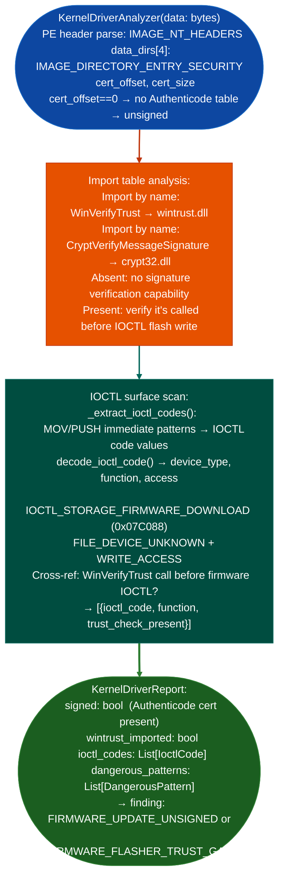

# Firmware Flasher Trust Checks

Detect PE-format firmware update executables that lack Authenticode signature verification: the trust anchor for the entire firmware update chain: by checking the `IMAGE_DIRECTORY_ENTRY_SECURITY` data directory entry and analyzing update dispatch code for `WinVerifyTrust` / `CryptVerifyMessageSignature` import presence versus absence: via `ablation/analyzers/kernel_driver_analyzer.py` `KernelDriverAnalyzer`.

---

## Why this exists

1. Firmware updater binaries that do not call `WinVerifyTrust` or `CryptVerifyMessageSignature` before writing to flash cannot verify that the firmware image is from the legitimate vendor: an attacker who can place a modified firmware file on the update path network share, USB, download directory can achieve persistent firmware-level code execution. `KernelDriverAnalyzer._check_signature()` checks the PE `IMAGE_DIRECTORY_ENTRY_SECURITY` data directory entry (index 4): if the offset and size are both zero, the binary has no Authenticode WIN_CERTIFICATE table and ships unsigned. An unsigned firmware flasher cannot be a trust anchor.

2. Checking for verification call-sites is the second layer: even when the flasher binary itself is signed has an Authenticode certificate, it may not call signature verification APIs before flashing the payload. `KernelDriverAnalyzer` scans the import table and optionally the disassembled code for `WinVerifyTrust`, `CryptVerifyMessageSignature`, `Crypt32.dll` import presence, and `WTD_UI_NONE` pattern (indicating `WinVerifyTrust` called in silent verification mode). Absence of these imports in a binary that calls `DeviceIoControl` with firmware write IOCTL codes is a strong indicator of unsigned firmware acceptance.

3. IOCTL-based firmware write detection: `KernelDriverAnalyzer._extract_ioctl_codes()` decodes IOCTL codes in the flasher binary using the CTL_CODE macro formula (`(device_type << 16) | access << 14 | function << 2 | method`). IOCTL codes in the range `0x0022xxxx` FILE_DEVICE_UNKNOWN or `0x00070084` IOCTL_STORAGE_FIRMWARE_DOWNLOAD that appear alongside `DeviceIoControl` calls without a preceding `WinVerifyTrust` call indicate a flasher that accepts arbitrary payloads.

---

## How it works



---

## Usage

```python
from ablation.analyzers.kernel_driver_analyzer import KernelDriverAnalyzer, analyze_driver

# Analyze a firmware updater PE
# KernelDriverReport fields: is_signed, ioctl_codes, dangerous_patterns, kernel_api_findings,
#   driver_type, pdb_path, entry_point_rva, image_base
report = analyze_driver('/path/to/FirmwareUpdate.exe')

print(f"Signed (Authenticode): {report.is_signed}")
print(f"Driver type: {report.driver_type}")

# IoctlCode fields: raw, device_type, function, method, access, site_va
for ioctl in report.ioctl_codes:
    print(f"  IOCTL: {ioctl.raw:#010x}  fn={ioctl.function:#x}  method={ioctl.method}  site_va={ioctl.site_va:#x}")

# Dangerous patterns found
for dp in report.dangerous_patterns:
    print(f"  DANGEROUS: {dp}")

if not report.is_signed:
    print("FINDING: Unsigned firmware flasher — no Authenticode certificate")
```

---

## Example output

The following illustrates firmware flasher trust check output format.

```
KernelDriverAnalyzer: FirmwareUpdate.exe

Signed (Authenticode): False
  IMAGE_DIRECTORY_ENTRY_SECURITY: offset=0, size=0 (no WIN_CERTIFICATE table)

WinVerifyTrust imported: False
  wintrust.dll not in import table → no signature verification capability

IOCTL codes found:
  0x07C088 (IOCTL_STORAGE_FIRMWARE_DOWNLOAD)  access=WRITE

FINDING: FIRMWARE_FLASHER_TRUST_GAP
  Flasher calls IOCTL_STORAGE_FIRMWARE_DOWNLOAD without WinVerifyTrust
  Arbitrary firmware images accepted without vendor signature check
```

---

## False positives

**Authenticode table absent in debug builds**: unsigned PE binaries produced during development may be flashers distributed only internally during engineering. Confirm whether the binary is a shipping product or an internal debug build before treating absence of signing as a shipping vulnerability.

**`WinVerifyTrust` imported but not called before IOCTL**: some flashers import `wintrust.dll` for other purposes certificate UI, non-firmware trust checks. Only flag a trust gap when import table analysis is combined with IOCTL trace showing flash write before trust verification.

---

## Pipeline position

Run firmware flasher trust checks on any PE executable found in a firmware update package, driver installation bundle, or device management software. Unsigned flasher findings indicate persistent firmware tampering capability for any attacker who can reach the update path.

---

## Reading output

`KernelDriverAnalyzer.from_path(path).analyze()` returns a `KernelDriverReport`:

| Attribute | Content |
|:---|:---|
| `path` | Path to the analyzed PE |
| `driver_type` | `'WDM'` / `'KMDF'` / `'minifilter'` / `'unknown'` |
| `is_signed` | `True` if the binary has a valid Authenticode signature |
| `pdb_path` | PDB path embedded in the debug directory, or `None` |
| `ioctl_codes` | `list[IoctlCode]`: parsed IOCTL control codes from dispatch tables |
| `kernel_api_findings` | `list[KernelApiFinding]`: security-sensitive kernel API imports |
| `dangerous_patterns` | `list`: patterns indicating firmware write without prior trust check |
| `error` | `None` on success; error string on parse failure |

`KernelApiFinding` fields: `api`, the import name; `dll`, `severity`, `category`.

---

## See also

- [Hardware Root Discovery](hardware-root-discovery.md): firmware container partition analysis and entropy classification
- [BYOVD Detector](byovd-capability-detection.md): kernel driver dangerous capability detection for signed but exploitable drivers
