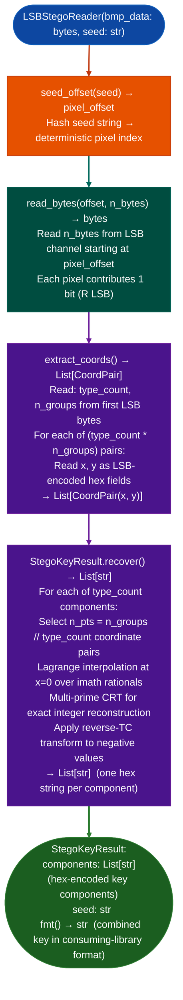

# LSB Steganographic Key Recovery

Extract key material hidden in BMP pixel LSBs using a Shamir-style Lagrange polynomial secret-sharing scheme: recovering multi-component keys encoded as coordinate pairs in the LSB channel of firmware or APK embedded BMP images, using multi-prime CRT for exact rational reconstruction.

---

## Why this exists

1. **Certain firmware and APK distributions embed key material in BMP pixel LSBs using a Shamir-style Lagrange polynomial scheme over rational arithmetic.** This encoding is not detectable by string scanning, entropy analysis, or conventional secret-scanning tools: the key bits are distributed across pixel LSBs in a mathematically structured way. `LSBStegoReader` implements the full pipeline: seed hash → pixel offset → coordinate pair extraction → Lagrange interpolation → CRT reconstruction.

2. **The Lagrange scheme distributes each key component as `n_groups // type_count` coordinate pairs across `type_count` components.** Reconstruction requires exact rational arithmetic not floating point, which `LSBStegoReader` performs using the `imath` library for arbitrary-precision integer math. A floating-point interpolation would produce wrong results due to rounding in large polynomial coefficients.

3. **The output format applies a non-standard reverse two's-complement transformation to negative polynomial values**, this matches the byte order expected by the consuming library in the firmware. Without this transformation, the recovered key bytes are in the wrong order and the key is unusable for verification. `StegoKeyResult.fmt()` outputs the key in the format the consuming library expects.

---

## How it works



---

## Usage

```python
from ablation.analyzers.lsb_stego_extractor import LSBStegoReader

with open('/path/to/embedded.bmp', 'rb') as f:
    bmp_data = f.read()

# Attempt recovery with known seed string
reader = LSBStegoReader(bmp_data, seed='firmware_key_seed')

# Extract coordinates
coords = reader.extract_coords()
print(f"type_count={coords.type_count}  n_groups={coords.n_groups}")

# Recover key components
result = coords.recover()
print(result.fmt())
for i, component in enumerate(result.components):
    print(f"  component[{i}]: {component}")
```

---

## Example output

The following illustrates the key recovery output format. Actual coordinate counts and key values are image-specific.

```
LSBStegoReader: embedded.bmp  (seed='firmware_key_seed')

type_count: <T>  n_groups: <G>
Coordinate pairs extracted: <T*G>

Lagrange recovery (CRT, imath):
  component[0]: <hex-component-0>
  component[1]: <hex-component-1>

Combined key (consuming-library format): <hex-key>
```

---

## False positives

**BMP files without LSB steganography produce garbage coordinate pairs**: `extract_coords()` reads raw bit patterns from any BMP regardless of whether they encode meaningful data. The `type_count` and `n_groups` values will be nonsensical for non-steganographic BMPs, and `recover()` will produce meaningless output. Confirm that a BMP is a likely steganographic carrier discovered in firmware alongside known-encrypted data before running recovery.

**The Lagrange scheme requires the correct seed string**: using the wrong seed produces a different `seed_offset` and extracts the wrong pixel region. If recovery produces invalid key material for example fails key verification in the consuming library, try alternative seed strings from observed firmware string constants.

---

## Pipeline position

Run `LSBStegoReader` when a BMP file is found embedded in firmware or APK content alongside encrypted data that cannot be decrypted by other means. Pair with `EntropyMapper` to confirm the encrypted region exists, then use `LSBStegoReader` to attempt key recovery from nearby BMP resources.

---

## Reading output

`LSBStegoReaderpixel_data, seed.extract()` returns a `StegoKeyResult`:

| Attribute | Content |
|:---|:---|
| `seed` | Seed string used for coordinate generation |
| `type_count` | Number of polynomial components in the key |
| `n_groups` | Total number of coordinate groups encoded |
| `n_pts` | Points per component used in Lagrange interpolation |
| `components` | `List[str]`: hex string per recovered polynomial component |
| `raw_key_hex` | All components concatenated as a single hex string |

---

## See also

- [Firmware Extraction](firmware-extraction.md): outer layer extraction pipeline
- [Compressed BFF Detection / Entropy Mapping](compressed-bff-detection-and-lzw-attempt.md): entropy analysis to locate encrypted regions before key recovery
- [Credential/Token/Key Discovery](credential-token-key-discovery.md): live host credential enumeration complements static firmware triage
