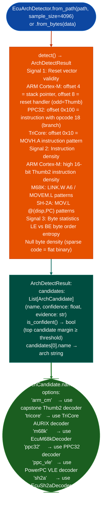

# Flat ROM Function Discovery

Fingerprint the instruction set architecture of a flat ECU ROM image from raw bytes: identifying the ISA from reset vector patterns, instruction density signatures, and byte-level statistical features: then discover function start addresses using ISA-specific prologue patterns on the identified architecture.

---

## Why this exists

1. **Flat ECU ROM images have no ELF header, no IHEX record type, and no symbol table: just raw bytes at a base address.** Before any disassembly or analysis can proceed, the ISA must be identified. `EcuArchDetector` distinguishes between ARM Cortex-M Thumb-2 LE vector table at offset 0, Infineon TriCore AURIX, Motorola M68K/CPU32, PowerPC 32-bit Book E, PowerPC VLE, and Renesas SH-2A/SH-2 using a multi-signal fingerprinting approach.

2. **`EcuArchDetector` uses three independent detection signals: reset vector pointer validity, instruction density signatures, and byte-level statistical patterns: producing a confidence-ranked list of candidates.** `ArchDetectResult.is_confident()` returns `True` when the top candidate has a significant confidence margin over the second candidate, enabling automated pipeline decisions without analyst intervention for common ECU types.

3. Once the ISA is identified, ISA-specific decoders `EcuC28xDecoder`, `EcuM68kDecoder`, `V850Decoder`, `ARCDecoder` provide `function_starts()` via prologue pattern scanning: finding function boundaries without symbols in flat binaries that have no `.eh_frame` or DWARF.

---

## How it works



---

## Usage

```python
from ablation.analyzers.ecu_arch_detector import EcuArchDetector
from ablation.analyzers.ecu_m68k_decoder import EcuM68kDecoder
from ablation.analyzers.ecu_c28x_decoder import EcuC28xDecoder

with open('/path/to/ecu_rom.bin', 'rb') as f:
    data = f.read()

# Fingerprint the ISA
detector = EcuArchDetector.from_bytes(data)
result = detector.detect()

print(f"Detected: {result.candidates[0].name}  (confidence={result.candidates[0].confidence:.2f})")
print(f"Confident: {result.is_confident()}")
for c in result.candidates[:3]:
    print(f"  {c.name:12}  {c.confidence:.2f}  {c.evidence}")

# Dispatch to the appropriate decoder
if result.candidates[0].name == 'm68k':
    decoder = EcuM68kDecoder.from_bytes(data, base_va=0x8000)
    starts = decoder.function_starts()
    print(f"Found {len(starts)} M68K function starts")
    for insn in decoder.disassemble(0x8000, 0x8200):
        print(insn)

elif result.candidates[0].name == 'ti_c28x':
    decoder = EcuC28xDecoder.from_bytes(data, base_va=0)
    starts = decoder.function_starts()
    print(f"Found {len(starts)} C28x function starts")
```

---

## Example output

The following illustrates the arch detection output format. Actual confidences are image-specific.

```
EcuArchDetector: ecu_rom.bin  (<N> bytes, sample=4096)

Candidates:
  m68k        0.91  LINK.W A6 at 0x8012, 0x8054, 0x81a0  (19 occurrences)
  arm_cm      0.23  No valid Thumb2 reset vector at offset 0
  tricore     0.18  No MOVH.A pattern at offset 0x10

Confident: True  (top candidate margin 0.68)
```

---

## False positives

**`is_confident()` uses a threshold margin**: when two architectures have similar confidence for example PPC32 vs PPC VLE in a mixed image, `is_confident()` returns `False`. In this case, inspect `candidates[:3]` and select manually based on the `evidence` field.

**`function_starts()` in ISA decoders is prologue-scan based**, it finds functions with standard calling-convention prologues and misses functions with non-standard or compiler-specific prologues. Always treat `function_starts()` output as a starting point, not a complete function list.

---

## Pipeline position

`EcuArchDetector` is the entry point for any flat ECU ROM analysis, it must run first to select the correct ISA decoder. After detection, proceed to the ISA-specific decoder's `disassemble()` and `function_starts()`, then build a `BinaryContext` equivalent manually (since flat ROMs have no ELF header for `BinaryContext.load_or_build()`).

---

## Reading output

`EcuArchDetector.detect()` returns an `ArchResult` object:

| Attribute | Content |
|:---|:---|
| `isa` | ISA string for example `M68K`, `RH850`, `TRICORE`, `C167` |
| `confidence` | `HIGH` / `MEDIUM` / `LOW` |
| `evidence` | List of byte-pattern evidence items that drove the detection |

Select the decoder class from `result.isa`: `'RH850'` → `EcuRh850Decoder`, `'TRICORE'` → `EcuTriCoreDecoder`, `'C167'` → `EcuC166Decoder`. `EcuArchDetector` does not expose a decoder-factory method directly.

---

## See also

- [C166/C167 Decoding](c166-c167-decoding.md): C166/C167 flat ROM decoder (not covered by EcuArchDetector)
- [Calibration Parsers](calibration-parsers.md): A2L/open_damos parsing after ISA detection
- [ECU Calibration Table Interpretation](calibration-table-interpretation.md): calibration data extraction after firmware analysis
