# The Flywheel

Every confirmed finding becomes a search pattern. Every new engagement runs all prior confirmed findings automatically.

---

## Why this exists

Two things went wrong before the flywheel existed:

**1. Confirmed findings died at the end of an engagement.** After a long engagement with 30 confirmed findings, none of that work carried forward. The next binary started from zero. `PatternLibrary` existed but required explicit `pl.add()` calls to register each pattern, and backfilling 30 entries at close-out was a tax on finishing the work. `ingest_from_registry()` eliminates that: one call at the start of any engagement pulls every confirmed finding from every prior target.

**2. Cross-architecture pattern reuse was not possible.** A heap overflow confirmed in an ARM32 router looks completely different at the opcode level from the same class of bug in an x86-64 BMC. Without normalization, a confirmed pattern gave zero signal on a different architecture. BinFuse opcode categorization maps both to the same category sequence so a pattern confirmed on one vendor replays on a completely different architecture without any manual re-authoring.

---

## How it works

The flywheel has two halves: storage and replay.

**Storage** happens when you confirm a finding. `FindingRegistry.register()` writes the finding to a local SQLite database at `~/.ablation/findings.db`. Each record carries the vendor, product, version, title, description, CWE class, severity, function address, and an optional BERT embedding vector.

**Replay** happens at the start of each new engagement. `PatternLibrary.ingest_from_registry()` reads every confirmed finding from the database and adds it as a semantic search pattern. `sweep()` then runs all patterns against the new binary. Confirmed findings from one vendor run against a completely different vendor's binary. Confirmed findings from x86-64 run against ARM32. The tool gets sharper with each engagement.

```mermaid
flowchart LR
    A(["Confirm finding\nFindingRegistry.register()"]):::input --> B["~/.ablation/findings.db\nSQLite · all vendors · all targets"]:::primary
    B:::primary --> C["Next engagement\nPatternLibrary.ingest_from_registry()"]:::secondary
    C:::secondary --> D["pl.sweep(searcher)\nAll confirmed patterns run\nagainst the new binary"]:::tertiary
    D:::tertiary --> E["New confirmed finding\nFindingRegistry.register()"]:::tertiary
    E:::tertiary --> B:::primary
    classDef input     fill:#0d47a1,stroke:#1565c0,color:#fff
    classDef primary   fill:#e65100,stroke:#bf360c,color:#fff
    classDef secondary fill:#004d40,stroke:#00695c,color:#fff
    classDef tertiary  fill:#4a148c,stroke:#6a1b9a,color:#fff
    classDef neutral   fill:#37474f,stroke:#546e7a,color:#fff
    classDef output    fill:#1b5e20,stroke:#2e7d32,color:#fff
    linkStyle 0 stroke:#bf360c,stroke-width:2px
    linkStyle 1 stroke:#00695c,stroke-width:2px
    linkStyle 2 stroke:#6a1b9a,stroke-width:2px
    linkStyle 3 stroke:#6a1b9a,stroke-width:2px
    linkStyle 4 stroke:#bf360c,stroke-width:2px
```



---

## The pipeline

### Step 1: Register a confirmed finding

```python
from ablation.analyzers.finding_registry import FindingRegistry

reg = FindingRegistry()

reg.register(
    vendor='example_vendor',
    product='example_product',
    version='1.0.0',
    binary='httpd',
    title='Pre-auth SQL injection via Bearer token',
    description='PROTOCOL_PARSER | role=bearer_token_handler | calls: sqlite3_exec | '
                'vuln: unsanitized token value reaches SQL sink without bounds check',
    cwe_class='CWE-89',
    severity='CRITICAL',
    func_addr=0x4a1c30,
    embedding=func_embedding_vector,
)
```

### Step 2: Load confirmed patterns at engagement start

```python
from ablation.analyzers.finding_registry import FindingRegistry
from ablation.analyzers.pattern_library import PatternLibrary
from ablation.analyzers.semantic_search import SemanticSearcher
from ablation.analyzers.binary_context import BinaryContext

reg = FindingRegistry()
pl  = PatternLibrary()
ctx = BinaryContext.load_or_build('/path/to/new_binary.so')

# Pull all confirmed findings into the pattern library (idempotent)
n = pl.ingest_from_registry(reg)
print(f"{n} new patterns loaded from confirmed findings")

# Build the semantic corpus for the new binary
searcher = SemanticSearcher.from_context(ctx)

# Sweep: confirmed patterns from every prior engagement run automatically
results = pl.sweep(searcher)
for tag, hits in results.items():
    for va, score in hits:
        print(f"  [{tag}] {ctx.name(va)} @ {va:#x}  score={score:.3f}")
```

`ingest_from_registry()` is idempotent. Calling it again at the start of a later session adds only findings registered since the previous call.

### Step 3: Find structurally similar prior findings

```python
# Query the registry directly for a function embedding
embedding = searcher.embed_function(va)
hits = reg.find_similar(embedding, top_k=8, min_sim=0.60)
for h in hits:
    print(f"  {h['vendor']}/{h['product']} {h['version']}  {h['title']}  ({h['severity']})")
```

---

## Cross-architecture normalization

BinFuse maps opcodes to 11 behavioral categories before encoding. The category sequence for a heap overflow confirmation in ARM32 (`ARITHMETIC_OP->COMPARISON_OP->CONDITIONAL_OP->MEMORY_OP`) is the same as the sequence for the same class in x86-64 BMC firmware. The BERT embedding trained on these normalized sequences produces similar vectors for structurally similar functions regardless of ISA, so `find_similar()` returns cross-architecture matches without any ISA-specific handling.

---

## Seed corpus

`ablation/data/seed_corpus.json` ships pre-loaded with patterns derived from published CVEs. These seed the flywheel on first install so the pattern library is not empty on a fresh engagement. Confirmed findings from your own work layer on top of the seeds.

---

## Storage

| Path | Contents |
|---|---|
| `~/.ablation/findings.db` | SQLite database of all confirmed findings. User-local, not committed to git. |
| `~/.ablation/pattern_library.json` | Ingested patterns from confirmed findings. Auto-updated by `ingest_from_registry()`. |
| `ablation/data/seed_corpus.json` | Published-CVE seed patterns shipped with the tool. |

---

## API reference

| Call | Description |
|---|---|
| `FindingRegistry.register(...)` | Store a confirmed finding |
| `FindingRegistry.find_similarembedding, top_k, min_sim` | Retrieve structurally similar prior findings |
| `FindingRegistry.export_patterns()` | Return all confirmed findings as `[{query, tag}]` dicts for manual `pl.add()` |
| `FindingRegistry.stats()` | Finding count by vendor, product, and CWE class |
| `FindingRegistry.list_findings(vendor=None)` | List all findings, optionally filtered |
| `PatternLibrary.ingest_from_registry(reg)` | Pull all confirmed findings into the pattern library idempotent |
| `PatternLibrary.sweepsearcher` | Run all confirmed patterns against the current binary |
| `PatternLibrary.record_hittag, binary, va, confirmed=True` | Mark a sweep hit as confirmed |

See [Registry Modules](registry.md) for the full `FindingRegistry` and `NameRegistry` API.

---

## Usage

```python
from ablation.analyzers.engine_pattern_library import EnginePatternLibrary

lib = EnginePatternLibrary.default()
labels = lib.label_binary(ctx)
for va, label in sorted(labels.items()):
    if label.confidence >= 0.80:
        print(f"  {va:#x}  {label.engine}  conf={label.confidence:.2f}")
```

---

## Example output

```
pl.ingest_from_registry(reg)
  31 new patterns ingested (0 already present)
  total patterns: 93  (62 seed + 31 confirmed)

pl.sweep(searcher, top_k=8, min_score=0.30)  target=fortigate_7.2.1
  heap_overflow (CWE-122):
    0.82  fn_0x1d700  (auth_radius_parse)
    0.71  fn_0x31400  (process_dhcp_option)
  command_injection (CWE-78):
    0.77  fn_0x58000  (exec_cli_command)
  stack_overflow (CWE-121):
    [no hits above 0.30]

reg.find_similar(embedding, top_k=3, min_sim=0.60)
  fortinet/fortigate 7.0.x  Pre-auth heap overflow in RADIUS parse  CRITICAL  sim=0.84
  tencent/tencentos 1.2       Heap overflow in dhcpv6 option handler  HIGH      sim=0.71
  cisco/ios_xe 17.3          Stack overflow in SNMP trap handler      HIGH      sim=0.63
```

---

## False positives

**Patterns that flood every sweep**: a confirmed finding with a very generic description for example "processes network input" will score above 0.30 against most functions in any network-facing binary. The pattern produces high recall but low precision. Improve it by editing the stored description in `findings.db` to include the specific error condition: memory operation type, size field behavior, and call chain.

**`ingest_from_registry()` adding patterns from false-positive findings**: if a finding was registered but later determined to be a false positive at the analysis stage, its pattern remains in the library. Call `reg.list_findings()` to identify and remove the false-positive finding from `findings.db` before the next engagement, then rebuild the pattern library.

---

## Pipeline position

**Before this module:** `FindingRegistry` must have at least one confirmed finding for `ingest_from_registry()` to add anything beyond the seed corpus. `SemanticSearcher.build_corpus()` must be called so `sweep()` has an embedding matrix to query against.

**After this module:** Sweep hits above 0.60 go to `FuncProfiler` and `TaintTracker`. Confirmed findings from this engagement are registered with `FindingRegistry.register()`, closing the loop and growing the pattern library for the next target.

---

## Reading output

The flywheel has no single output type. It is an operational loop between three modules:

1. `PatternLibrary.sweepsearcher, top_k, min_score` → `dict[str, list[tuple[float, int, str]]]`: tag → `score, func_id, name` candidates from prior confirmed patterns.
2. `FindingRegistry.find_similarembedding, top_k, min_sim` → `list[dict]`: confirmed findings from prior engagements whose embeddings are similar to the query. Dict keys: `vendor`, `product`, `version`, `title`, `cwe_class`, `severity`, `func_addr`, `binary`, `similarity`.
3. `FindingRegistry.register(...)` → `str` finding ID: persists a new confirmed finding and adds its embedding to the in-memory matrix for immediate similarity queries.

See [Finding Validation](finding-validation.md) and [Registry](registry.md) for full API details.

---

## See also

- [BinaryContext](binary-context.md): session foundation for all analysis
- [SemanticSearch](semantic-search.md): function candidate identification
- [FindingRegistry](registry.md): persistent finding storage
