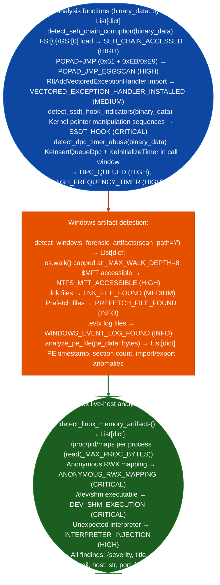

# Forensics Enumeration

Detect Windows rootkit indicators SEH chain access, SSDT hooks, DPC/timer abuse, live Linux memory artifacts anonymous RWX mappings, `/dev/shm` execution, and interpreter injection, forensic artifact presence $MFT, LNK files, Prefetch, EVTX, and binary obfuscation patterns: from raw binary data or live procfs: via `modules/forensics_enum.py`.

---

## Why this exists

1. **SEH-based exploit detection requires byte-level pattern matching that generic AV cannot perform**: `detect_seh_chain_corruption()` searches for Windows SEH access patterns (`FS:[0]` or `GS:[0]` register loads), POPAD+JMP eggscan sequences classic SEH overwrite: POPAD restores registers and JMP skips nSEH, VEH installation patterns (`RtlAddVectoredExceptionHandler` import), and custom exception handler field writes. These are malware and exploit delivery indicators that are only detectable at the byte level in stripped or packed binaries.

2. **SSDT and DPC abuse indicates kernel rootkits operating below the process layer**: `detect_ssdt_hook_indicators()` searches for kernel function pointer manipulation patterns SSDT index-based call sequences. `detect_dpc_timer_abuse()` finds `KeInsertQueueDpc`, `KeInitializeTimer`, and `KeSetTimerEx` import strings alongside `KeWaitForSingleObject` in a tight call window: the signature of timing-based rootkit persistence via deferred procedure calls.

3. **Live Linux memory artifact detection**: `detect_linux_memory_artifacts()` reads `/proc/<pid>/maps` for all processes and flags: anonymous RWX mappings no file backing, executable: shellcode or reflective loader, execution from `/dev/shm` tmpfs-backed executable memory, persistence-free malware, and interpreter injection Python/Ruby/Perl in a process that should not have scripting engines. This is a fast triage for active compromise on a live host without requiring a full memory image.

---

## Key constants

| Constant | Value | Applied to |
|:---|:---|:---|
| `_MAX_PROC_BYTES` | 4 MB | `/proc/{pid}/maps` reads in `detect_linux_memory_artifacts()` |
| `_MAX_WALK_DEPTH` | 8 | `os.walk()` recursion depth in `detect_windows_forensic_artifacts()` |

---

## How it works



---

## Usage

```python
from modules.forensics_enum import (
    detect_seh_chain_corruption,
    detect_ssdt_hook_indicators,
    detect_dpc_timer_abuse,
    detect_windows_forensic_artifacts,
    detect_linux_memory_artifacts,
    analyze_pe_file,
)

# Binary analysis (all return [{severity, title, detail, host, port}])
binary = open('target.exe', 'rb').read()
findings = (
    detect_seh_chain_corruption(binary)
    + detect_ssdt_hook_indicators(binary)
    + detect_dpc_timer_abuse(binary)
)

# PE static analysis
pe_findings = analyze_pe_file(binary)

# Live Linux host (reads /proc/*/maps)
live_findings = detect_linux_memory_artifacts()

for f in findings + pe_findings + live_findings:
    print(f"  [{f['severity']}] {f['title']}: {f['detail'][:80]}")
```

---

## Example output

The following is a schematic example showing output structure and field names. Values are illustrative.

```
detect_seh_chain_corruption:
  [HIGH] SEH_CHAIN_ACCESSED
         FS:[0] or GS:[0] load — rootkit or exploit reads the SEH linked list
  [HIGH] POPAD_JMP_EGGSCAN
         POPAD (0x61) followed by near-JMP within 8 bytes — SEH overwrite pattern

detect_dpc_timer_abuse:
  [HIGH] HIGH_FREQUENCY_TIMER
         KeInitializeTimer + KeSetTimerEx within function — timing-based DPC persistence

detect_linux_memory_artifacts:
  [CRITICAL] ANONYMOUS_RWX_MAPPING
             PID 1234 (httpd): anonymous rwxp mapping at 0x7f2a00000000 — shellcode or loader
  [CRITICAL] DEV_SHM_EXECUTION
             PID 5678 (bash): mapped /dev/shm/.x executable — persistence-free in-memory execution
```

---

## False positives

**`SEH_CHAIN_ACCESSED` on legitimate Windows exception handlers**: many compiler-generated try/catch blocks access FS:[0] to register a handler at function entry. The pattern fires on every Windows binary that uses structured exception handling for normal error recovery, not just malicious SEH overwrites. Confirm by tracing the access to a WRITE to the SEH chain pointer (exploit) vs. a READ-only `push`/`call` sequence legitimate handler installation.

**`ANONYMOUS_RWX_MAPPING` from JIT compilers**: V8 Node.js/Chrome, LuaJIT, and Java's JIT compiler all create anonymous RWX mappings for compiled code. On application servers where these runtimes are expected, this finding is noise. Filter by checking the process name and `/proc/<pid>/cmdline` against the known runtime list for the host.

---

## Pipeline position

Run binary analysis functions `detect_seh_chain_corruption()` and `detect_dpc_timer_abuse()` during static analysis of suspected malware samples. Run `detect_linux_memory_artifacts()` immediately upon gaining shell access to a live host, it provides a fast indicator-of-compromise sweep in under one second.

---

## Reading findings

All three detection functions return `List[{severity, title, detail}]`:

| Field | Content |
|:---|:---|
| `severity` | `CRITICAL` / `HIGH` |
| `title` | Finding code such as `SEH_CHAIN_ACCESSED`, `POPAD_JMP_EGGSCAN`, `HIGH_FREQUENCY_TIMER`, and `ANONYMOUS_RWX_MAPPING` |
| `detail` | Instruction VA, PID/process name, or memory range providing evidence |

`detect_linux_memory_artifacts()` additionally includes `pid` and `process` fields in `detail`.

---

## See also

- [Volatile and Linux Artifact Triage](volatile-and-linux-artifact-triage.md): `/proc`-based triage combining forensics and privesc indicators
- [Windows Artifact Discovery](windows-artifact-discovery.md): `detect_windows_forensic_artifacts()` combined with registry and EVTX parsing
- [Finding Registry](finding-registry.md): record confirmed forensic findings
