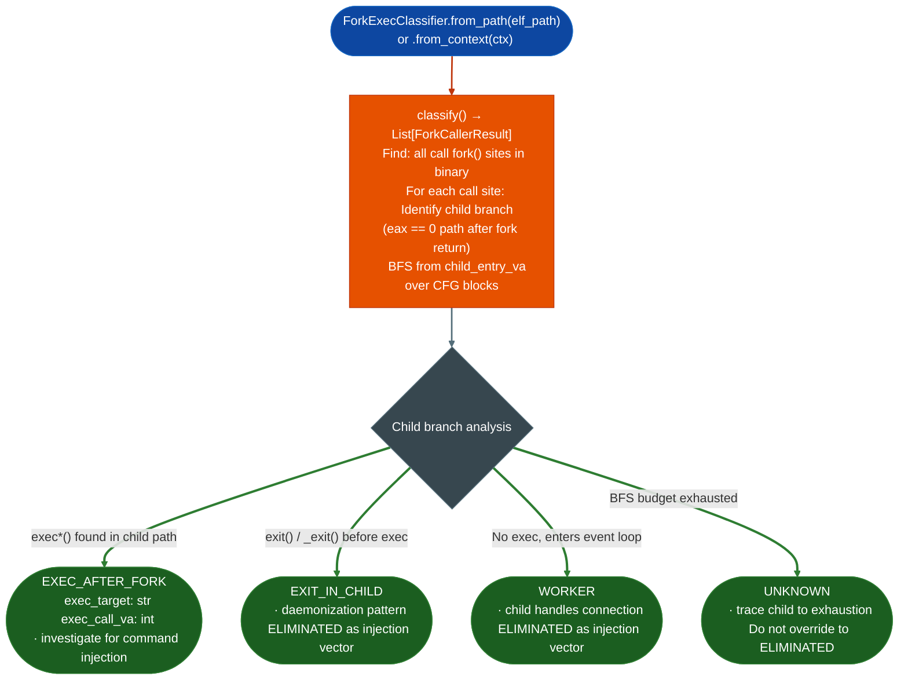

# Fork-Exec Classification

Classify `fork()` callers in x86-64 ELF binaries as `WORKER`, `EXEC_AFTER_FORK`, or `EXIT_IN_CHILD`: enabling elimination of fork callers that never load a new process image from injection-vector analysis, reducing false-positive command injection findings from `SinkArgClassifier` and `TaintTracker` on `execve`/`system` sinks in worker-process callers.

---

## Why this exists

1. **Many network daemons fork a child process to handle a connection, then the child enters an event loop that never calls `exec*()`.** `SinkArgClassifier` and `TaintTracker` report `exec*()` sinks in these worker processes as `ARG_PROPAGATED` findings, but the sink is in the parent's code path and the forked child never loads a new image: the finding is not exploitable as a command injection. `ForkExecClassifier.classify()` identifies these as `WORKER` and marks them `ELIMINATED`.

2. **`EXEC_AFTER_FORK` verdict identifies the security-relevant pattern**: child processes that call `exec*()` immediately after `fork()` can be injection vectors if the `exec*()` argument is tainted. The `ForkCallerResult.exec_target` field names the specific `exec` function and `exec_call_va` gives its VA for direct handoff to `TaintTracker`.

3. **`EXIT_IN_CHILD` verdict identifies `fork()` callers used only for daemonization**: the child calls `exit()` immediately after `fork()` double-fork daemonization pattern. These callers are `ELIMINATED` as injection vectors. Distinguishing them from `WORKER` requires BFS across the child branch, which `ForkExecClassifier.classify_caller()` performs up to its block-walk budget.

---

## How it works



---

## Usage

```python
from ablation.analyzers.fork_exec_classifier import ForkExecClassifier
from ablation.analyzers.binary_context import BinaryContext

ctx = BinaryContext.load_or_build('/path/to/daemon')
classifier = ForkExecClassifier.from_context(ctx)

results = classifier.classify()
print(classifier.report(results))

# Route EXEC_AFTER_FORK to taint analysis
for r in results:
    if r.verdict == 'EXEC_AFTER_FORK':
        print(f"Injection vector: fork at {r.caller_va:#x}  "
              f"exec={r.exec_target} at {r.exec_call_va:#x}")
    elif r.verdict in ('WORKER', 'EXIT_IN_CHILD'):
        print(f"Eliminated: {r.verdict} at {r.caller_va:#x}")
    elif r.verdict == 'UNKNOWN':
        print(f"Unknown — trace manually: child_entry={r.child_entry_va:#x}")

# Classify a specific site
single = classifier.classify_caller(caller_va=0x12340)
print(single.fmt())
```

---

## Example output

The following illustrates the fork-exec classification output format. Actual addresses and counts are binary-specific.

```
ForkExecClassifier: daemon  (x86-64)

fork() call sites: <N>
  WORKER          call@<va>  func@<va>  blocks=14   child handles connection loop
  EXEC_AFTER_FORK call@<va>  func@<va>  blocks=3
    exec=execve@<va>  !! TRACE CHILD TO EXHAUSTION !!
  EXIT_IN_CHILD   call@<va>  func@<va>  blocks=2   double-fork daemonization

Injection vectors (EXEC_AFTER_FORK): <M>
Eliminated: <K>
```

---

## False positives

**`UNKNOWN` verdict means the BFS block-walk budget was exhausted**: the warning in `ForkCallerResult.fmt()` is explicit: "TRACE CHILD TO EXHAUSTION: do not override to ELIMINATED from a partial trace". An `UNKNOWN` result may be `EXEC_AFTER_FORK` deeper in the child branch. Always trace `UNKNOWN` callers manually before treating them as eliminated.

**Classification is x86-64 only**: ARM64, MIPS, and other architectures are not supported. `ForkExecClassifier` uses `call fork` mnemonic matching specific to x86-64. On non-x86-64 binaries, all results will be `UNKNOWN`.

---

## Pipeline position

Run `ForkExecClassifier` after `SinkArgClassifier` returns `ARG_PROPAGATED` findings for `execve`/`system`/`popen` sinks. Feed `EXEC_AFTER_FORK` sites to `TaintTracker`; eliminate `WORKER` and `EXIT_IN_CHILD` sites without further analysis.

---

## Reading output

`ForkExecClassifier.classify()` returns a list of `ForkCallerResult` objects:

| Attribute | Content |
|:---|:---|
| `caller_va` | VA of the `call fork` instruction |
| `func_va` | VA of the function containing the fork |
| `verdict` | `EXEC_AFTER_FORK`, `WORKER`, `EXIT_IN_CHILD`, or `UNKNOWN` |
| `child_entry_va` | VA where the child branch begins (`eax==0` path), or `0` |
| `exec_target` | Exec function name for example `'execve'`, `'system'`: set when `EXEC_AFTER_FORK` |
| `exec_call_va` | VA of the exec call: set when `EXEC_AFTER_FORK`, otherwise `0` |
| `blocks_walked` | Count of BFS blocks examined during child-path analysis |
| `detail` | Human-readable verdict detail string |

Only `EXEC_AFTER_FORK` sites need taint analysis. `WORKER` and `EXIT_IN_CHILD` sites can be eliminated.

---

## See also

- [Sink Argument Classification](sink-argument-classifier.md): `SinkArgClassifier` whose ARG_PROPAGATED findings are routed through fork-exec classification
- [Named Taint Sources and Bounds](named-taint-sources-and-bounds.md): `TaintTracker` for confirmed EXEC_AFTER_FORK sites
- [Single-Function Profiling](single-function-profiling.md): `FuncProfiler` for detailed analysis of EXEC_AFTER_FORK functions
