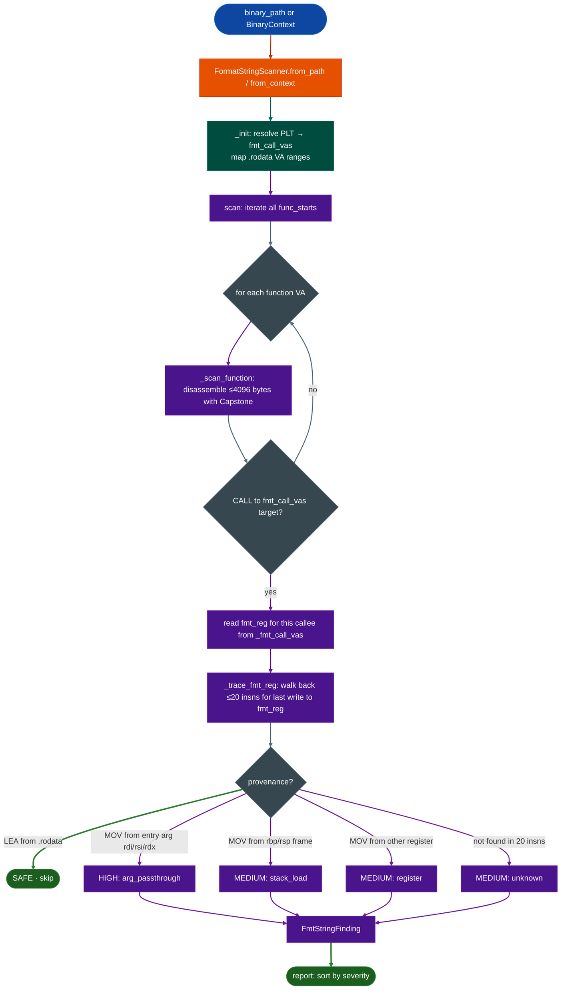

# FormatStringScanner

  - [What is format string analysis?](#what-is-format-string-analysis)
  - [Why this exists](#why-this-exists)
  - [How it works](#how-it-works)
  - [FormatStringScanner](#formatstringscanner-1)
    - [Covered format functions](#covered-format-functions)
  - [Usage](#usage)
  - [Example output](#example-output)
  - [False positives](#false-positives)
  - [Pipeline position](#pipeline-position)
  - [Reading findings](#reading-findings)
  - [See also](#see-also)

**File:** `ablation/analyzers/format_string_scanner.py`

---

## What is format string analysis? <sup>[↑](#formatstringscanner)</sup>

A format string vulnerability (CWE-134) occurs when an attacker-controlled string reaches a `printf`-family function as the format argument rather than as a value argument. The format argument controls the number and types of values read from or written to memory. An attacker who controls it can read arbitrary stack memory with `%x` specifiers and write to arbitrary addresses with `%n`. Unlike buffer overflows, format string bugs are often pre-authentication, require no heap spray, and are exploitable without knowing the binary's base address.

The critical fact that makes format string bugs tractable to detect statically: the format argument and value arguments occupy different positions in the ABI. For `printf(fmt, ...)`, `fmt` is in `rdi`. For `snprintf(buf, n, fmt, ...)`, `fmt` is in `rdx`. Whether a particular call site is safe depends on whether `fmt` holds a pointer into `.rodata` (a string constant the attacker cannot control) or a register value that traces back to attacker-supplied input. This is a backward-dataflow question over the single function containing the call site.

`FormatStringScanner` answers that question at scale. It walks every `func_starts` entry in `BinaryContext`, disassembles up to 4096 bytes, identifies every `CALL` instruction whose target is a format-string sink, and walks backward up to 20 instructions to classify the format register's provenance. The result is a list of `FmtStringFinding` records sorted by severity so the analyst can triage HIGH findings (entry-argument passthrough) before spending time on MEDIUM findings (stack loads or unresolved origins).

## Why this exists <sup>[↑](#formatstringscanner)</sup>

1. **Format string vulnerabilities are invisible to import-list audits.** Seeing `printf` or `syslog` in a binary's import table tells you nothing about whether those calls are safe. The only thing that matters is whether the format argument is a string literal from `.rodata` or a value the attacker can influence. There was no tool in Ablation that answered that question automatically across an entire firmware image.

2. **Manual inspection of every printf-family call site is impractical.** A typical FortiOS or Cisco LINA binary has several hundred printf-family call sites. Walking backwards through disassembly from each one to trace the format register is mechanical work that takes seconds per site, but hours across a full binary. This scanner does it in one pass.

3. **Logging wrappers conceal the real format argument position.** Firmware commonly defines `log_printfpriority, fmt, ...` or `debug_printftag, fmt, ...` where the format string is not the first argument. A scanner that only looks at `rdi` for every call misses these. This scanner maintains a per-function format-register map so each callee's ABI is handled correctly.

---

## How it works <sup>[↑](#formatstringscanner)</sup>

The scanner operates in three stages: **sink enumeration**, **per-function disassembly**, and **backwards register tracing**.

**Stage 1: Sink enumeration.** The scanner resolves the binary's PLT and maps each imported format-string function printf, fprintf, snprintf, syslog, err, warn, and common firmware logging wrappers to the register that carries the format argument under the SysV AMD64 ABI. `printffmt, ...` puts `fmt` in `rdi`; `fprintfstream, fmt, ...` puts it in `rsi`; `snprintfbuf, n, fmt, ...` puts it in `rdx`. This mapping is built once from the PLT and stored as `_fmt_call_vas`.

**Stage 2: Per-function disassembly.** For each function start in `func_starts`, the scanner disassembles up to 4096 bytes. It iterates instructions looking for `CALL` instructions whose target is in `_fmt_call_vas`.

**Stage 3: Backwards register tracing.** For each qualifying call site, the scanner walks back up to 20 instructions to find the last instruction that wrote to the format register. The outcome is one of five provenance values:

| Provenance | Meaning | Severity |
|---|---|---|
| `rodata` | LEA from `.rodata`: string literal, safe |: (skipped) |
| `arg_passthrough` | Entry argument (`rdi`/`rsi`/`rdx`/`rcx`) passed unchanged | **HIGH** |
| `stack_load` | Loaded from `[rbp±N]` or `[rsp±N]`: local buffer or argv | MEDIUM |
| `register` | Loaded from another non-entry register | MEDIUM |
| `unknown` | No definition found within 20 instructions | MEDIUM |

Sub-register aliasing is handled: a write to `esi` is recognized as a write to `rsi`.



---

## FormatStringScanner <sup>[↑](#formatstringscanner)</sup>

```python
from ablation.analyzers.format_string_scanner import FormatStringScanner
from ablation.analyzers.binary_context import BinaryContext

# Preferred: share an existing context to avoid re-parsing
ctx = BinaryContext.load_or_build('/path/to/firmware')
scanner = FormatStringScanner.from_context(ctx)

# Standalone: builds a context internally
scanner = FormatStringScanner.from_path('/path/to/firmware')

findings = scanner.scan()
print(scanner.report(findings))
```

### Covered format functions <sup>[↑](#formatstringscanner)</sup>

| Function | fmt register | Notes |
|---|---|---|
| `printf`, `vprintf` | `rdi` | |
| `fprintf`, `vfprintf`, `sprintf`, `vsprintf`, `asprintf`, `dprintf` | `rsi` | |
| `snprintf`, `vsnprintf` | `rdx` | |
| `syslog`, `vsyslog` | `rsi` | |
| `err`, `errx`, `warn`, `warnx`, `verr`, `verrx`, `vwarn`, `vwarnx` | `rsi` | |
| `log_printf` | `rsi` | Firmware logging wrapper |
| `debug_printf`, `trace_printf` | `rdi` | Firmware debug wrappers |

To add a custom logging function: extend `_build_fmt_funcs()` in the source or subclass the scanner.

---

## Usage <sup>[↑](#formatstringscanner)</sup>

```python
from ablation.analyzers.format_string_scanner import FormatStringScanner
from ablation.analyzers.binary_context import BinaryContext

ctx = BinaryContext.load_or_build('/fw/fortios/httpsd')
scanner = FormatStringScanner.from_context(ctx)
findings = scanner.scan()

# Triage by severity
high = [f for f in findings if f.severity == 'HIGH']
for f in high:
    print(f"0x{f.func_va:x}: {f.callee}({f.fmt_reg}=user?)  {f.description}")

# Full structured output
for f in findings:
    d = f.as_dict()   # func_va, call_va, callee, fmt_reg, provenance, severity, verdict, description
```

---

## Example output <sup>[↑](#formatstringscanner)</sup>

```
[format_string_scanner] 3 finding(s)  HIGH=1  MED=2

  HIGH    fmt_string  0x401200+0x3a  syslog(rsi=user?)  rsi (entry arg) passed as format string: caller controls format
  MEDIUM  fmt_string  0x402100+0x18  fprintf(rsi=user?)  loaded from stack [rbp-0x20]
  MEDIUM  fmt_string  0x403500+0x50  printf(rdi=user?)  format register rdi provenance not found in 20 insns
```

---

## False positives <sup>[↑](#formatstringscanner)</sup>

**Stack loads that are always constants.** The scanner flags `rbp-0x20` loads as MEDIUM regardless of whether the value stored there is always a string literal. When the containing function writes a constant string into a stack buffer and then passes it to printf, the scanner raises MEDIUM even though the call is safe. Verify by disassembling the function and checking what writes to that stack slot.

**Logging wrapper arguments.** If a firmware logging wrapper always receives a string literal from its callers but stores it in a local variable first, the scanner may flag the wrapper's internal printf call as MEDIUM stack_load. Add the wrapper to `_FMT_FUNCS` or verify the wrapper's call sites are all string literals.

**20-instruction lookback limit.** If the format register was defined more than 20 instructions before the call e.g. after a long loop prologue, the scanner returns `unknown` (MEDIUM). This is intentionally conservative, it does not declare the site safe just because it cannot see the definition.

---

## Pipeline position <sup>[↑](#formatstringscanner)</sup>

**Before this module:** `BinaryContext.load_or_build()` to supply `func_starts` and the PLT symbol map.

**After this module:** Run `TaintTracker` on the HIGH findings (provenance `arg_passthrough`) to verify that the entry argument is reachable from a network-facing source. MEDIUM findings from `stack_load` warrant manual disassembly of the containing function.

---

## Reading findings <sup>[↑](#formatstringscanner)</sup>

| Field | Content |
|:---|:---|
| `func_va` | Virtual address of the function containing the call site |
| `call_va` | Virtual address of the `CALL` instruction itself |
| `callee` | Name of the format-string function being called |
| `fmt_reg` | Register carrying the format argument `rdi`, `rsi`, or `rdx` |
| `provenance` | `rodata` / `arg_passthrough` / `stack_load` / `register` / `unknown` |
| `severity` | `HIGH` for `arg_passthrough`; `MEDIUM` for all others |
| `verdict` | `SAFE` / `VULNERABLE` (HIGH) / `SUSPICIOUS` (MEDIUM) |
| `description` | Human-readable trace result with register names and addresses |

---

## See also <sup>[↑](#formatstringscanner)</sup>

- [Taint Analysis](taint-analysis.md): confirm HIGH findings are reachable from attacker-controlled network input
- [Sink Arg Classifier](sink-arg-classifier.md): pre-classify all sink call sites as RODATA_CONST / ARG_PROPAGATED before running the full scanner
- [Binary Context](binary-context.md): provides `func_starts` and PLT; run this first
