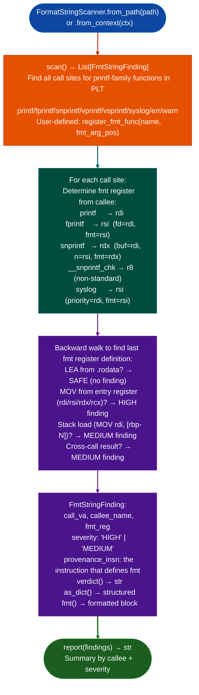

# Format String Scanning

Detect format string vulnerabilities in x86-64 ELF binaries by identifying call sites where the format argument of `printf`/`fprintf`/`syslog` and similar functions is not a `.rodata` string literal: covering the full `printf` family, `syslog`, `err`/`warn`, and user-supplied callable tables per TAOSSA Chapter 8.

---

## Why this exists

1. **Format string vulnerabilities arise when user-controlled data reaches the format argument of a printf-family function: the format argument is safe only when it is a string literal (RIP-relative load from `.rodata`).** `FormatStringScanner` applies the TAOSSA Ch8 detection algorithm to every `printf`/`fprintf`/`snprintf`/`syslog`/`err`/`warn` call site in the binary, walking backward from the call to find the last instruction that defined the format register. If that definition is a `.rodata` LEA, the site is safe. Otherwise it is a finding.

2. `FormatStringScanner` handles all printf-family format argument positions correctly: `rdi` for `printf`, `rsi` for `fprintf` and `dprintf`, `rdx` for `snprintf` and `sprintf`, and `r8` for `__snprintf_chk`. Using a wrong register assumption such as always checking `rdi` would produce false negatives on every `fprintf` call site.

3. **Severity is determined by the format argument's provenance: HIGH when the format comes directly from a function argument register at function entry the caller passed a format string, MEDIUM when the provenance is unclear.** A `HIGH` finding means there exists a direct code path from an external input network, file, environment to the format argument without a string literal interception.

---

## How it works



---

## Usage

```python
from ablation.analyzers.format_string_scanner import FormatStringScanner
from ablation.analyzers.binary_context import BinaryContext

ctx = BinaryContext.load_or_build('/path/to/target.elf')
scanner = FormatStringScanner.from_context(ctx)

# Scan all printf-family call sites
findings = scanner.scan()
print(scanner.report(findings))

# Filter by severity
high = [f for f in findings if f.severity == 'HIGH']
print(f"HIGH severity findings: {len(high)}")

# From path (no BinaryContext required)
scanner2 = FormatStringScanner.from_path('/path/to/target.elf')
findings2 = scanner2.scan()
for f in findings2:
    print(f.fmt())
```

---

## Example output

The following illustrates the finding output format. Actual addresses and registers are binary-specific.

```
[HIGH] printf at <va>
  fmt_reg: rdi ← rdi (function entry argument)
  Caller passes format string — user-controlled format if caller receives network input

[MEDIUM] syslog at <va>
  fmt_reg: rsi ← [rbp-0x20] (stack load)
  Provenance unclear — verify stack slot source
```

---

## False positives

**HIGH severity requires that the format register traces to an entry-argument register, this fires when the format is passed as a function argument even if the caller always passes a string literal.** A HIGH finding at depth > 2 calls from any network input source may be a false positive; use `TaintTracker` to confirm that the format argument register is tainted from a network source.

**Backward walk is bounded: a format register defined at the beginning of a long function may not be traced back to its source within the look-back window.** In this case the finding is MEDIUM even if the actual provenance is a `.rodata` literal. Verify by inspecting the backward-walk evidence in `FmtStringFinding.provenance_insn`.

---

## Pipeline position

Run `FormatStringScanner` as part of the initial `SemanticSearcher`-guided triage sweep. Format string findings are independent of taint analysis: `FormatStringScanner` uses backward provenance walking rather than forward taint propagation. HIGH findings with confirmed taint sources (from `TaintTracker`) are disclosure-grade.

---

## Reading findings

`FormatStringScanner.scan()` returns a list of finding dicts:

| Field | Content |
|:---|:---|
| `severity` | `HIGH` format arg is a function parameter, `MEDIUM` stack load: unclear provenance |
| `title` | Finding code, e.g., `FORMAT_STRING_ARG_PROPAGATED` or `FORMAT_STRING_STACK_LOAD` |
| `detail` | Function name, sink VA, format register, and provenance description |
| `fmt_reg` | Register holding the format string argument such as `rdi` and `rsi` |
| `call_va` | VA of the format-string sink call |

---

## See also

- [Sink Argument Classifier](sink-argument-classifier.md): complementary: classifies command-string provenance at exec-class sinks
- [Taint Analysis](taint-analysis.md): forward propagation to confirm that network input reaches the format argument
- [Deprecated Unsafe Function Scanning](deprecated-unsafe-function-scanning.md): detects gets/mktemp different from format string class
