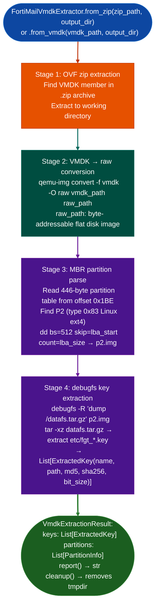

# FortiMail VM Key Extraction

Extract PKI private key material `fgt_512.key`, `fgt_2048.key` from FortiMail VM firmware distributed as VMware OVF/VMDK packages: using a root-free pipeline of OVF zip extraction, VMDK-to-raw conversion via `qemu-img`, MBR partition table parsing, and `debugfs` ext4 access to recover keys from `datafs.tar.gz` on the P2 partition.

---

## Why this exists

1. **FortiMail VM firmware packages are distributed as OVF zip archives containing a VMDK virtual disk.** The PKI keys `fgt_512.key`, `fgt_2048.key` are stored inside `datafs.tar.gz` on the P2 ext4 partition of the virtual disk: a layout completely different from hardware FortiGate firmware NAND XOR images. `FortiOSHardwareExtractor` handles NAND flash images; `FortiMailVmdkExtractor` handles the VMDK virtual format.

2. **Root-free ext4 access eliminates the loop mount requirement.** Traditional access to an ext4 filesystem inside a VM disk requires `losetup` and `mount`, both needing root privileges. `FortiMailVmdkExtractor` uses `dd` to extract the P2 partition as a flat image and then runs `debugfs` on that image to dump `datafs.tar.gz` without any root access or loop device.

3. **`VmdkExtractionResult.keys` returns typed `ExtractedKey` objects with RSA key size**: the RSA key size (`bit_size`) distinguishes `fgt_512.key` 512-bit, legacy from `fgt_2048.key` 2048-bit. The 512-bit key, if present, represents a weak RSA key vulnerability in itself. Both keys' SHA-256 hashes are provided for cross-version comparison.

---

## How it works



---

## Usage

```python
from ablation.analyzers.fortimail_vmdk_extractor import FortiMailVmdkExtractor

# From OVF zip package (most common distribution format)
result = FortiMailVmdkExtractor.from_zip(
    '/media/cowboy/research/Fortinet/FortiMail/FMG_VM64-v7.4.2.F.ovf.zip',
    output_dir='/tmp/fortimail_extracted'
)

print(result.report())

for key in result.keys:
    print(f"  {key.name}  {key.bit_size}-bit  sha256={key.sha256[:16]}...")
    if key.bit_size <= 512:
        print(f"    !! WEAK KEY: {key.bit_size}-bit RSA !!")

# From VMDK directly (if already extracted)
result2 = FortiMailVmdkExtractor.from_vmdk(
    '/tmp/FortiMail.vmdk',
    output_dir='/tmp/fortimail_extracted'
)

# Clean up temp files when done
result.cleanup()
```

---

## Example output

The following illustrates the key extraction output format. Actual key details are image-specific.

```
FortiMailVmdkExtractor — FMG_VM64-v7.4.2.F.ovf.zip

Partitions found: <N>
  P1: type=0x0c  lba=<start>  size=<count>  (FAT32 boot)
  P2: type=0x83  lba=<start>  size=<count>  (Linux ext4 — target)

Keys extracted: 2
  etc/fgt_512.key    512-bit RSA   sha256=<hash>   !! WEAK KEY !!
  etc/fgt_2048.key  2048-bit RSA   sha256=<hash>
```

---

## False positives

**`qemu-img` must be installed**: `FortiMailVmdkExtractor` calls `qemu-img convert` as a subprocess. If `qemu-img` is not available, stage 2 fails with an error in `VmdkExtractionResult`. Check `result.error` before processing `result.keys`.

**`debugfs` key extraction uses a path of `etc/fgt_*.key`**: FortiMail firmware versions that store keys under a different path for example `/etc/ssl/` for newer builds will produce an empty `result.keys`. Inspect `datafs.tar.gz` directly via `tar -tzf` if `result.keys` is empty.

---

## Pipeline position

Run `FortiMailVmdkExtractor` as part of FortiMail VM firmware analysis before any binary analysis. Feed extracted key SHA-256 hashes to `FortiBuildTrackClassifier.classify()` to verify expected key counts match the firmware build track. Store recovered keys in `~/VDT/intel/voice-ai/voices/<ip>/` only if voice files are involved: otherwise record in the target RE module.

---

## Reading output

`FortiMailVmdkExtractor.extract()` returns an `ExtractionResult` object:

| Attribute | Content |
|:---|:---|
| `fw_path` | Path of the input firmware/VMDK file |
| `outer_key` | `Optional[bytes]`: recovered outer XOR key |
| `outer_key_confidence` | Float 0.0–1.0: confidence of the outer key recovery |
| `pkcs1_candidates` | `List[bytes]`: PKCS#1-formatted key block candidates |
| `partitions` | `List[PartitionResult]`: extracted partition results |
| `datafs_path` | `Optional[str]`: path to the extracted `datafs` archive on disk |
| `workdir` | `Optional[str]`: temp working directory (call `.cleanup()` when done) |
| `error` | `Optional[str]`: error message if extraction failed partially |

---

## See also

- [Fortinet Build Track Classification](fortinet-build-track-classification.md): predicts expected key counts from firmware filename
- [Firmware Extraction](firmware-extraction.md): FortiOS hardware firmware extraction NAND XOR, not VMDK
- [Firmware Signature and Secret Triage](firmware-signature-and-secret-triage.md): broad key/credential scanning after extraction
