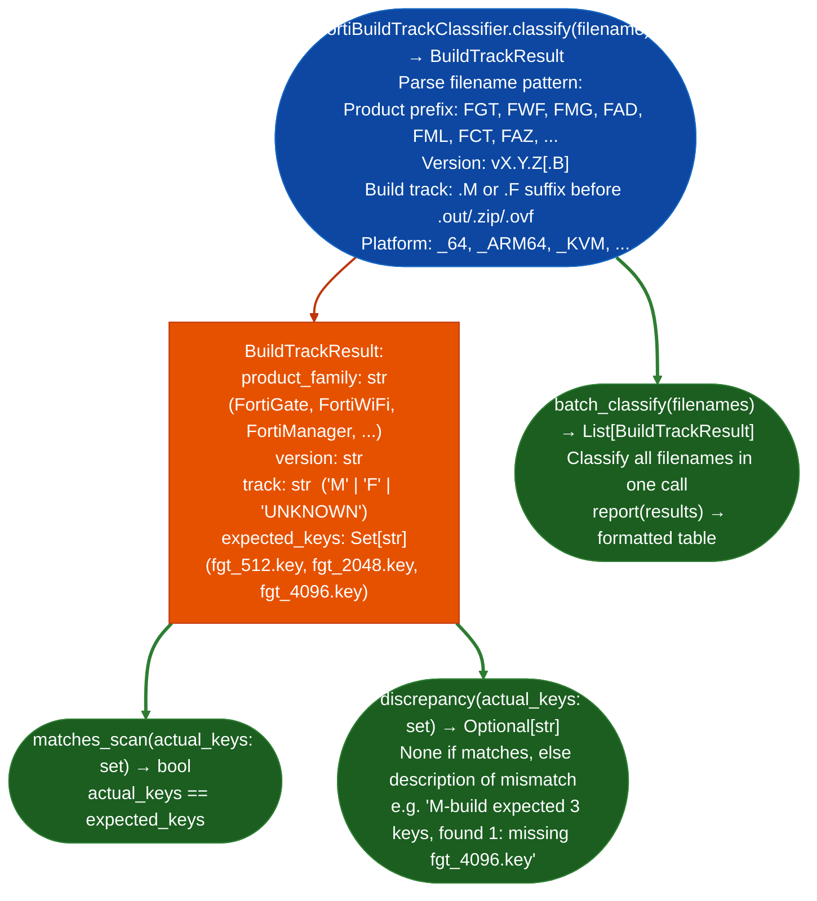

# Fortinet Build Track Classification

Parse Fortinet firmware filenames to determine build track M for Managed/maintenance, F for Feature, expected PKI certificate key set, product family, and firmware version: without any disk I/O: enabling batch scan anomaly detection when actual extracted key counts differ from expected counts.

---

## Why this exists

1. **The M/F build track distinction appears in the Fortinet firmware filename and deterministically predicts the key set shipped with that firmware.** Before `FortiBuildTrackClassifier`, there was no programmatic way to predict whether a firmware image ships one or three cert keys without running a full VMDK conversion and `debugfs` extraction. The classifier validates this prediction against every virtual format in the corpus VMware OVF, Hyper-V VHD/VHDX, KVM QCOW2, ARM64 KVM.

2. **Batch anomaly detection catches builds where the actual key count differs from the expected count.** An M-build that unexpectedly ships only one key, or an F-build with three keys, would be silent evidence of a firmware supply-chain anomaly or key removal event. `BuildTrackResult.discrepancyactual_keys` surfaces these mismatches without manual inspection of each image.

3. **`FortiBuildTrackClassifier.classify()` takes only a filename string, no disk access, no ELF parsing, no extraction.** This makes it usable as the first step in any Fortinet firmware batch processing pipeline: classify all filenames in a directory, identify expected key sets, then run extraction only on images where key count verification is needed.

---

## How it works



---

## Usage

```python
from ablation.analyzers.fortibuild_track_classifier import FortiBuildTrackClassifier

# Single filename classification
result = FortiBuildTrackClassifier.classify('FGT_VM64-v7.2.4.F.ovf.zip')
print(f"Product: {result.product_family}")
print(f"Version: {result.version}")
print(f"Track: {result.track}")
print(f"Expected keys: {result.expected_keys}")

# Anomaly detection against extracted keys
actual = {'fgt_512.key', 'fgt_2048.key'}
discrepancy = result.discrepancy(actual)
if discrepancy:
    print(f"!! ANOMALY: {discrepancy}")
else:
    print("Key count matches expected")

# Batch classification for a firmware directory
import os
filenames = os.listdir('/media/cowboy/research/Fortinet/')
results = FortiBuildTrackClassifier.batch_classify(filenames)
print(FortiBuildTrackClassifier.report(results))
```

---

## Example output

The following illustrates the batch classification output format. Actual filenames are corpus-specific.

```
FortiBuildTrackClassifier: batch results

Filename                           Product      Version   Track  Expected keys
FGT_VM64-v7.2.4.F.ovf.zip         FortiGate    7.2.4     F      {fgt_512.key, fgt_2048.key, fgt_4096.key}
FML_VM64-v7.4.2.M.ovf.zip         FortiMail    7.4.2     M      {fgt_512.key, fgt_2048.key}
FWF_60F-v6.4.12.M.out             FortiWiFi    6.4.12    M      {fgt_512.key, fgt_2048.key}

Anomalies found: 0
```

---

## False positives

**Filename patterns that deviate from Fortinet naming conventions**: custom or renamed firmware files may produce `track='UNKNOWN'`. Check `result.track` before relying on `expected_keys`. A result with `track='UNKNOWN'` should be manually inspected; `matches_scan()` returns `False` when `expected_keys` is empty.

**Track letter M/F may be absent from older firmware**: firmware from pre-v6.0 may use a different naming scheme without explicit track designation. These produce `track='UNKNOWN'`.

---

## Pipeline position

Run `FortiBuildTrackClassifier.classify()` on the firmware filename as the first step in any Fortinet firmware extraction pipeline: before `FortiMailVmdkExtractor` or `FortiOSHardwareExtractor` runs. Use `BuildTrackResult.expected_keys` to set expectations for `VmdkExtractionResult.keys` comparison. Surface `discrepancy()` results as anomaly findings before proceeding to binary analysis.

---

## Reading output

`FortiBuildTrackClassifier.classifyfilename` returns a `BuildTrackResult` object:

| Attribute | Content |
|:---|:---|
| `filename` | Input filename basename |
| `product` | Product name string for example `'FGT_VM64'`, `'FOS_VM64_KVM'` |
| `version` | Version string for example `'7.4.12'` |
| `build_number` | Build number integer for example `2902` |
| `build_track` | Track identifier: `'M'` (main) or `'F'` (feature) |
| `expected_keys` | `List[str]`: filenames of encryption keys expected in this build |
| `key_generation` | Key generation identifier for example `'Gen1'`, `'Gen2'` |
| `error` | `Optional[str]`: error message if classification failed |

`FortiBuildTrackClassifier.batch_classifyfilenames` returns `List[BuildTrackResult]`.

---

## See also

- [FortiMail VM Key Extraction](fortimail-vm-key-extraction.md): extracts keys that this classifier predicts
- [Firmware Extraction](firmware-extraction.md): hardware firmware extraction pipeline
- [Firmware Signature and Secret Triage](firmware-signature-and-secret-triage.md): broad credential scanning after extraction
