# Cross-Version Function Tracking

Track a specific function across binary versions using a three-stage homolog matching pipeline: structural pre-filter, mnemonic 4-gram Jaccard similarity, and semantic tiebreaker: then localize exactly which instructions changed using `difflib.SequenceMatcher` on normalized instruction lines.

---

## Why this exists

1. **After identifying a vulnerable function in one firmware version, the analyst needs to confirm it is patched in a later version, and verify the patch actually addresses the root cause.** `version_delta.py` tracks a seed function VA across versions by finding its homolog in the target binary using three progressively more expensive stages, then diffs the instruction sequences to show exactly what changed. This was the primary tool for confirming CVE-2022-0778 / RADIUS overflow remediation.

2. **Stripped firmware has no symbol names: homolog matching cannot rely on function names.** Stage 1 structural pre-filter: basic block count ±2, edge count ±30% eliminates candidates quickly. Stage 2 mnemonic 4-gram Jaccard similarity on the top-10 structural matches identifies the best match by instruction sequence. Stage 3 (SemanticSearcher tiebreaker when top-2 candidates are within 0.05 Jaccard) uses semantic embeddings to break ties that mnemonic similarity cannot distinguish.

3. `HomologMatch.callee_changed` identifies when a patch introduced a new safety callee: for example, a stack overflow patch that adds a call to `check_buffer_size()` before the dangerous `strcpy()`. This is a higher-confidence signal of a real patch than instruction-sequence changes alone, because adding a callee is a structural change that cannot be coincidental.

---

## How it works

```mermaid
flowchart TD
    A(["version_delta: seed_binary + seed_va → target_binary"]):::input --> B["BinaryClassification.from_path(target)\n  ELF32/ELF64, arch detection"]:::primary
    B:::primary --> C["FuncFeatures.from_disasm_lines(disasm) for each target function\n  Stage 1: structural pre-filter\n    block_count ±2, edge_count ±30% of seed function"]:::secondary
    C:::secondary --> D["Stage 2: mnemonic 4-gram Jaccard\n  Keep top-10 structural candidates\n  Rank by Jaccard(seed.ngrams, candidate.ngrams)"]:::tertiary
    D:::tertiary --> E{"top-2 within 0.05?"}:::neutral
    E:::neutral -->|"Yes"| F["Stage 3: SemanticSearcher tiebreaker\n  semantic_score breaks the tie"]:::tertiary
    E:::neutral -->|"No"| G["Accept top-1 candidate"]:::tertiary
    F:::tertiary --> G:::tertiary
    G:::tertiary --> H["compute_patch_delta(features_a, features_b) → PatchDelta\n  difflib.SequenceMatcher on normalized instruction lines\n  added, removed, context, ratio"]:::tertiary
    H:::tertiary --> I["HomologMatch:\n  va, name, jaccard, semantic_score\n  confidence: HIGH/MEDIUM/LOW\n  delta: PatchDelta\n  new_callees: List[str]\n  removed_callees: List[str]\n  callee_changed: bool"]:::tertiary
    I:::tertiary --> J(["DeltaReport:\n  era_confirmed → Optional[int]\n  summary() → str\n  match.delta.unified_diff()"]):::output
    classDef input     fill:#0d47a1,stroke:#1565c0,color:#fff
    classDef primary   fill:#e65100,stroke:#bf360c,color:#fff
    classDef secondary fill:#004d40,stroke:#00695c,color:#fff
    classDef tertiary  fill:#4a148c,stroke:#6a1b9a,color:#fff
    classDef neutral   fill:#37474f,stroke:#546e7a,color:#fff
    classDef output    fill:#1b5e20,stroke:#2e7d32,color:#fff
    linkStyle 0 stroke:#bf360c,stroke-width:2px
    linkStyle 1 stroke:#00695c,stroke-width:2px
    linkStyle 2 stroke:#6a1b9a,stroke-width:2px
    linkStyle 3 stroke:#546e7a,stroke-width:2px
    linkStyle 4 stroke:#6a1b9a,stroke-width:2px
    linkStyle 5 stroke:#6a1b9a,stroke-width:2px
    linkStyle 6 stroke:#6a1b9a,stroke-width:2px
    linkStyle 7 stroke:#6a1b9a,stroke-width:2px
    linkStyle 8 stroke:#6a1b9a,stroke-width:2px
    linkStyle 9 stroke:#2e7d32,stroke-width:3px
```



---

## Usage

```python
from ablation.analyzers.version_delta import (
    BinaryClassification, FuncFeatures, compute_patch_delta, DeltaReport
)
from ablation.analyzers.binary_context import BinaryContext
from ablation.analyzers.dtw_matcher import DTWMatcher

# Track function across versions
ctx_old = BinaryContext.load_or_build('/path/to/daemon_v6.2.bin')
ctx_new = BinaryContext.load_or_build('/path/to/daemon_v7.4.bin')

dtw = DTWMatcher.from_context(ctx_old)
seed_va = 0x12340  # known vulnerable function in old version

# Find homolog in new version via DTW first (fast)
matches = dtw.score_functions([seed_va], ctx_new)
best = max(matches, key=lambda m: m.score)

print(f"Homolog: {best.va:#x}  score={best.score:.2f}  confidence={best.confidence}")

# Then compute instruction-level patch delta
feat_old = FuncFeatures.from_disasm_lines(ctx_old.disasm_lines(seed_va))
feat_new = FuncFeatures.from_disasm_lines(ctx_new.disasm_lines(best.va))
delta = compute_patch_delta(feat_old, feat_new)

print(f"Patched: {delta.is_patched}  similarity: {delta.ratio:.3f}")
print(delta.unified_diff('v6.2', 'v7.4'))
```

---

## Example output

The following illustrates the patch delta output format. Actual instruction sequences are binary-specific.

```
HomologMatch:
  va=<va>  jaccard=0.89  semantic_score=0.91  confidence=HIGH
  callee_changed: True
  new_callees: ['check_buf_len']
  removed_callees: []

PatchDelta: ratio=0.94  (patched)
--- v6.2
+++ v7.4
-  mov    eax, [rbp-0x10]
-  call   strcpy
+  call   check_buf_len
+  test   eax, eax
+  jz     <error_exit>
+  call   strncpy
```

---

## False positives

**Jaccard similarity of 0.05 at stage-2 tiebreaker boundary**: when two candidates have nearly identical mnemonic 4-gram Jaccard scores, the semantic tiebreaker is used. If the semantic model has low confidence for both for example a small utility function, `HomologMatch.confidence` is `LOW`. Treat `LOW` confidence matches as requiring manual verification.

**`compute_patch_delta()` uses normalized instruction lines**: normalization strips immediate values and addresses to make sequence comparison register-independent. A function where only an immediate constant changed for example buffer size will show `delta.ratio` close to 1.0 but `delta.is_patched = True` with the changed constant visible in `unified_diff()`.

---

## Pipeline position

Run `version_delta` after `DTWMatcher` identifies a candidate homolog to verify patch confirmation. Use `DeltaReport.era_confirmed` for anchor-based era confirmation, and `HomologMatch.callee_changed` as the primary patch signal. Reference this module in `MatrixProfileDiff.is_likely_patched()` workflow for full patch analysis.

---

## Reading output

`VersionDelta` takes two `BinaryContext` objects and `seed_va` as constructor arguments. Run `.run()` to build the `DeltaReport`:

`DeltaReport` fields:

| Attribute | Content |
|:---|:---|
| `seed_binary` | Path of the seed known-version binary |
| `seed_va` | VA of the seed function in the seed binary |
| `seed_name` | Name of the seed function |
| `target_binary` | Path of the target binary |
| `target_version` | Version string extracted from the target binary |
| `match` | `Optional[HomologMatch]`: best homolog found in the target, or `None` |
| `anchor_results` | `List[AnchorScanResult]`: masked byte-pattern anchor results each with `anchor_name`, `era`, `hit_offset`, and `description`; `found` property returns `True` when `hit_offset >= 0` |
| `era_confirmed` | Property: `Optional[int]`: inferred version era if confirmed, else `None` |

The `match` attribute is a `HomologMatch` with these fields:

| Attribute | Content |
|:---|:---|
| `va` | VA of the homolog in the target binary |
| `name` | Name of the matched function |
| `jaccard` | Jaccard similarity of mnemonic sets |
| `semantic_score` | Semantic similarity score (0.0–1.0) |
| `confidence` | `'HIGH'` / `'MEDIUM'` / `'LOW'` |
| `delta` | `PatchDelta`: instruction-level diff |
| `new_callees` | Callee names added in the target vs. seed |
| `removed_callees` | Callee names removed in the target vs. seed |
| `callee_changed` | Property: `True` if either `new_callees` or `removed_callees` is non-empty |

---

## See also

- [DTW Function Homolog Matching](dtw-function-homolog-matching.md): Stage 2 DTW matching that feeds into version delta
- [Matrix Profile Patch Diff](matrix-profile-patch-diff.md): complementary patch localization approach
- [Generic Vulnerability Profile Sweeps](generic-vulnerability-profile-sweeps.md): SemanticSearcher used in stage 3 tiebreaker
