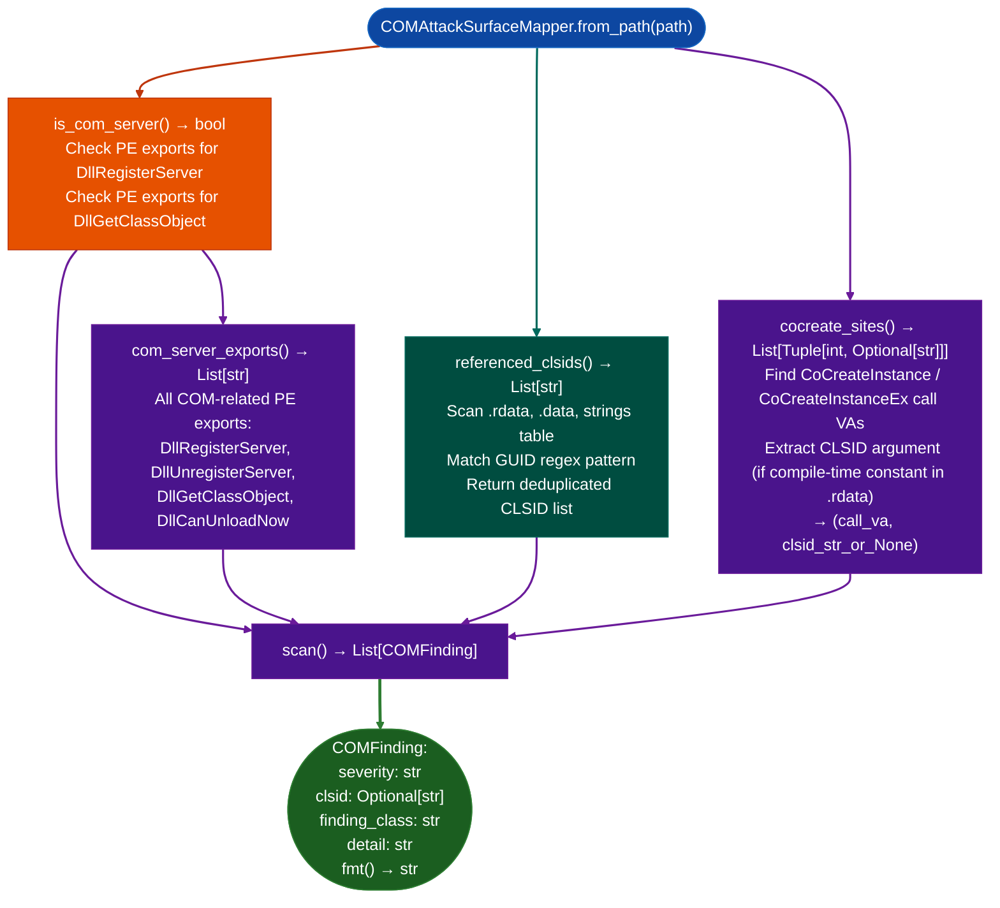

# COM Attack Surface Mapping

Enumerate the COM attack surface of a Windows PE binary: detecting self-registering COM servers (via `DllRegisterServer`/`DllGetClassObject` exports), all CLSIDs referenced in the binary's string table and `.rdata`, and `CoCreateInstance`/`CoCreateInstanceEx` call sites: providing a complete map of what COM objects a binary exposes and activates.

---

## Why this exists

1. **COM is the dominant inter-process and privilege-boundary crossing mechanism on Windows.** Security tools, browsers, AV products, and OS services expose COM interfaces. Any binary that exports `DllRegisterServer` is a self-registering COM server: any user who can execute it gains a CLSID registration, which becomes a `CoCreateInstance` activation target for other processes at their privilege level.

2. **`COMAttackSurfaceMapper.referenced_clsids()` finds all CLSIDs in the binary**, not just registered ones. CLSIDs appear as strings (formatted as `{XXXXXXXX-XXXX-XXXX-XXXX-XXXXXXXXXXXX}`) in `.rdata`, PE string tables, and embedded XML manifests. A CLSID in `.rdata` that is not registered by `DllRegisterServer` may indicate a hardcoded activation target for `CoCreateInstance`: a privileged object the binary can create without user interaction.

3. **`COMAttackSurfaceMapper.cocreate_sites()` returns every `CoCreateInstance`/`CoCreateInstanceEx` call site**: with the CLSID argument if it is a compile-time constant. This enables CLSID-to-activation-target tracing: given a CLSID and the binary that creates it, find the registered COM server for that CLSID and its privilege level, completing the privilege escalation chain.

---

## How it works



---

## Usage

```python
from ablation.analyzers.com_attack_surface_mapper import COMAttackSurfaceMapper

mapper = COMAttackSurfaceMapper.from_path('/path/to/FortiClientApp.dll')

if mapper.is_com_server():
    print(f"COM server exports: {mapper.com_server_exports()}")

clsids = mapper.referenced_clsids()
print(f"Referenced CLSIDs: {len(clsids)}")
for clsid in clsids:
    print(f"  {clsid}")

for va, clsid in mapper.cocreate_sites():
    print(f"  CoCreateInstance at {va:#x}  CLSID={clsid or 'dynamic'}")

findings = mapper.scan()
print(COMAttackSurfaceMapper.report(findings))
```

---

## Example output

The following illustrates COM attack surface mapping output format. Actual CLSIDs and addresses are binary-specific.

```
COMAttackSurfaceMapper: FortiClientApp.dll

is_com_server(): True
com_server_exports(): ['DllRegisterServer', 'DllGetClassObject', 'DllCanUnloadNow']

referenced_clsids(): <N>
  {XXXXXXXX-XXXX-XXXX-XXXX-XXXXXXXXXXXX}
  {YYYYYYYY-YYYY-YYYY-YYYY-YYYYYYYYYYYY}

cocreate_sites(): <C> sites
  <va>  CLSID={XXXXXXXX-...}
  <va>  CLSID=dynamic

scan() findings:
  [HIGH] com_server_self_register  DllRegisterServer exported
  [MEDIUM] cocreate_dynamic  CoCreateInstance with dynamic CLSID at <va>
```

---

## False positives

**`referenced_clsids()` finds GUID-format strings that are not Windows CLSIDs**: interface IDs (IIDs), category IDs (CATID), and device GUIDs share the same `{8-4-4-4-12}` format. A GUID in a network protocol context is not a COM CLSID. Verify that the GUID appears in a COM registration context alongside `ProgID`, `InprocServer32` before treating it as an activation surface.

**`cocreate_sites()` returns `None` as the CLSID for indirect activations**: a `CoCreateInstance` where the CLSID is loaded from a configuration file, registry key, or computed at runtime cannot be resolved statically. These sites are reported as `CLSID=dynamic` and require dynamic analysis or registry tracing to determine the actual activation target.

---

## Pipeline position

Run `COMAttackSurfaceMapper` on any Windows PE binary DLL or EXE during initial attack surface triage. Pair with `RPCServerAnalyzer` for WinAPI-level IPC analysis and `ETWProviderExtractor` for detection-gap assessment on the same binary.

---

## Reading output

`COMAttackSurfaceMapper` returns structured results:

| Method / Attribute | Content |
|:---|:---|
| `is_com_server()` | `True` if the binary exports `DllGetClassObject` or `DllRegisterServer` |
| `com_server_exports()` | `List[str]`: exported COM registration entry points |
| `referenced_clsids()` | `List[str]`: CLSID GUIDs found in binary strings or data sections |
| `cocreate_sites()` | `List[{va: int, clsid: str}]`: `CoCreateInstance` call sites and their CLSID arguments |

---

## See also

- [RPC Server Analysis](rpc-server-analysis.md): `RPCServerAnalyzer` for Windows RPC interface UUID enumeration
- [ETW Provider Extraction](etw-provider-extraction.md): `ETWProviderExtractor` for detection coverage assessment
- [BYOVD Capability Detection](byovd-capability-detection.md): `ByovdDetector` for kernel attack surface in Windows drivers
