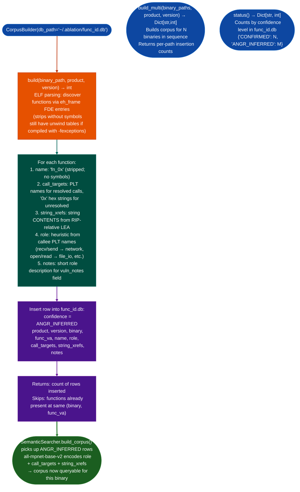

# Function Corpus Builder

Populate `func_id.db` with `ANGR_INFERRED` function records for binaries with no prior RE coverage: enabling `SemanticSearcher.build_corpus()` to index new firmware libraries and include them in semantic queries without requiring manual RE work on each function.

---

## Why this exists

1. **`SemanticSearcher` requires a populated `func_id.db` corpus to perform semantic search: a binary with zero corpus entries returns no results regardless of how many functions it contains.** For freshly-encountered firmware shared libraries such as a new version of a vendor's `libcrypto_hw.so` with no prior RE coverage, `CorpusBuilder.build()` generates the initial corpus entries automatically by heuristically inferring role and call targets from the binary's PLT and string cross-references.

2. **`ANGR_INFERRED` is a distinct confidence level from `CONFIRMED`, it signals that the function record was machine-generated and has not been validated by a human analyst.** `SemanticSearcher.build_corpus()` accepts `confidence_filter=['CONFIRMED', 'ANGR_INFERRED']` to include inferred records, while sensitive operations for example formal disclosure query `CONFIRMED` only. This separation prevents polluting the confirmed corpus with noisy inferred data while still making the inferred corpus useful for initial triage.

3. **For each function discovered via `eh_frame` FDE entries, `CorpusBuilder` extracts three features that `SemanticSearcher` can match against: PLT callee names call targets, RIP-relative string literal cross-references string xrefs, and a heuristic role description.** These three features encode most of what an analyst would manually write in a `CONFIRMED` record, at roughly 100x the speed. `SigLibrary.auto_name()` renames `ANGR_INFERRED` records when a semantic match above a confidence threshold is found.

---

## How it works



---

## Usage

```python
from ablation.analyzers.corpus_builder import CorpusBuilder

cb = CorpusBuilder('~/.ablation/func_id.db')

# Build corpus for a single newly-encountered library
count = cb.build(
    '/path/to/firmware.so',
    product='my-target',
    version='1.0'
)
print(f"Inserted {count} ANGR_INFERRED records")

# Build corpus for all shared libraries extracted from a firmware image
binary_paths = ['/tmp/fw/lib/libssl.so', '/tmp/fw/lib/libcrypto.so']
counts = cb.build_multi(binary_paths, product='target-fw', version='7.4.1')
for path, n in counts.items():
    print(f"  {path}: {n} records")

# Check corpus state
status = cb.status()
print(f"Confirmed: {status['CONFIRMED']}  Inferred: {status['ANGR_INFERRED']}")
```

---

## Example output

The following illustrates the build output format. Actual counts are binary-specific.

```
CorpusBuilder: /path/to/firmware.so
  Functions found (via eh_frame): <N>
  Inserted: <M> ANGR_INFERRED records
  Skipped (already present): <K>

status():
  CONFIRMED: <N>
  ANGR_INFERRED: <M>
```

---

## False positives

**`eh_frame` FDE discovery misses functions in binaries compiled with `-fno-exceptions` and without `.eh_frame` section.** For these binaries, combine `CorpusBuilder` with `ARM32FunctionScanner` prologue scan or `GoStringResolver.scan_function()` Go binaries to supplement function discovery before building the corpus.

**`ANGR_INFERRED` role assignments are heuristic: a function that calls `recv()` then `strncpy()` will be labeled `network` when it might be a dispatcher that calls both.** Review inferred roles for high-priority functions before promoting their records to `CONFIRMED`.

---

## Pipeline position

Run `CorpusBuilder.build()` immediately after the first `BinaryContext.load_or_build()` on a previously-unseen binary: before `SemanticSearcher.query()`, since querying against an empty corpus returns nothing. See the RE workflow in `CLAUDE.md`: step 3 ("CorpusBuilder.build() if no prior coverage") precedes step 4 ("SemanticSearcher.query()").

---

## Reading output

`CorpusBuilder.build(binary_path, product='', version='', arch='x86-64')` returns `int`: the number of function records inserted into `func_id.db`. The build also persists all semantic embeddings and role labels to the database; the integer count is the only direct return value.

---

## See also

- [Bundled Finding Signature Seeds](bundled-finding-signature-seeds.md): `SigLibrary.auto_name()` promotes `ANGR_INFERRED` → named when semantic match found
- [DTW Function Homolog Matching](dtw-function-homolog-matching.md): uses corpus to find cross-version homologs
- [SAX Approximate Indexing](sax-approximate-indexing.md): complementary pre-filter index
