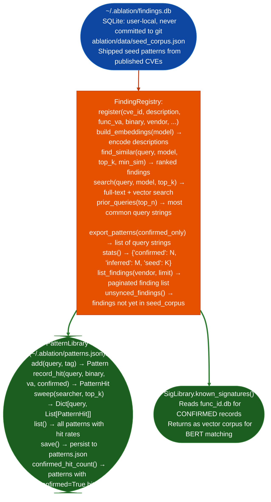

<a id="function-identity-database"></a>
# Function Identification & Naming

Persistent SQLite store of confirmed and inferred function records, prior RE findings, and semantic embeddings: the central shared state for `SemanticSearcher`, `CorpusBuilder`, `SigLibrary`, `RAGRetriever`, and `FindingRegistry` across all targets and engagements.

---

## Why this exists <sup>[↑](#function-identity-database)</sup>

1. **RE work accumulates knowledge across engagements: a confirmed finding in one firmware image is evidence for the same function in all future images from the same vendor.** `func_id.db` persists function records `name`, `role`, `call_targets`, `string_xrefs`, `confidence` and finding records across sessions. Without a persistent store, each new binary starts from zero and the analyst re-discovers the same function patterns.

2. **`FindingRegistry` stores every confirmed vulnerability with its embedding vector: `FindingRegistry.find_similar()` retrieves prior findings with semantic similarity to a new candidate, grounding LLM hypotheses and PatternLibrary queries in confirmed evidence rather than pattern speculation.** The seed corpus (`ablation/data/seed_corpus.json`) ships with embedding-ready records from published CVEs, giving the database useful signal before any engagement-specific findings are added.

3. `PatternLibrary` accumulates successful semantic search queries with hit rates per binary: `pl.sweepsearcher` auto-replays all confirmed patterns on new binaries in step 5 of the RE workflow, ensuring that patterns that found real vulnerabilities in past engagements are always tried on new targets.

---

## How it works <sup>[↑](#function-identity-database)</sup>



---

## Usage <sup>[↑](#function-identity-database)</sup>

```python
from ablation.analyzers.finding_registry import FindingRegistry
from ablation.analyzers.pattern_library import PatternLibrary
from ablation.analyzers.sig_library import SigLibrary

# ── FindingRegistry ──────────────────────────────────────────────────────────
reg = FindingRegistry()
print(reg.stats())

# Register a confirmed finding after validation
reg.register(
    cve_id='VULN-TARGET-001',
    description='command injection in HTTP handler via user-controlled path parameter',
    func_va=0x12340,
    binary='httpd',
    vendor='acme',
    severity='HIGH',
    cwe='CWE-78'
)

# Build embeddings (required before semantic search)
from sentence_transformers import SentenceTransformer
model = SentenceTransformer('all-mpnet-base-v2')
reg.build_embeddings(model)

# Find similar prior findings
similar = reg.find_similar('command injection in configuration handler', model, top_k=5)
for s in similar:
    print(f"  {s['cve_id']}  sim={s['similarity']:.2f}  {s['description'][:60]}")

# ── PatternLibrary ───────────────────────────────────────────────────────────
pl = PatternLibrary()
pl.list()

# Replay confirmed patterns on a new binary
from ablation.analyzers.sax_index import SAXIndex
# (assume searcher is a SemanticSearcher instance)
results = pl.sweep(searcher, top_k=5)
for pattern, hits in results.items():
    if hits:
        print(f"  '{pattern}': {len(hits)} hits")
        pl.record_hit(pattern, binary='new_target.elf', va=hits[0].func_va, confirmed=False)
pl.save()
```

---

## Example output <sup>[↑](#function-identity-database)</sup>

The following illustrates the database stats and finding output format.

```
FindingRegistry.stats():
  confirmed: <N>
  inferred: <M>
  seed: <K>  (from seed_corpus.json)

find_similar('command injection in parser'):
  VULN-TARGET-001  sim=0.91  'command injection in HTTP handler via user-...'
  CVE-20XX-XXXXX   sim=0.84  'shell metacharacter injection via filename ...'
```

---

## False positives <sup>[↑](#function-identity-database)</sup>

**`find_similar()` returns findings with similarity ≥ `min_sim` default 0.60**: a similarity of 0.65 means "semantically related" not "the same vulnerability." Use similarity scores for prioritization and hypothesis seeding only. Confirm findings independently.

**`PatternLibrary.sweep()` returns hits based on semantic similarity to stored query strings**: a high-hit-rate pattern like "unsafe string copy from network input" will match many functions that copy strings from network input, most of which are correct implementations. Filter by `confirmed=True` hits to get patterns with the best precision.

---

## Pipeline position <sup>[↑](#function-identity-database)</sup>

`func_id.db` is the central persistence layer used by `CorpusBuilder` (write), `SemanticSearcher` read/write, `RAGRetriever` (read), `SigLibrary` (read), `FindingRegistry` read/write, and `PatternLibrary` read/write. It is always local (`~/.ablation/`), never committed to the ablation repo. Back up with `cp ~/.ablation/findings.db ~/findings_backup_$date +%Y%m%d.db` before major schema migrations.

---

## Reading output <sup>[↑](#function-identity-database)</sup>

`FindingRegistry.stats()` returns `{confirmed: int, inferred: int, seed: int}`.

`FindingRegistry.find_similar(query)` returns a list of `FindingRecord` objects ranked by similarity:

| Attribute | Content |
|:---|:---|
| `id` | Finding identifier for example `VULN-TARGET-001`, CVE number |
| `similarity` | Float 0.0–1.0: embedding cosine similarity to the query |
| `title` | Brief finding title |
| `detail` | Full finding description |
| `source` | `confirmed`, `inferred`, or `seed` |

---

## See also <sup>[↑](#function-identity-database)</sup>

- [Function Corpus Builder](function-corpus-builder.md): populates `func_id.db` with `ANGR_INFERRED` records
- [Bundled Finding Signature Seeds](bundled-finding-signature-seeds.md): `SigLibrary` reads `func_id.db` for BERT matching
- [Prior Finding Retrieval](prior-finding-retrieval.md): `RAGRetriever` SQLite-query retrieval strategy
