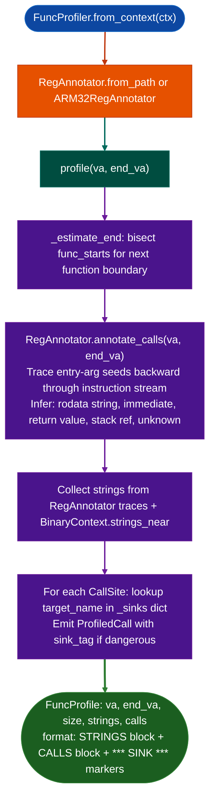

# Function Profiler

Generate a complete behavioral profile of a single function in one call: the strings it references, every call site with argument values inferred by register tracing, and flags on any call that reaches a dangerous sink: replacing the four-call manual sequence of callees, dump, annotate, and string lookup.

---

## Why this exists

1. **Candidate analysis is the most time-consuming step in a firmware RE session.** After semantic search or heap scanning surfaces a candidate function, the analyst must answer: what does this function call, with what arguments, and does it pass user-controlled data to a dangerous sink? Doing this manually requires four separate tool invocations: `callees_of()`, disassemble-and-dump, register annotation, string cross-reference. `FuncProfiler.profile()` collapses all four into one call, producing a formatted block that includes everything needed for a triage decision.

2. **Argument values at call sites change everything.** Seeing `malloc` in a callee list tells you the function allocates memory. Seeing `malloc(rdi=strlen(arg0)+1)`: the argument traced to `strlen` of the first entry argument plus one: tells you whether there is an off-by-one risk. `RegAnnotator` traces register values backwards through the instruction stream so each argument displayed shows its specific computed value, not just a register name like `rdi` or `rbx`.

3. **Sink detection at function scope eliminates false-triage overhead.** Not all calls to `strcpy` are dangerous; many are safe uses with known buffer sizes. The profiler classifies each call site as a sink or not, based on a configurable sink dict buffer-overflow, cmd-exec, tcl-inject, fmt-string, filesystem, and marks `*** SINK ***` only where a dangerous function is called. Vendor-specific sinks Fortinet's `fadcsystem` and Cisco's `exec_handler` can be added without modifying the module.

---

## How it works



### Default sink categories

| Category | Functions |
|---|---|
| `buffer-overflow` | `strcpy`, `strcat`, `stpcpy`, `wcscpy`, `sprintf`, `vsprintf`, `gets` |
| `cmd-exec` | `system`, `popen`, `execv`, `execve`, `execvp`, `execl`, `execlp`, `execvpe` |
| `tcl-inject` | `Tcl_Eval`, `Tcl_EvalEx`, `Tcl_EvalObjEx`, `Tcl_GlobalEval`, `Tcl_GlobalEvalObj` |
| `fmt-string` | `printf`, `fprintf`, `syslog` |
| `filesystem` | `unlink`, `rename`, `fopen`, `open` |

Add custom sinks by passing `custom_sinks={'sink_name': 'category'}` at construction or via `add_sink()`.

### Argument value kinds

Each argument displayed in the profile carries a value kind from `RegAnnotator`:

| Kind | Display | Meaning |
|---|---|---|
| `string` | `'literal text'` | LEA from `.rodata`: known string constant |
| `immediate` | `0x10` | Known integer constant |
| `ret` | `ret(malloc)` | Return value of a prior call |
| `entry_arg` | `arg0_entry` | Entry argument register passed through |
| `stack_ref` | `[rbp-0x20]` | Stack slot reference |
| `unknown` | hidden in non-sink calls | Not resolved within look-back window |

---

## Usage

```python
from ablation.analyzers.func_profiler import FuncProfiler
from ablation.analyzers.binary_context import BinaryContext

ctx = BinaryContext.load_or_build('/fw/fortigate/httpsd')
fp = FuncProfiler.from_context(ctx)

# Profile a single function
profile = fp.profile(va=0x22ccc0)
print(profile.fmt())

# Profile with a known end VA
profile = fp.profile(va=0x22ccc0, end_va=0x22d200)
print(profile.fmt())

# Add vendor-specific sinks
fp_custom = FuncProfiler.from_context(ctx, custom_sinks={
    'fadcsystem': 'cmd-exec',
    'sys_vdom_exec': 'cmd-exec',
    'fadcsystem_envp': 'cmd-exec',
})
profile = fp_custom.profile(va=0x22ccc0)

# Quick triage: just get sink calls
sinks = fp.sinks_in_region(0x22ccc0)
for pc in sinks:
    print(pc.fmt())

# Bulk profiling of semantic search results
from ablation.analyzers.semantic_search import SemanticSearcher
searcher = SemanticSearcher.from_context(ctx)
candidates = searcher.query("command injection via user input")
profiles = fp.profile_many([r.va for r in candidates if r.score > 0.8])
for p in profiles:
    if p.sink_calls:
        print(p.fmt())
```

---

## Example output

```
[httpsd] [FUNC 0x22ccc0..0x22d200]  1088B  11 calls  4 strings  2 SINKS

  STRINGS:
    0x4038a0  'recv_handler: error'
    0x4038b8  'SSL_read error: %d'
    0x4038d0  '/bin/sslctl'
    0x4038e8  '--mode'

  CALLS:
    0x22ccf0  malloc(rdi=ret(strlen)+1)
    0x22cd10  memcpy(rdi=[rbp-0x40], rsi=arg0_entry, rdx=ret(strlen))
    0x22cd30  strcmp(rdi=[rbp-0x40], rsi='--mode')
    0x22cd50  printf(rdi='SSL_read error: %d', rsi=arg1_entry)  *** SINK (fmt-string) ***
    0x22cd90  system(rdi='/bin/sslctl', rsi=arg2_entry)  *** SINK (cmd-exec) ***
    0x22ce20  free(rdi=[rbp-0x40])
```

---

## False positives

**Sink calls with hardcoded arguments.** A `system("/bin/ls")` call with a `.rodata` string argument qualifies as a sink but cannot be exploited. The profile marks it `*** SINK cmd-exec ***` regardless. Verify the argument kind: if `rdi='hardcoded/path'` string kind, the call is safe. Only `arg0_entry`, `stack_ref`, or `unknown` as the first argument to a cmd-exec sink represent real risk.

**Unknown argument kind.** When the register annotation cannot trace an argument within its look-back window, it shows `unknown`. This occurs when the argument was computed in a prior function call and stored in a callee-saved register. Treat `unknown` at a sink argument as MEDIUM risk: confirm safety with a manual trace.

**ARM32 profiling.** On ARM32 binaries, `FuncProfiler` automatically uses `ARM32RegAnnotator` instead of the x86-64 `RegAnnotator`. Argument registers follow the ARM32 AAPCS: `r0`–`r3` serve as the first four arguments. The profile output uses ARM register names.

---

## Pipeline position

**Before this module:** `BinaryContext.load_or_build()` and `SemanticSearcher` to identify candidate VAs. `FuncProfiler.from_context()` takes the shared context.

**After this module:** For functions with `sink_calls` and non-`string` argument kinds, proceed to `TaintTracker.trace_function()` to confirm that attacker-controlled data reaches the sink. For confirmed sinks, register the function with `ctx.set_name()` and proceed to `FindingRegistry.register()`.

---

## Reading profiles

| Field | Content |
|:---|:---|
| `va` | Function start VA |
| `end_va` | Function end VA (estimated from `func_starts` if not provided) |
| `size` | Byte size of the function (`end_va - va`) |
| `strings` | `List[Tuple[int, str]]`: all strings referenced in this function |
| `calls` | `List[ProfiledCall]`: all call sites with argument annotations |
| `sink_calls` | Filtered subset of `calls` where `is_sink == True` |

---

## See also

- [Binary Context](binary-context.md): provides `func_starts` and string table
- [Taint Analysis](taint-analysis.md): confirm that sink arguments carry attacker-controlled data
- [Sink Arg Classifier](sink-arg-classifier.md): pre-classify all sink arguments before full profiling
- [Semantic Code Search](semantic-code-search.md): generates candidate VA lists for `profile_many()`
- [Interprocedural Argument Provenance](interprocedural-argument-provenance.md): traces arguments across function call boundaries
