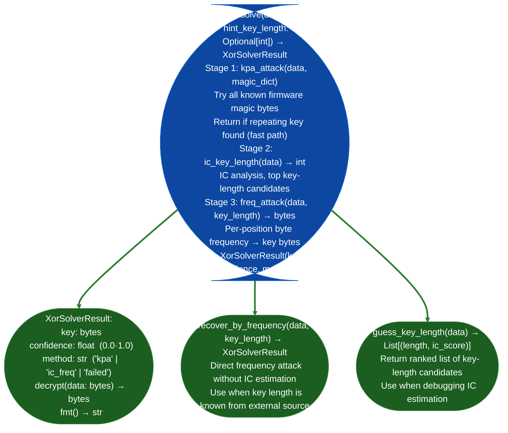

# XOR Key Recovery

Recover repeating multi-byte XOR keys from firmware images using three attack modes: magic-byte known-plaintext attack (KPA), index-of-coincidence (IC) key-length estimation, and frequency-analysis key byte recovery: automating what was previously a manual Vigenère-style attack on each new firmware target.

---

## Why this exists

1. Firmware XOR obfuscation almost always uses a static, repeating multi-byte key: the cipher is weak, but key recovery requires knowing the key length first. `XorSolver.solve()` automates the full attack pipeline: try KPA against firmware magic bytes first fastest, succeeds when ciphertext starts at a known magic value, fall back to IC key-length estimation + frequency analysis when no magic byte match is found.

2. `kpa_attack()` uses a dictionary of known firmware magic bytes: ELF (`\x7fELF`), SquashFS (`sqsh`/`hsqs`), ext4 (`\x53\xef`), U-Boot (`\x27\x05\x19\x56`), gzip (`\x1f\x8b`), and others. XOR the first N bytes of the ciphertext against each magic sequence: `key_candidate = ciphertext[:N] ^ magic`. If `key_candidate` repeats throughout the ciphertext, it is the key. This attack takes milliseconds and succeeds for most FortiOS-family firmware.

3. IC key-length estimation follows the Kasiski/Friedman approach: compute the index of coincidence for different key-length hypotheses and select the key length with the highest IC. This is then combined with per-position frequency analysis byte with highest frequency in each key-position slice maps to the most common plaintext byte. `ic_key_length()` + `freq_attack()` are exposed separately for cases where one stage must be customized.

---

## How it works



---

## Usage

```python
from ablation.analyzers.xor_solver import XorSolver

with open('/path/to/firmware_encrypted.bin', 'rb') as f:
    data = f.read()

solver = XorSolver()
result = solver.solve(data)
print(result.fmt())

if result.method != 'failed' and result.confidence > 0.8:
    decrypted = result.decrypt(data)
    print(f"Key ({len(result.key)} bytes): {result.key.hex()}")
    with open('/tmp/firmware_decrypted.bin', 'wb') as f:
        f.write(decrypted)

# If key length is known
result2 = solver.recover_by_frequency(data, key_length=64)
print(f"64-byte key: {result2.key.hex()}")

# Debug IC estimation
for length, ic in solver.guess_key_length(data)[:5]:
    print(f"  key_length={length}  IC={ic:.4f}")
```

---

## Example output

The following illustrates XOR solver output format. Actual key bytes and confidence are firmware-specific.

```
XorSolver: firmware_encrypted.bin  (<N> bytes)

Stage 1 (KPA): Trying 12 magic byte patterns...
  gzip  [1f 8b]: key repeats — MATCH
  
XorSolverResult:
  method: kpa
  key (<N> bytes): <hex-key>
  confidence: 0.97
  decrypt: writes firmware_decrypted.bin
```

---

## False positives

**High confidence (>0.8) does not guarantee the correct key**: if the ciphertext was encrypted with a key that happens to score well on the IC metric but is not the actual key, `XorSolverResult.confidence` will be high but the decrypted output will be garbage. Always verify decryption by checking for expected magic bytes `\x7fELF`, `\x1f\x8b`, etc. at known-good offsets in the decrypted output.

**KPA stage fires on coincidental byte matches**: a `key_candidate` that repeats in the first 64 bytes but diverges afterward is a false match. `kpa_attack()` validates key repetition across the full ciphertext; the confidence score reflects the repetition uniformity.

---

## Pipeline position

Run `XorSolver.solve()` after `EntropyMapper` identifies an encrypted region (`H≥7.5`). Feed successful decryption output to `FortiOSHardwareExtractor` or directly to `BinaryContext.load_or_build()`. `XorSolver` is also called internally by `FortiOSHardwareExtractor.recover_xor_key()`: direct use is for non-FortiOS XOR-encrypted targets.

---

## Reading output

`XorSolver.solve()` returns an `XorSolverResult` object (or `None` if no key was recovered):

| Attribute | Content |
|:---|:---|
| `key` | Recovered key as `Optional[bytes]` |
| `key_length` | `Optional[int]`: length of the recovered key |
| `method` | `'kpa'` known-plaintext, `'hamming+freq'` frequency analysis, or `'manual'` |
| `magic_matched` | `Optional[str]`: magic bytes label if KPA matched a known header |
| `confidence` | Float 0.0–1.0: key correctness confidence |
| `notes` | Additional notes from the solver |

Call `result.decrypt(data)` to apply the recovered key to raw bytes.

---

## See also

- [Firmware Extraction](firmware-extraction.md): `FortiOSHardwareExtractor` that calls XorSolver internally
- [Entropy Mapping](compressed-bff-detection-and-lzw-attempt.md): identifies encrypted regions before XOR recovery
- [Firmware Signature and Secret Triage](firmware-signature-and-secret-triage.md): LSB stego key recovery for non-XOR ciphers
