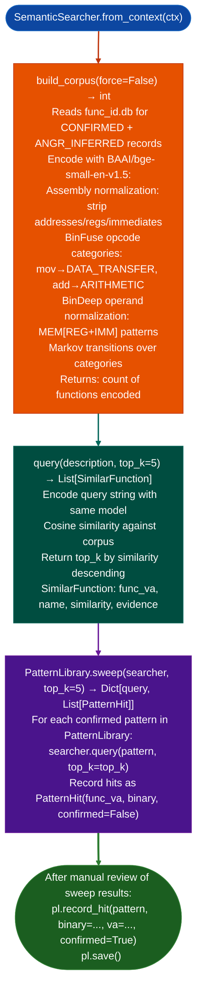

# Generic Vulnerability Profile Sweeps

Sweep all registered `PatternLibrary` query strings against a new binary using `SemanticSearcher`: automatically replaying confirmed patterns from prior engagements on new targets using BAAI/bge-small-en-v1.5 cross-architecture semantic similarity, step 5 of the RE workflow.

---

## Why this exists

1. **Each confirmed vulnerability finding generates a semantic query string that captures the behavioral signature of the vulnerable function: `PatternLibrary` persists these query strings with hit rates across all prior binaries.** `PatternLibrary.sweep()` replays all confirmed-hit query strings against a new binary in a single batch call, surfacing functions with similar behavioral signatures without requiring the analyst to manually formulate queries for each new target.

2. **`SemanticSearcher` uses fastembed BAAI/bge-small-en-v1.5 with BinFuse-style opcode categorization 11 semantic categories and BinDeep operand normalization**: cross-architecture behavioral similarity that finds the same function pattern in ARM64, MIPS, and x86_64 binaries regardless of register allocation or optimization level. A query that found a command injection handler in a Fortinet ARM64 binary will also find it in a Cisco MIPS binary if the behavioral pattern is similar.

3. **`SemanticSearcher.build_corpus()` is the prerequisite step**, it ingests the binary's functions into the vector store fastembed-encoded, with optional `WhiteningTransform` for improved discrimination. Build the corpus once per binary per analysis session; subsequent `query()` calls use the cached corpus.

---

## How it works



---

## Usage

```python
from ablation.analyzers.semantic_search import SemanticSearcher
from ablation.analyzers.pattern_library import PatternLibrary
from ablation.analyzers.binary_context import BinaryContext

ctx = BinaryContext.load_or_build('/path/to/target.elf')
searcher = SemanticSearcher.from_context(ctx)

# Build corpus (step 4 in RE workflow)
n = searcher.build_corpus()
print(f"Corpus: {n} functions encoded")

# Direct query
hits = searcher.query('command injection in HTTP request handler', top_k=5)
for h in hits:
    print(f"  {h.func_va:#x} {h.name}  sim={h.similarity:.3f}")

# Pattern sweep (step 5 in RE workflow)
pl = PatternLibrary()
results = pl.sweep(searcher, top_k=5)
for pattern, hits in results.items():
    if hits:
        print(f"  '{pattern[:60]}': {len(hits)} hits")
        for hit in hits:
            print(f"    {hit.func_va:#x}  sim={hit.score:.3f}")

# Record confirmed hits after manual verification
pl.record_hit('command injection in HTTP handler', binary='httpd', va=0x12340, confirmed=True)
pl.save()
```

---

## Example output

The following illustrates the sweep output format. Actual patterns and scores are engagement-specific.

```
PatternLibrary.sweep():
  'command injection in http request parser':
    <va>  sim=0.91  parse_http_request  (confirmed hit in 2 prior binaries)
  'strcpy with user-controlled src buffer':
    <va>  sim=0.87  handle_config_value
    <va>  sim=0.73  copy_parameter
  'format string sink with syslog':
    (no hits above threshold)
```

---

## False positives

**`SemanticSearcher.query()` uses cosine similarity on behavioral embeddings: similarity 0.80 means "similar behavioral structure," not "same vulnerability."** High similarity indicates that the function may implement the same pattern; it does not confirm that the pattern is exploitable. Always feed sweep hits to `FuncProfiler.profile()` for human triage before escalating to `TaintTracker`.

**`WhiteningTransform` when fitted improves discrimination but requires a representative corpus.** If the corpus has fewer than ~100 functions, skip whitening: `build_corpus(force=False)` without fitting the transform.

---

## Pipeline position

Steps 4–5 in the RE workflow CLAUDE.md: `build_corpus()` (step 4) then `PatternLibrary.sweep()` (step 5). These two steps should run before any manual disassembly: the sweep identifies which functions are worth inspecting, eliminating the need to manually review all functions in the binary.

---

## Reading output

`PatternLibrary.sweepctx, queries=None, min_score=0.0` returns `Dict[str, SweepResult]`: query string → result:

| Attribute | Content |
|:---|:---|
| `pattern` | The query string |
| `tag` | Vulnerability category tag for example `'buffer-overflow'`, `'cmd-exec'` |
| `hits` | `List[Tuple[int, float]]`: `func_va, score` pairs sorted by score descending |

---

## See also

- [Function Corpus Builder](function-corpus-builder.md): populates `func_id.db` that `build_corpus()` reads
- [Function Identity Database](function-identity-database.md): `PatternLibrary` and `FindingRegistry` persistence
- [Single Function Profiling](single-function-profiling.md): step 6: profile sweep hits before taint analysis
