# Global Symbol and BSS Tracking

Locate functions that walk a `[start, end)` range from adjacent pointer-sized BSS globals: tracing forward taint propagation from BSS symbol pairs to detect decrypt loops and memory processing routines that consume `initrd_start`/`initrd_end` pairs in stripped kernel binaries.

---

## Why this exists

1. **Stripped Fortinet kernel binaries contain firmware decrypt routines that use `initrd_start`/`initrd_end` BSS globals to determine the region to decrypt, these routines cannot be found by string search or function name matching because they have no symbols and no printable string references.** `BssTaintTracker` finds them by scanning for adjacent pointer-pair BSS loads `[abs_addr]`, `[abs_addr+8]` in the same basic block, then forward-tainting from those pairs to find loops where the tainted pointers are used as both memory bases and comparison bounds.

2. **`BssTaintTracker` is the only Ablation module that reasons about BSS global pointer pairs**: all other taint trackers start from network input sources. BSS tracking is specifically for the case where the "source" of the interesting data is a pair of kernel globals that bound the region of interest, rather than a network-received buffer.

3. **The primary output is the decrypt loop's VA and the BSS symbol pair that seeds it**: with these two pieces of information, an analyst can extract the encrypted initrd payload, apply the decrypt routine, and inspect the decrypted content without a JTAG debugger.

---

## How it works

```mermaid
flowchart TD
    A(["BssTaintTracker.analyze(fn: Function) → Optional[dict]"]):::input --> B["Phase 1: BSS symbol collection\n  Scan function for: mov reg, [abs_addr]\n  where abs_addr is in a BSS-like region\n  (address above .text, below stack, no .rodata overlap)\n  Collect: BSSSymbol(addr, reg, basic_block_id)"]:::primary
    B:::primary --> C["Phase 2: Adjacent pair detection\n  Find two BSSSymbol entries in the same basic block:\n    addr_b == addr_a + sizeof(pointer)  (8 bytes on x86_64)\n  → (start_sym, end_sym) pair candidate"]:::secondary
    C:::secondary --> D["Phase 3: Forward taint propagation (register-level)\n  Seed: start_reg and end_reg tainted\n  Propagate through CFG:\n    Register moves propagate taint\n    Arithmetic preserves taint\n    Unknown calls clear caller-saved regs"]:::tertiary
    D:::tertiary --> E["Phase 4: Loop back-edge detection\n  Find back-edges (successor dominates predecessor)\n  At back-edge: is a tainted reg used as:\n    Memory base: [tainted_reg]\n    Comparison bound: cmp tainted_reg, end_reg?\n  If yes → DECRYPT_LOOP candidate"]:::tertiary
    E:::tertiary --> F(["Returns:\n  {'decrypt_va': va, 'start_sym': addr, 'end_sym': addr}\n  None if no loop found"]):::output
    classDef input     fill:#0d47a1,stroke:#1565c0,color:#fff
    classDef primary   fill:#e65100,stroke:#bf360c,color:#fff
    classDef secondary fill:#004d40,stroke:#00695c,color:#fff
    classDef tertiary  fill:#4a148c,stroke:#6a1b9a,color:#fff
    classDef neutral   fill:#37474f,stroke:#546e7a,color:#fff
    classDef output    fill:#1b5e20,stroke:#2e7d32,color:#fff
    linkStyle 0 stroke:#bf360c,stroke-width:2px
    linkStyle 1 stroke:#00695c,stroke-width:2px
    linkStyle 2 stroke:#6a1b9a,stroke-width:2px
    linkStyle 3 stroke:#6a1b9a,stroke-width:2px
    linkStyle 4 stroke:#2e7d32,stroke-width:3px
```



---

## Usage

```python
from ablation.analyzers.bss_taint_tracker import BssTaintTracker, Function
from ablation.analyzers.binary_context import BinaryContext
from ablation.analyzers.cfg_builder import CFGBuilder

ctx = BinaryContext.load_or_build('/path/to/vmlinuz_stripped')
builder = CFGBuilder(ctx)

tracker = BssTaintTracker()

# Try all known function starts
for func_va in ctx.func_starts:
    cfg = builder.build_function(func_va)
    if cfg is None:
        continue
    fn = Function.from_cfg(cfg, ctx)
    result = tracker.analyze(fn)
    if result:
        print(f"Decrypt loop found at {result['decrypt_va']:#x}")
        print(f"  BSS pair: [{result['start_sym']:#x}..{result['end_sym']:#x}]")
        break
```

---

## Example output

The following illustrates the BSS tracking output format. Actual addresses are binary-specific.

```
BssTaintTracker:
  Function at <va>:
    BSS loads: 2  ([<start_addr>], [<end_addr>])
    Adjacent pair: start=<start_addr>  end=<end_addr>  (offset=8)
    Loop back-edge at <va>:
      tainted reg used as memory base: [rdi]
      tainted end_reg used as comparison bound: cmp rdi, rsi
    Result: {'decrypt_va': <va>, 'start_sym': <addr>, 'end_sym': <addr>}
```

---

## False positives

**Adjacent BSS loads in the same basic block may be unrelated pairs that happen to be 8 bytes apart**: array element access patterns produce the same signature. Confirm that the two BSS addresses are pointers not integers and that the forward taint actually produces a loop with pointer-increment behavior before treating the result as a decrypt loop.

**`BssTaintTracker` uses register-level taint only**: stack spills of BSS pointers are not tracked. A function that spills the start/end pointers to the stack before the loop will not be detected. For stack-heavy functions, supplement with `ConstPropAnalysis` to trace the stack slot values.

---

## Pipeline position

Run `BssTaintTracker` on stripped kernel binaries where `SemanticSearcher` fails to find a decrypt routine no string references, no known sink calls. It is a specialized analysis tool for the Fortinet kernel decrypt use case; for general firmware analysis, standard `TaintTracker` with network sources is more appropriate.

---

## Reading output

`BssTaintTracker.run()` returns `None` if no BSS-loop decrypt candidate is found, or a dict:

| Key | Content |
|:---|:---|
| `fn_start` | VA of the candidate decrypt function |
| `fn_name` | Name of the function (from debug info or `sub_VA`) |
| `bss_pairs` | `List[Tuple[int, int]]`: `start_bss_addr, end_bss_addr` bounds pairs used in loops |
| `loops` | `List`: detected loop structures in the candidate function |

---

## See also

- [Taint Analysis (x86)](x86.md): standard x86/x86-64 taint tracker for network-source analysis
- [Cross-Binary Taint](cross-library-analysis.md): extends BSS tracking across library boundaries
- [Persistent Analysis Context](persistent-analysis-context.md): `BinaryContext` providing BSS section bounds for BSS address range detection
