# Go Dangerous Call Graph

Map every `os/exec` call site in a stripped Go binary: resolving the static command string argument using pclntab function boundaries and `GoStringResolver` LEA/MOV tracking, so every relative-path and bare-name subprocess invocation surfaces as a named finding before any manual disassembly.

---

## Why this exists

1. **`os/exec.Command("curl", ...)` is safe. `os/exec.Command("./helper")` is not.** Both patterns appear throughout Go-based network appliances and management tools, and both look the same in a call graph without argument resolution. The critical distinction is the command path type: an absolute path (`/usr/bin/curl`) is not injectable via `PATH` or `CWD`; a bare name (`curl`) resolves through `PATH` and can be hijacked; a relative path (`./helper`) resolves against the process working directory and is exploitable whenever the caller sets that directory to something writable. `GoSubprocessScanner` resolves the static command string at each call site and classifies it before any manual inspection.

2. **Go pclntab provides function boundaries in stripped binaries.** The `.gopclntab` section embeds a complete function name-to-VA table regardless of whether `strip` was run on the binary. This makes Go substantially different from C firmware: every function name is available, caller/callee relationships are recoverable, and the scanner filters out the Go standard library namespace at the name level rather than having to infer it from export tables. The scanner processes only application-package functions: the subset that actually calls `os/exec`: reducing the disassembly pass from the full binary to the relevant application code.

3. **Go 1.17+ AMD64 ABI uses registers for argument passing, not the stack.** In the post-1.17 register ABI, `os/exec.Commandname string, ...` receives the command string in `rax` (pointer) and `rbx` (length). The `GoStringResolver` 4-instruction window traces the LEA+MOV pair that loads this value, resolving `.rodata` string literals in under a millisecond per call site. Functions that construct the command string at runtime heap allocation, `fmt.Sprintf` return `cmd_type=dynamic` rather than a static string.

---

## How it works

```mermaid
flowchart TD
    A(["scan_binary(binary_path)"]):::input --> B["Load ELF bytes\n_parse_elf_segments → PT_LOAD [{p_vaddr, p_offset, p_filesz}]"]:::primary
    B:::primary --> C["GoFuncTable.from_binary(data) → {VA: name} from .gopclntab"]:::secondary
    C:::secondary --> D["GoSubprocessScanner(data, segments, func_table)"]:::tertiary
    D:::tertiary --> E["GoStringResolver(data, segments) · resolves .rodata strings from LEA/MOV"]:::tertiary
    D:::tertiary --> F(["Build _va_to_name, _name_to_va maps\nBuild _sorted_vas for size estimation"]):::output
    E:::tertiary --> G["scan(): iterate _sorted_vas"]:::tertiary
    G:::tertiary --> H{"_is_stdlib(name)?"}:::neutral
    H:::neutral -->|yes| I(["Skip: runtime. reflect. sync. syscall. etc."]):::output
    H:::neutral -->|no| J["_func_size(va): gap to next pclntab entry, capped at max_func_size=0x4000"]:::tertiary
    J:::tertiary --> K["_disasm_func(va, size): Capstone x86-64 or ARM64"]:::tertiary
    K:::tertiary --> L{"iterate instructions"}:::neutral
    L:::neutral --> M{"_extract_call_target(insn): CALL imm / BL imm?"}:::neutral
    M:::neutral -->|no| L:::neutral
    M:::neutral -->|"yes, VA in EXEC_TARGETS?"| N["Exec target found: os/exec.Command / CommandContext / Start / Run / Output / CombinedOutput"]:::tertiary
    N:::tertiary --> O{"arch == arm64?"}:::neutral
    O:::neutral -->|yes| P(["resolved = None (ARM64 ADRP+ADD not implemented)\ncmd_type = dynamic, severity = MEDIUM"]):::output
    O:::neutral -->|no x86-64| Q["GoStringResolver.resolve_call_site(instrs, idx, lookback=12)\nLEA rax,[rip+X] + MOV rbx,N window\nResolve VA to .rodata content"]:::tertiary
    Q:::tertiary --> R{"resolved?"}:::neutral
    R:::neutral -->|yes| S["cmd_string = content\n_classify_cmd → (relative/path/absolute/dynamic, severity)"]:::tertiary
    R:::neutral -->|no| T(["cmd_type=dynamic, severity=MEDIUM"]):::output
    S:::tertiary --> U["SubprocessSite(scanner_func, call_va, exec_target, cmd_string, cmd_type, severity)"]:::tertiary
    U:::tertiary --> L:::neutral
    L:::neutral --> V["Sort: HIGH → MEDIUM → INFO → alphabetical"]:::tertiary
    V:::tertiary --> W(["List[SubprocessSite]"]):::output
    classDef input     fill:#0d47a1,stroke:#1565c0,color:#fff
    classDef primary   fill:#e65100,stroke:#bf360c,color:#fff
    classDef secondary fill:#004d40,stroke:#00695c,color:#fff
    classDef tertiary  fill:#4a148c,stroke:#6a1b9a,color:#fff
    classDef neutral   fill:#37474f,stroke:#546e7a,color:#fff
    classDef output    fill:#1b5e20,stroke:#2e7d32,color:#fff
    linkStyle 0 stroke:#bf360c,stroke-width:2px
    linkStyle 1 stroke:#00695c,stroke-width:2px
    linkStyle 2 stroke:#6a1b9a,stroke-width:2px
    linkStyle 3 stroke:#6a1b9a,stroke-width:2px
    linkStyle 4 stroke:#2e7d32,stroke-width:3px
    linkStyle 5 stroke:#6a1b9a,stroke-width:2px
    linkStyle 6 stroke:#546e7a,stroke-width:2px
    linkStyle 7 stroke:#2e7d32,stroke-width:3px
    linkStyle 8 stroke:#6a1b9a,stroke-width:2px
    linkStyle 9 stroke:#6a1b9a,stroke-width:2px
    linkStyle 10 stroke:#546e7a,stroke-width:2px
    linkStyle 11 stroke:#546e7a,stroke-width:2px
    linkStyle 12 stroke:#546e7a,stroke-width:2px
    linkStyle 13 stroke:#6a1b9a,stroke-width:2px
    linkStyle 14 stroke:#546e7a,stroke-width:2px
    linkStyle 15 stroke:#2e7d32,stroke-width:3px
    linkStyle 16 stroke:#6a1b9a,stroke-width:2px
    linkStyle 17 stroke:#546e7a,stroke-width:2px
    linkStyle 18 stroke:#6a1b9a,stroke-width:2px
    linkStyle 19 stroke:#2e7d32,stroke-width:3px
    linkStyle 20 stroke:#6a1b9a,stroke-width:2px
    linkStyle 21 stroke:#546e7a,stroke-width:2px
    linkStyle 22 stroke:#6a1b9a,stroke-width:2px
    linkStyle 23 stroke:#2e7d32,stroke-width:3px
```



### Command path classification

| `cmd_type` | Severity | Condition | Exploitability |
|---|---|---|---|
| `relative` | HIGH | String starts with `./` or `../` | Exploitable if process CWD is attacker-writable |
| `path` | MEDIUM | Bare name, no `/` character | Hijackable via `PATH` manipulation in calling environment |
| `absolute` | INFO | String starts with `/` | Not directly injectable (excluded by default with `skip_absolute=True`) |
| `dynamic` | MEDIUM | Not statically resolvable | Manual trace required; format verbs, length >80, or embedded spaces also classify as dynamic |

---

## Usage

```python
from ablation.analyzers.go_subprocess_scanner import (
    GoSubprocessScanner, scan_binary, print_results, EXEC_TARGETS
)

# One-shot scan (absolute paths excluded by default)
sites = scan_binary('/fw/hassos/supervisor', skip_absolute=False)
print_results(sites, min_severity="MEDIUM")

# Filtered: HIGH and MEDIUM only
critical = [s for s in sites if s.severity in ('HIGH', 'MEDIUM')]
for s in critical:
    print(f"  {s.severity:6}  {s.cmd_type:8}  {s.scanner_func}:{s.call_va:#x}")
    print(f"           → {s.exec_target}({s.cmd_string!r})")
    if s.note:
        print(f"           {s.note}")

# Scan a single function by VA (useful when FuncProfiler flagged a specific site)
from ablation.analyzers.go_pclntab import GoFuncTable
data = open('/fw/hassos/supervisor', 'rb').read()
from ablation.analyzers.go_subprocess_scanner import _parse_elf_segments
segs = _parse_elf_segments(data)
ft   = GoFuncTable.from_binary(data)
scanner = GoSubprocessScanner(data, segs, ft)
sites = scanner.scan_function(0x123456)

# Custom exec targets (e.g., vendor-specific subprocess wrappers)
from ablation.analyzers.go_subprocess_scanner import GoSubprocessScanner
custom_targets = EXEC_TARGETS | frozenset(['main.runCommand', 'util.Shell'])
all_sites = scanner.scan(target_names=custom_targets)
```

---

## Example output

```
GoSubprocessScanner: 2 HIGH  7 MEDIUM  0 LOW  14 INFO

SEVERITY  TYPE      CALLER                               CALL_VA     EXEC_TARGET                 CMD
--------  --------  -----------------------------------  ----------  --------------------------  ---
HIGH      relative  github.com/hassio/addon.runHook      0x4a1c90    os/exec.Command             "./run.sh"
HIGH      relative  main.updateBootloader                0x3b2300    os/exec.Command             "../install/apply"
MEDIUM    path      github.com/hassio/util.dockerExec    0x5f1040    os/exec.CommandContext      "docker"
MEDIUM    path      main.buildImage                      0x3a9f10    os/exec.Command             "docker"
MEDIUM    path      github.com/hassio/network.applyConf  0x6c2210    os/exec.(*Cmd).Run          "nmcli"
MEDIUM    dynamic   github.com/hassio/addon.startAddon   0x4a30c0    os/exec.Command             <dynamic>
...

  github.com/hassio/addon.runHook:0x4a1c90
    Relative path './run.sh' resolved against process CWD.
    Exploitable if CWD is attacker-writable.
```

---

## False positives

**Format string arguments classified as dynamic.** `os/exec.Command(fmt.Sprintf("/usr/bin/%s", bin), ...)` loads the command from `fmt.Sprintf`: a function return, not a static `.rodata` LEA. The resolver sees no `lea rax` for the call and returns `dynamic`. This is not a false positive in the security sense dynamic commands do require manual trace, but it does include findings that are not exploitable when the `fmt.Sprintf` format string is `"absolute"`.

**Multi-call-site functions.** A function that calls `os/exec.Command` in two branches: once with a hardcoded absolute path (`/bin/ls`) and once with a dynamic string: produces two `SubprocessSite` entries at different `call_va` values. The absolute finding appears if `skip_absolute=False`. Review both entries before dismissing the function.

**ARM64 always reports MEDIUM/dynamic.** `GoStringResolver` uses x86-64 LEA+MOV patterns. ARM64 uses `ADRP`+`ADD` to load string addresses into registers, which is not yet implemented. All ARM64 exec call sites appear as `cmd_type=dynamic, severity=MEDIUM` regardless of whether the actual command is a static string. Verify ARM64 findings manually.

---

## Pipeline position

**Before this module:** For initial Go binary triage, run `scan_binary()` before any semantic search, it is faster than building a corpus and directly surfaces the most dangerous patterns. If a dynamic call site needs deeper trace, follow with `GoStringResolver.resolve_call_site()` directly to inspect the broader instruction window.

**After this module:** For `relative` and `path` findings, run `IPRegAnnotator.annotate_chain()` from the caller function to determine whether the caller receives the `CWD` or `PATH` from user-controlled input. Register confirmed `relative`/`path` findings in `FindingRegistry` with `cwe_class="CWE-78"`.

---

## Reading findings

| Field | Content |
|:---|:---|
| `scanner_func` | Full Go package-qualified caller name from pclntab |
| `scanner_func_va` | VA of the caller function |
| `call_va` | VA of the `CALL` / `BL` instruction |
| `exec_target` | `os/exec.Command` / `os/exec.CommandContext` / `os/exec.(*Cmd).Start` / etc. |
| `cmd_string` | Resolved command path, or `""` if dynamic |
| `cmd_type` | `relative` / `path` / `absolute` / `dynamic` |
| `severity` | `HIGH` relative / `MEDIUM` path or dynamic / `INFO` absolute |
| `note` | Plain-language exploitation note for `relative` and `path` types |

---

## See also

- [Stripped Go x86-64 Boundaries](stripped-go-x86-64-boundaries.md): `GoStringResolver` and pclntab boundary extraction
- [Interprocedural Argument Provenance](interprocedural-argument-provenance.md): trace dynamic command string sources across call hops
- [Pattern Library](pattern-library.md): record `os/exec` with attacker-controlled command as a replayable pattern
- [YARA Generator](yara-generator.md): generate YARA rules from resolved command string literals
