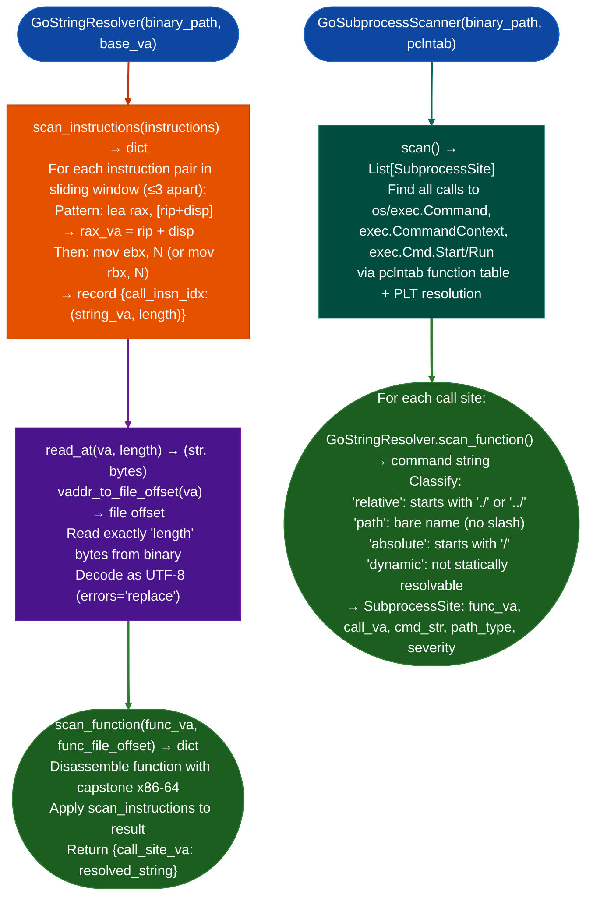

# Go String Recovery

Resolve Go 1.17+ AMD64 non-NUL-terminated strings in stripped binaries: detecting the `lea rax, [rip+disp]` / `mov ebx, N` call-site pattern and reading the exact string bytes from `.rodata`, eliminating the truncation errors caused by NUL-scan string recovery on Go binaries.

---

## Why this exists

1. **Go strings are NOT NUL-terminated: they are `data_ptr, length` pairs.** In the Go AMD64 register ABI Go 1.17+, `rax` carries the data pointer (pointing into `.rodata`) and `rbx` carries the exact byte count. A NUL-scan string recovery (reading until `\x00`) will silently truncate any Go string that happens to contain a zero byte, or return false results when two adjacent strings in `.rodata` are scanned as one. `GoStringResolver` reads the exact `rbx` bytes from the `rax`-pointed location, producing the complete untruncated string.

2. **The `lea` and `mov ebx` may be separated by up to 3 non-clobbering instructions: other arguments being set up for the same call.** `GoStringResolver.scan_instructions()` uses a sliding-window scan that tolerates up to 3 intervening instructions between the `lea rax, [rip+disp]` and the `mov ebx, N`, matching the pattern that Go compilers actually emit for string arguments even when multiple arguments are set up simultaneously.

3. **`GoSubprocessScanner` builds on `GoStringResolver` to classify every `os/exec.Command` and `exec.Cmd.Start/Run` call site by command path type: `relative`, `path`, `absolute`, or `dynamic`.** PATH injection is possible at every `path`-type site bare name without a slash, and CWD injection is possible at every `relative`-type site. Without string resolution, all call sites appear as `dynamic` unresolved, making injection surface classification impossible.

---

## How it works



### Path type severity

| Path type | Risk | Description |
|:---|:---|:---|
| `relative` | HIGH | `./cmd` or `../cmd`: exploitable if CWD is attacker-writable |
| `path` | HIGH | bare name: hijackable via PATH injection |
| `absolute` | LOW | `/usr/bin/cmd`: not directly injectable |
| `dynamic` | MEDIUM | runtime-built string: requires dynamic analysis |

---

## Usage

```python
from ablation.analyzers.go_string_resolver import GoStringResolver
from ablation.analyzers.go_subprocess_scanner import GoSubprocessScanner

# ── String resolution ────────────────────────────────────────────────────────
resolver = GoStringResolver('/path/to/go_binary', base_va=0x400000)

# Resolve strings referenced at a specific function
import capstone
md = capstone.Cs(capstone.CS_ARCH_X86, capstone.CS_MODE_64)
data = open('/path/to/go_binary', 'rb').read()[<func_offset>:<func_end>]
insns = list(md.disasm(data, <func_va>))
strings = resolver.scan_instructions(insns)
for call_idx, (string_va, s) in strings.items():
    print(f"  Call {call_idx}: '{s}' (at {string_va:#x})")

# ── Subprocess scanning ───────────────────────────────────────────────────────
scanner = GoSubprocessScanner('/path/to/go_binary', pclntab=<pclntab_data>)
sites = scanner.scan()
for site in sites:
    print(f"  {site.call_va:#x}  {site.path_type.upper()}  cmd='{site.cmd_str}'")
```

---

## Example output

The following illustrates the scanner output format. Actual strings and addresses are binary-specific.

```
GoSubprocessScanner results:
  <call-va>  PATH    cmd='ping'              [HIGH — PATH injection risk]
  <call-va>  ABSOLUTE  cmd='/usr/bin/ssh'   [LOW]
  <call-va>  DYNAMIC  cmd=<unresolved>      [MEDIUM — verify at runtime]
  <call-va>  RELATIVE  cmd='./agent'        [HIGH — CWD injection risk]
```

---

## False positives

**`scan_instructions()` tolerates up to 3 non-clobbering instructions between the `lea rax` and `mov ebx`: an instruction that writes `rax` or `rbx` in between invalidates the pattern, but the scan may miss the clobbering if it involves an indirect write.** Always verify resolved strings at the call site with `read_nul_terminated()` as a sanity check: if the NUL-terminated and length-bounded reads disagree, the length-bounded read is correct.

**Go 1.17+ uses the register ABI (`rax`/`rbx`) but earlier Go versions used the stack-based ABI (`rsp+0`/`rsp+8`).** `GoStringResolver` targets the register ABI only. Binaries compiled with Go < 1.17 will produce no matches from `scan_instructions()`. Check the Go version from the binary's `pclntab` header before assuming register ABI.

---

## Pipeline position

Run `GoStringResolver` as part of any Go binary analysis where string content is needed: before or alongside `GoSubprocessScanner`. The resolved strings improve `SemanticSearcher` results better function descriptions and enable injection surface classification. On x86-64 Go binaries, string resolution is the difference between `dynamic/MEDIUM` and `path/HIGH` on subprocess call sites.

---

## Reading output

`GoStringResolver.scan_functions(funcs)` returns `Dict[int, Tuple[str, int]]`: string load site VA → `text, length` for all resolvable string loads across the provided function list. Each function dict must have `'va'` and `'fileoff'` keys.

`GoStringResolver.scan_functionfunc_va, func_file_offset, func_size` returns the same dict format for a single function.

`build_resolver_from_elfbinary_data, elf_parser` constructs a `GoStringResolver` for ELF binaries without requiring a `BinaryContext`.

---

## See also

- [Go Subprocess Surface](go-subprocess-surface.md): `GoSubprocessScanner` higher-level summary page
- [Taint Analysis](taint-analysis.md): taint tracking on `path`-type Go subprocess call sites
- [Source Code Auditing](source-code-auditing.md): for Go binaries with source available
