# ABCDecompiler

Zero-dependency parser, disassembler, and decompiler for HarmonyOS Ark Bytecode (ABC) files and HAP application packages. Covers ABC versions v9 through v13+, including the v12.0.6.0 literal-array header boundary. Three classes form the stack: `ABCParser` (binary format), `ARKDisasm` (instruction decode), `ABCDecompiler` (pseudocode lift).

- [What is HarmonyOS, ArkTS, and ABC?](#what-is-harmonyos-arkts-and-abc)
  - [ArkTS and ArkCompiler](#arkts-and-arkcompiler)
  - [ABC file format versions](#abc-file-format-versions)
  - [HAP package structure](#hap-package-structure)
  - [Why ABC binaries appear in RE work](#why-abc-binaries-appear-in-re-work)
- [Why this exists](#why-this-exists)
- [Module relationships](#module-relationships)
- [ABCParser](#abcparser)
  - [Construction](#construction)
  - [Header](#header)
  - [Class names](#class-names)
  - [Method iteration](#method-iteration)
  - [Code items](#code-items)
  - [Security queries](#security-queries)
  - [Summary](#summary)
  - [String and name resolution](#string-and-name-resolution)
- [ARKDisasm](#arkdisasm)
  - [Construction](#construction-1)
  - [Instruction iteration](#instruction-iteration)
  - [Disassembly text](#disassembly-text)
  - [Security queries](#security-queries-1)
  - [ISA table design](#isa-table-design)
- [ABCDecompiler](#abcdecompiler-class)
  - [Construction](#construction-2)
  - [Decompiling methods](#decompiling-methods)
  - [Architecture](#architecture)
  - [Index table routing](#index-table-routing)
- [Format notes](#format-notes)
  - [ABC dialects](#abc-dialects)
  - [Version boundary](#version-boundary)
  - [String encoding](#string-encoding)
  - [Class body layout](#class-body-layout)
  - [Method item layout](#method-item-layout)
- [Safe usage](#safe-usage)
- [Usage](#usage)
- [Example output](#example-output)
- [Limitations](#limitations)
- [Pipeline position](#pipeline-position)
- [See also](#see-also)

---

## What is HarmonyOS, ArkTS, and ABC? <sup>[↑](#abcdecompiler)</sup>

**HarmonyOS** is Huawei's operating system for smartphones, tablets, and embedded devices, deployed since 2021. From HarmonyOS 3.0 onward, application development uses **ArkTS** as the primary language and **ArkCompiler** as the compiler toolchain. Earlier HarmonyOS versions used a JavaScript runtime derived from OpenHarmony's JS stack; HarmonyOS 4.x and later use ArkTS exclusively.

HarmonyOS applications are distributed as **HAP** (HarmonyOS Ability Package) files. A HAP is a ZIP archive, analogous to an Android APK, containing compiled bytecode, resources, a configuration manifest (`module.json5`), and native `.so` libraries. The compiled bytecode is **ABC** (Ark Bytecode), produced by ArkCompiler from ArkTS/JavaScript source.

**Why HarmonyOS RE is distinct from Android RE:** HarmonyOS runs ABC bytecode on the **ArkJS/ArkTS runtime**, not the Dalvik/ART VM. DEX tools (`dexdump`, `jadx`, `apktool`) do not parse ABC. IDA Pro has no ABC loader as of 2025. The ABC format is defined by ArkCompiler's `libpandafile` library and is not publicly documented beyond the open-source codebase. `ABCParser`, `ARKDisasm`, and `ABCDecompiler` are the only Python tools that correctly parse and disassemble ABC across versions v9–v13+.

### ArkTS and ArkCompiler <sup>[↑](#abcdecompiler)</sup>

**ArkTS** is a TypeScript superset with static type annotations and value semantics for structured concurrency. ArkCompiler (`es2abc`) compiles ArkTS source to ABC bytecode. The ARK ISA is register-based with a central **accumulator register** (`_acc`): most instructions implicitly read from or write to the accumulator rather than naming both source and destination registers.

The runtime is the **ArkJS engine**, an ECMAScript-compatible virtual machine. It executes Dalvik-style bytecode, not native code. The ArkTS type system is erased at compile time; the bytecode uses dynamic dispatch for all property access. The instruction set has 324 opcodes across five prefix groups: unprefixed (standard), `callruntime` (0xFB), `deprecated` (0xFC), `wide` (0xFD), and `throw` (0xFE).

**NAPI** (Native API) is the ArkTS equivalent of JNI. Native `.so` libraries inside a HAP expose C functions as ArkTS-callable APIs through NAPI registration. A `loadLibrary` method reference in ABC bytecode indicates a NAPI bridge point; the implementation is in the corresponding `.so` library.

### ABC file format versions <sup>[↑](#abcdecompiler)</sup>

| Version tuple | HarmonyOS release | Key change |
|:---|:---|:---|
| `[9,0,0,0]` | HarmonyOS 3.0 early | Initial ArkTS ABC format |
| `[11,0,0,0]` | HarmonyOS 3.1 | Index region additions |
| `[12,0,6,0]` | HarmonyOS 4.0 | Last version with literal array count in header |
| `[13,0,0,0]` | HarmonyOS 4.2+ | Literal arrays moved to index section only |

Version `[12,0,6,0]` is the `LAST_CONTAINS_LITERAL_IN_HEADER_VERSION` constant in ArkCompiler source. Files at or below this version embed `num_literalarrays` and `literalarray_idx_off` directly in the 60-byte fixed header. v13+ stores literal arrays only in the index section; the header fields read as zero. Parsers that do not check this boundary produce wrong literal-array counts on v13+ files, corrupting class walks.

### HAP package structure <sup>[↑](#abcdecompiler)</sup>

```
app.hap (ZIP)
  module.json5        ← module configuration (not binary XML)
  modules.abc         ← compiled ArkTS bytecode (primary target)
  resources.index     ← compiled resource table
  libs/
    arm64-v8a/*.so    ← native NAPI libraries
  assets/             ← raw assets
  ets/                ← source maps (debug builds only)
```

`modules.abc` is the primary analysis target. It contains all ArkTS classes, methods, and string constants compiled from the HAP's source tree. Debug builds may include an `ets/` directory with source maps but release builds do not. The native `.so` libraries are analyzed separately using the standard `BinaryContext` pipeline.

### Why ABC binaries appear in RE work <sup>[↑](#abcdecompiler)</sup>

**Commercial HAP applications on HarmonyOS-only devices:** Huawei smartphones sold in China since 2023 ship HarmonyOS 4.x without Google Play. Applications distributed through Huawei AppGallery are HAP files. Device management software, banking apps, and carrier applications on these devices are targets for security research.

**WeChat HarmonyOS port:** The WeChat HarmonyOS HAP is one of the largest ABC files encountered in practice (356 KB, 867 methods, 39 classes). It serves as the primary validation target for the ABC stack and is referenced in `ABCParser.summary()` output examples throughout this document.

**Obfuscated HAP bundles:** ArkCompiler supports identifier obfuscation through `hvigor`'s obfuscation config. Obfuscated builds replace class and method names with single-letter identifiers but do not encrypt string constants or remove method references. The string table in `modules.abc` remains readable even in obfuscated builds.

**Embedded controllers running OpenHarmony:** Huawei's open-source OpenHarmony platform runs on embedded MCUs and SoCs. Firmware for smart home devices, industrial controllers, and automotive components increasingly ships with OpenHarmony and uses ABC bytecode for application logic.

---

## Why this exists <sup>[↑](#abcdecompiler)</sup>

Four gaps existed before this module:

1. No Python tool could parse ABC before `ABCParser`. The ABC format is defined by ArkCompiler's `libpandafile` but not publicly documented. LIEF does not support ABC. No general-purpose binary parser handles the MUTF-8 string encoding, ULEB128 field widths in dynamic-dialect class bodies, or the v12/v13 literal-array header boundary. Naive parsers corrupt all section names and method offsets from section 1 onward.

2. No Python disassembler existed for the ARK ISA. The ARK ISA has 324 opcodes across five prefix groups. The parallel `opcode_idx`/`format` array representation in ArkCompiler's `isa.yaml` creates 138 false collisions when iterated naively. `ARKDisasm` embeds the complete opcode table (built by pairing arrays at the same index) and decodes all instruction formats without requiring an external `isa.json` at runtime.

3. The accumulator-centric ISA makes raw disassembly hard to read without copy-propagation. The ARK ISA routes most values through an implicit accumulator register. A raw disassembly of `lda.str 0x21; sta v0; lda v0; returnundefined` is less readable than the propagated form `return "L@system.curves;"`. `ABCDecompiler`'s pass-1 copy-propagation inlines accumulator assignments, producing output closer to the original ArkTS source.

4. `a || b` compiled to consecutive conditional jumps is unreadable without short-circuit merging. ArkTS `a || b` compiles to two consecutive `jfalse` instructions targeting the same label. Without pass 2.5 (`_merge_short_circuit`), both branches appear as raw `if ... goto` pairs. The merge pass reconstructs the `||` expression, matching the Cifuentes/Simon 1998 short-circuit evaluation recovery technique.

---

## Module relationships <sup>[↑](#abcdecompiler)</sup>

```
ABCDecompiler
  └── ABCParser        (ablation/analyzers/abc_parser.py)
  └── ARKDisasm        (ablation/analyzers/abc_disasm.py)
        └── ABCParser  (wraps the same parser instance)
```

`ABCDecompiler.from_path()` constructs both the parser and the disassembler internally. The parser is exposed as `dec.parser` for direct access to `iter_methods()`, `find_native_methods()`, and other parser-level queries. The disassembler is exposed as `dec.dis`.

**Used by:**
- [HarmonyOS RE targets](harmonyos.md): `ABCDecompiler` is the primary entry point for all HarmonyOS application RE
- NAPI bridge analysis: `ABCParser.find_native_methods()` identifies JNI-equivalent bridge points before native `.so` analysis with `BinaryContext`

---

## ABCParser <sup>[↑](#abcdecompiler)</sup>

**File:** `ablation/analyzers/abc_parser.py`

Parses the binary ABC format defined by ArkCompiler's `libpandafile`. ABC files appear in HarmonyOS as:

- `modules.abc`: compiled ArkTS module inside a HAP
- `*.abc`: individual class or utility files
- Obfuscated HAP bundles (e.g. WeChat HarmonyOS port)

### Construction <sup>[↑](#abcdecompiler)</sup>

```python
from ablation.analyzers.abc_parser import ABCParser

with ABCParser.from_path('/path/to/modules.abc') as p:
    print(p.summary())
```

`from_path()` reads the entire file into memory. The context manager is a no-op exit (no file handles kept open); it exists for symmetry with other ablation parsers.

### Header <sup>[↑](#abcdecompiler)</sup>

```python
hdr = p.header
print(hdr.version)           # (12, 0, 6, 0)
print(hdr.num_classes)       # 39
print(hdr.num_literalarrays) # 644 (v12); 0 for v13+ (index-only)
p.is_valid()                 # True if magic matches and size >= 60
```

The header is 60 bytes: `magic(8) + checksum(4) + version(4) + 11 × u32`. `has_literal_in_header()` returns True for versions ≤ `[12,0,6,0]`.

### Class names <sup>[↑](#abcdecompiler)</sup>

```python
for eid, name in p.iter_class_names():
    print(hex(eid), name)
# 0x2f12  Lcn.icheny.wechat/entry/ets/component/ListChatContentLeftItem;
```

Class entity IDs are file offsets. The class name IS the first field of the class body MUTF-8 string, so the entity ID also doubles as the string offset.

### Method iteration <sup>[↑](#abcdecompiler)</sup>

```python
for method in p.iter_methods():
    code = p.get_code(method)
    if code:
        print(method.fqn, code.code_size, 'bytes')
```

`iter_methods()` walks all class bodies. Each `MethodInfo` carries:

| Field | Type | Meaning |
|:---|:---|:---|
| `entity_id` | `int` | File offset of method item |
| `class_name` | `str` | Decoded class name |
| `method_name` | `str` | Decoded method name |
| `access_flags` | `int` | ULEB128-decoded flags |
| `code_off` | `int` | File offset of CodeItem (0 if none) |
| `fqn` | `str` | `ClassName.methodName` |
| `is_native` | `bool` | `ACC_NATIVE` set (0x100) |
| `is_abstract` | `bool` | `ACC_ABSTRACT` set (0x400) |
| `has_code` | `bool` | `code_off > 60` |

In dynamic ABC (ECMAScript/ArkTS runtime dialect), `ACC_NATIVE` does not mean JNI/FFI. All methods in this dialect carry bytecode. Use `find_native_methods()` for NAPI bridge identification.

`iter_methods()` enumerates class-body methods only (explicitly declared methods). Anonymous functions and closures stored in literal arrays are not covered; those require literal-array walking and appear in the IndexHeader's `method_idx` but not in class bodies.

### Code items <sup>[↑](#abcdecompiler)</sup>

```python
code = p.get_code(method)      # returns CodeItem or None
code = p.get_code(0x23222)     # also accepts raw code_off

code.register_count            # total vregisters allocated
code.parameter_count           # argument count
code.code_size                 # bytecode byte count
code.exception_handler_count
code.bytecode                  # bytes
```

CodeItem binary layout (all ULEB128, confirmed from ArkCompiler ark-rs):

```
register_count(uleb) + parameter_count(uleb) + code_size(uleb)
  + exception_handler_count(uleb) + bytecode[code_size]
  + exception_handler_records[exception_handler_count]
```

This differs from the static ABC format which uses fixed u16/u32 fields.

### Security queries <sup>[↑](#abcdecompiler)</sup>

```python
# Methods with ACC_NATIVE flag set (NAPI bridge candidates)
native = p.find_native_methods()

# Methods by name substring
hits = p.find_methods_by_name('loadLibrary')

# Methods in a specific class
hits = p.find_methods_in_class('com/example/CryptoHelper')

# String refs in bytecode (best-effort u32 pointer scan)
hits = p.find_string_refs_in_code('password')
# returns [(MethodInfo, matched_string), ...]

# Class info (metadata only, no method walk)
for ci in p.iter_class_info():
    print(ci.name, ci.num_fields, ci.num_methods)
```

### Summary <sup>[↑](#abcdecompiler)</sup>

```python
p.summary()
# {
#   'format': 'ABC',
#   'version': '12.0.6.0',
#   'file_size': 356808,
#   'num_classes': 39,
#   'num_literalarrays': 644,
#   'num_methods_total': 867,
#   'num_methods_with_code': 867,
#   'num_native_methods': 145,
#   'num_index_regions': 1,
# }
```

### String and name resolution <sup>[↑](#abcdecompiler)</sup>

```python
# Resolve an lda.str operand index to the actual string value.
# N is the 16-bit operand from the instruction: it is an INDEX
# into IndexHeader.class_idx[], not a raw file offset.
s = p.resolve_class_idx(n, region=0)    # returns "" if out of range

# Resolve a property/global name operand index to a string.
# Property-access instructions (ldobjbyname, stobjbyname, tryldglobalbyname,
# stglobalvar, etc.) use IndexHeader.method_idx[], NOT class_idx[].
name = p.resolve_method_idx(n, region=0)  # returns "" if out of range
```

Two separate index tables exist per region:

| Table | Used by | Example |
|:---|:---|:---|
| `class_idx` | `lda.str`, class references | `lda.str 0x21` → `"L@system.curves;"` |
| `method_idx` | property/global access | `ldobjbyname 0x36` → `"prototype"` |

`resolve_class_idx` is used internally by `ARKDisasm.find_string_loads()`. `resolve_method_idx` is used internally by `ABCDecompiler._resolve_entity()`. Both are public API for callers that want to resolve operands without a full pass.

---

## ARKDisasm <sup>[↑](#abcdecompiler)</sup>

**File:** `ablation/analyzers/abc_disasm.py`

Disassembler for the ARK Bytecode ISA. Wraps an `ABCParser` and consumes `CodeItem` objects to produce `ARKInstruction` sequences. The full ISA table (324 opcodes, ArkCompiler v13.0.0.0) is embedded in the module. No external `isa.json` file is required at runtime.

### Construction <sup>[↑](#abcdecompiler)</sup>

```python
from ablation.analyzers.abc_disasm import ARKDisasm
from ablation.analyzers.abc_parser import ABCParser

parser = ABCParser.from_path('/path/to/modules.abc')
dis = ARKDisasm(parser)
```

### Instruction iteration <sup>[↑](#abcdecompiler)</sup>

```python
code = parser.get_code(method)
for insn in dis.iter_insns(code):
    print(f'+{insn.offset:04x}  {insn.mnemonic:20s}  {insn.operands}')
```

`ARKInstruction` fields:

| Field | Type | Meaning |
|:---|:---|:---|
| `offset` | `int` | Byte offset within bytecode |
| `mnemonic` | `str` | Instruction mnemonic (e.g. `lda.str`) |
| `size` | `int` | Instruction size in bytes (1–5) |
| `raw` | `bytes` | Raw bytes |
| `operands` | `list` | Decoded operand values |

Unknown opcodes are emitted as single-byte `.data` instructions so that `iter_insns` always advances and alignment is preserved.

`insn.string_id` returns the 16-bit entity ID operand if the instruction is `lda.str`, else `None`.

### Disassembly text <sup>[↑](#abcdecompiler)</sup>

```python
# Single method: smali-style with inline string annotations
text = dis.disasm_method(method, code)
```

Example output:

```
func_main_0  (10 regs, 3 args, 129 bytes)
+0000  ldai      0
+000e  lda.str   0x21  # "L@system.curves;"
+0014  sta       v0
+0016  ldobjbyname  0x36  # prototype
```

`disasm_method(method, code)` resolves `lda.str` operands via `ABCParser.resolve_class_idx()` and appends the string as a `# "..."` comment.

```python
# All methods in the file
for text in dis.disasm_all():
    print(text)
```

### Security queries <sup>[↑](#abcdecompiler)</sup>

```python
# Call sites
for insn in dis.find_calls(code):
    print(f'+{insn.offset:04x}  {insn.mnemonic}')

# String loads: resolved to actual string value
for insn, s in dis.find_string_loads(code):
    print(f'+{insn.offset:04x}  {repr(s)}')
```

`find_string_loads()` resolves each `lda.str N` operand through `IndexHeader.class_idx[N]` → entity_id → string bytes. The raw 16-bit operand is NOT a file offset; it is an index into the current index region.

### ISA table design <sup>[↑](#abcdecompiler)</sup>

The embedded `_OPCODE_TABLE` is keyed by `(prefix_byte | None, opcode_byte)`. Four prefix groups:

| Prefix | Byte | Examples |
|:---|:---|:---|
| `callruntime` | `0xfb` | `callruntime.notifyconcurrentresult` |
| `deprecated` | `0xfc` | `deprecated.lda.str` |
| `wide` | `0xfd` | `wide.createobjectwithexcludedkeys` |
| `throw` | `0xfe` | `throw.ifdefinednotundefined` |
| (none) | — | everything else |

The ISA uses parallel arrays: `opcode_idx[i] ↔ format[i]`. Iterating format strings naively against all opcodes creates 138 false collisions (e.g. `getiterator` appears at both opcode 103 with format `op_imm_8` and opcode 171 with format `op_imm_16`). The table is built by pairing arrays at the same index, yielding 324 clean entries.

---

## ABCDecompiler class <sup>[↑](#abcdecompiler)</sup>

**File:** `ablation/analyzers/abc_decompiler.py`

Lifts ARK Bytecode instruction streams to JavaScript-like pseudocode using a register-state machine with accumulator tracking. Wraps `ABCParser` and `ARKDisasm`. No external dependencies.

### Construction <sup>[↑](#abcdecompiler)</sup>

```python
from ablation.analyzers.abc_decompiler import ABCDecompiler

# From path
dec = ABCDecompiler.from_path('/path/to/modules.abc')

# From an existing parser
from ablation.analyzers.abc_parser import ABCParser
parser = ABCParser.from_path('/path/to/modules.abc')
dec = ABCDecompiler(parser)
```

The parser is accessible as `dec.parser`. The disassembler is accessible as `dec.dis`.

### Decompiling methods <sup>[↑](#abcdecompiler)</sup>

```python
for method in dec.parser.iter_methods():
    code = dec.parser.get_code(method)
    if code:
        print(dec.decompile_method(method, code))

# Decompile all methods in a class by name substring
text = dec.decompile_class('ListChatContentLeftItem')

# Decompile every method in the file
for text in dec.decompile_all():
    print(text)
```

### Architecture <sup>[↑](#abcdecompiler)</sup>

The lifter follows the Durfina 2012 three-phase pipeline:

1. Front-end: `ARKDisasm.iter_insns()` yields `ARKInstruction` objects.
2. IR lift: `_lift(insn, state)` translates each instruction to a pseudocode statement, updating a register-state dict `Dict[str, _Reg]`.
3. Back-end: statements assembled into labelled blocks with `if/goto` control flow.

The ARK ISA is accumulator-centric: most instructions read from or write to `_acc`. The decompiler tracks `_acc` as a named slot alongside the numbered virtual registers.

```mermaid
flowchart TD
    A(["modules.abc\nARK Bytecode"]):::input --> B["ARKDisasm.iter_insns()\nyields ARKInstruction objects"]:::primary
    B:::primary --> C["_lift(insn, state)\ntranslate each insn to pseudocode statement\n_acc + numbered vregs tracked in state dict"]:::secondary
    C:::secondary --> D["flat statement list\n_acc = EXPR · return _acc · if cond goto L"]:::tertiary

    D:::tertiary --> E["Pass 1: Accumulator copy-propagation\n_propagate_acc · Cifuentes §5.4.6\n_acc = EXPR; X uses _acc once → X = EXPR (inline)\ndead _acc assignment → drop"]:::tertiary
    E:::tertiary --> F["_parse_blocks()\nbuild _BB basic blocks · label→index map"]:::tertiary
    F:::tertiary --> G["Pass 2.5: Short-circuit merging\n_merge_short_circuit · Cifuentes 1995 Fig.7\ntwo consecutive cond jumps · same target\n→ cond1 || cond2 (iterate until stable)"]:::tertiary
    G:::tertiary --> H["Pass 2: CFG structuring\n_structure_cfg · Cifuentes §6.6.1/§6.6.2\nwhile / if-else / simple-if\nconditions negated (ARK = jump-if-false)"]:::tertiary
    H:::tertiary --> I(["structured pseudo-JS\nwhile (!exit) { ... }\nif (a || b) { ... } else { ... }"]):::output
    H:::tertiary -.->|"unrecognized CFG\nnon-reducible / exception handler"| J["raw label+goto fallback"]:::tertiary
    J:::tertiary --> I:::output
    classDef input     fill:#0d47a1,stroke:#1565c0,color:#fff
    classDef primary   fill:#e65100,stroke:#bf360c,color:#fff
    classDef secondary fill:#004d40,stroke:#00695c,color:#fff
    classDef tertiary  fill:#4a148c,stroke:#6a1b9a,color:#fff
    classDef neutral   fill:#37474f,stroke:#546e7a,color:#fff
    classDef output    fill:#1b5e20,stroke:#2e7d32,color:#fff
    linkStyle 0 stroke:#bf360c,stroke-width:2px
    linkStyle 1 stroke:#00695c,stroke-width:2px
    linkStyle 2 stroke:#6a1b9a,stroke-width:2px
    linkStyle 3 stroke:#6a1b9a,stroke-width:2px
    linkStyle 4 stroke:#6a1b9a,stroke-width:2px
    linkStyle 5 stroke:#6a1b9a,stroke-width:2px
    linkStyle 6 stroke:#6a1b9a,stroke-width:2px
    linkStyle 7 stroke:#2e7d32,stroke-width:3px
    linkStyle 8 stroke:#6a1b9a,stroke-width:2px
    linkStyle 9 stroke:#2e7d32,stroke-width:3px
```



After all instructions are lifted, three post-processing passes run in order:

Pass 1 (accumulator copy-propagation, `_propagate_acc`, Cifuentes §5.4.6): for each `_acc = EXPR` line, if the next substantive line's rhs contains `_acc` exactly once, substitute EXPR inline and drop the assignment; if it contains no `_acc` (dead assignment), drop it silently. Labels and blank lines are transparent for look-ahead. Produces `return foo.bar` instead of `_acc = foo.bar; return _acc`.

Pass 2 (control flow structuring, `_structure_cfg`, Cifuentes §6.6.1/§6.6.2): parses the flat `label+goto` statement list into `_BB` basic blocks, builds a `label → index` map, then runs Pass 2.5 before recursively matching structural patterns:

- While loop: header block ends with `if exit_cond goto L_after`; a later block ends with `goto L_head` back-edge. Emitted as `while (!exit_cond) { body }`.
- If/else: `if (cond) goto L_else`; last then-block ends with `goto L_end`. Emitted as `if (!cond) { then } else { else }`.
- Simple if: `if (cond) goto L_skip`; fall-through is the then-body. Emitted as `if (!cond) { body }`.

Condition negation is required in all three cases because ARK bytecode encodes conditionals as jump-if-false exits: the fall-through path is always the then-branch. Unrecognized patterns (exception handlers, non-reducible CFGs) fall back to raw `label+goto` output.

Pass 2.5 (short-circuit merging, `_merge_short_circuit`, Cifuentes 1995 Figure 7; Cifuentes/Simon 1998 §5.2): runs inside Pass 2 between `_parse_blocks` and `_cfg_emit`. Collapses consecutive conditional blocks with the same `goto_tgt` into a single `||`-merged condition. ArkTS `a || b` compiles to two consecutive conditional jumps with the same target; without this pass both branches appear as raw gotos. Iterates until stable to handle chains of three or more conditions.

### Index table routing <sup>[↑](#abcdecompiler)</sup>

ABC `d`-kind operands are indices, not file offsets. Two separate tables exist:

| Instruction | Operand routes through |
|:---|:---|
| `lda.str` | `class_idx[N]` via `resolve_class_idx(N)` |
| `ldobjbyname`, `stobjbyname`, `tryldglobalbyname`, `stglobalvar`, etc. | `method_idx[N]` via `resolve_method_idx(N)` |
| `definefunc`, `definemethod` | direct entity_id file offset of method item |

Mixing these tables produces empty strings for any index < 60 (below the header boundary). The decompiler routes each instruction category to the correct resolver.

---

## Format notes <sup>[↑](#abcdecompiler)</sup>

### ABC dialects <sup>[↑](#abcdecompiler)</sup>

Two dialects exist:

- Dynamic (ECMAScript/ArkTS runtime): `access_flags` is ULEB128; `code_size` is ULEB128. Used in all HAP/APP bundles.
- Static (older compiler): `access_flags` is u32. The parser assumes dynamic dialect, which is backwards-compatible for flags ≤ 0x7F.

### Version boundary <sup>[↑](#abcdecompiler)</sup>

Version `[12,0,6,0]` is `LAST_CONTAINS_LITERAL_IN_HEADER_VERSION`. Files at or below this version embed `num_literalarrays` and `literalarray_idx_off` in the fixed 60-byte header. v13+ stores literal arrays in the index section only.

### String encoding <sup>[↑](#abcdecompiler)</sup>

Strings use MUTF-8: `uleb128 utf16_len + bytes[utf16_len >> 1] + 0x00`. `char_count = utf16_len >> 1`. `is_ascii = utf16_len & 1`. U+0000 is encoded as `C0 80`, not a real null.

### Class body layout <sup>[↑](#abcdecompiler)</sup>

```
inline_name_string (MUTF-8)
u32 reserved
uleb128 access_flags
uleb128 num_fields
uleb128 num_methods
ClassTaggedValues (terminated by tag=0)
Field12 items × num_fields
Method items × num_methods
```

### Method item layout <sup>[↑](#abcdecompiler)</sup>

```
u16 class_idx
u16 proto_idx   (0xffff = no prototype, common in dynamic ABC)
u32 name_off    (file offset of method name string)
uleb128 access_flags
MethodTaggedValues (terminated by tag=0)
```

Key `MethodTag` values: `CODE=1` (u32 code_off), `SOURCE_LANG=2` (u8), `DEBUG_INFO=5` (u32).

---

## Safe usage <sup>[↑](#abcdecompiler)</sup>

**Use `has_literal_in_header()` to detect the v12 boundary.** ABC versions through 12.0.6.0 store literal array counts in the header. v13+ moves them to the index region. Parsing a v13 file as v12 produces a wrong `num_literalarrays` count and corrupts literal-array walks.

**Use `resolve_class_idx()` for `lda.str` operands and `resolve_method_idx()` for property access.** Two separate index tables exist per region. Mixing them returns wrong string values for property-access instructions.

**Check `has_code` before calling `get_code(method)`.** Abstract and interface methods have `code_off=0`. Calling `get_code()` on a method with `has_code=False` returns `None`. Do not interpret a `None` return as a finding.

**Enumerate anonymous functions via literal arrays, not `iter_methods()`.** `iter_methods()` covers class-body methods only. Anonymous functions and closures stored in literal arrays require a separate literal-array walk.

---

## Usage <sup>[↑](#abcdecompiler)</sup>

```python
from ablation.analyzers.abc_decompiler import ABCDecompiler

# Full decompile pass
dec = ABCDecompiler.from_path('/path/to/modules.abc')
for method in dec.parser.iter_methods():
    code = dec.parser.get_code(method)
    if code:
        text = dec.decompile_method(method, code)
        if 'loadLibrary' in text or 'exec' in text:
            print(text)

# Find NAPI bridge points
for m in dec.parser.find_native_methods():
    print(f'[napi] {m.fqn}')

# Find string constants matching a pattern
for method, s in dec.parser.find_string_refs_in_code('password'):
    print(f'{method.fqn}: {repr(s)}')

# Disassemble a single method
code = dec.parser.get_code(method)
print(dec.dis.disasm_method(method, code))
```

---

## Example output <sup>[↑](#abcdecompiler)</sup>

Decompiler output for `func_main_0` from a WeChat HarmonyOS HAP:

```javascript
function func_main_0(a0, a1, a2) {
    // Lcn.icheny.wechat/entry/ets/component/ListChatContentLeftItem;
    _acc = "L@system.curves;"
    _acc = AudioCapturerManager.prototype
    if (_acc == 0) goto L_002a
    _acc = this.loadLibrarySync("napi_audioRecorder")
    return _acc
L_002a:
    return undefined
}
```

Disassembly for the same method (pre-decompile, with resolved strings):

```
func_main_0  (10 regs, 3 args, 129 bytes)
+0000  ldai            0
+000e  lda.str         0x21  # "L@system.curves;"
+0014  sta             v0
+0016  ldobjbyname     0x36  # prototype
+001e  jfalse          L_002a
+0024  callthis1       v1, v2
+002a  returnundefined
L_002a:
+002a  ldundefined
+002c  returnundefined
```

---

## Limitations <sup>[↑](#abcdecompiler)</sup>

1. Anonymous functions in literal arrays are not covered by `iter_methods()`. They require a separate literal-array walk using `IndexHeader.method_idx`. This gap is documented in-code; a `LiteralArrayWalker` module is planned.

2. The decompiler does not reconstruct structured exception handling. `try`/`catch` blocks in ArkTS compile to exception handler records in the CodeItem; the decompiler emits them as raw `label+goto` fallback output. The exception handler offset table is parsed but not structurally recovered.

3. NAPI bridge identification is heuristic. `find_native_methods()` identifies methods with `ACC_NATIVE` set, but in the dynamic ArkTS dialect all methods carry bytecode so `ACC_NATIVE` has a different meaning than in Java. Actual NAPI bridge methods are identified by the presence of `loadLibrarySync` or `loadLibrary` string constants in the caller, not by the flag alone.

4. Obfuscated identifier names are not recovered. ArkCompiler's `hvigor` obfuscation renames class, method, and field identifiers. The string table retains plaintext string literals and standard API names, but application-layer identifiers in obfuscated builds are single-letter or hash-suffixed names with no recovery path from bytecode alone.

5. The v12/v13 literal-array boundary must be detected explicitly. Callers that iterate literal arrays must call `has_literal_in_header()` and switch parsing strategy accordingly. `ABCParser` does not automatically adjust the walk; this is intentional so the boundary check is visible in the calling code.

---

## Pipeline position <sup>[↑](#abcdecompiler)</sup>

Before this module: confirm the target is a valid ABC file by checking for the `PANDA` magic bytes at offset 0 (`data[:8] == b'PANDA\x00\x00\x00'` or the ArkCompiler variant). `ABCParser.is_valid()` performs this check.

After this module: for `loadLibrarySync` or `loadLibrary` calls found in decompiler output, extract the library name from the string constant argument and locate the corresponding `.so` in the HAP's `libs/` directory. Run `BinaryContext.load_or_build()` on the `.so` for native NAPI analysis.

---

## See also <sup>[↑](#abcdecompiler)</sup>

- [BinaryContext](binary-context.md): native binary context for NAPI `.so` libraries extracted from HAP packages
- [TaintTracker](taint-tracker-alpha.md): trace dangerous call sites found in ABC decompiler output to their sources
- [FindingRegistry](registry.md): record confirmed findings from ABC analysis
