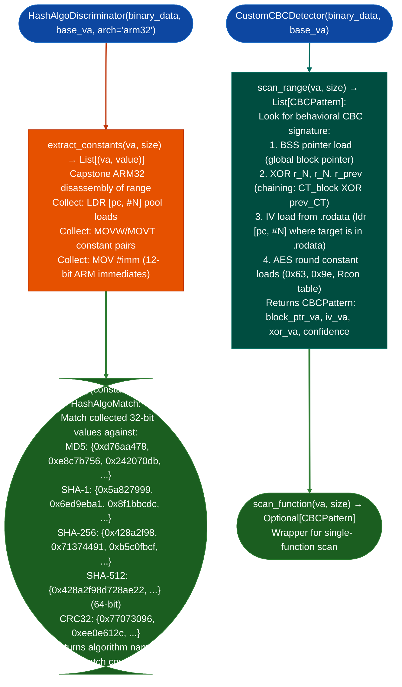

# Hash and AES Implementation Recognition

Identify hash algorithm implementations MD5, SHA-1, SHA-256, SHA-512, CRC32 and hand-rolled AES-128-CBC in ARM32/Thumb2 disassembly: using K-table constant fingerprinting for hash identification and behavioral pattern matching for CBC mode detection.

---

## Why this exists

1. **Stripped firmware frequently contains inlined or hand-rolled cryptographic implementations that are invisible to symbol-name analysis: a function named `sub_401200` that contains the MD5 K-table constants is provably an MD5 implementation regardless of its name.** `HashAlgoDiscriminator` extracts 32-bit constants from literal pools and immediate loads in a function, then matches against known K-tables MD5 round constants, SHA-1 initial hash values, SHA-256/512 K values, CRC32 polynomial. The match is definitive: no other function in normal firmware contains these exact constant sequences.

2. **`CustomCBCDetector` identifies hand-rolled AES-128-CBC in ARM32 Thumb2 by its behavioral signature: a BSS-tracked block pointer, XOR-with-previous-ciphertext chaining the defining operation of CBC mode, and an IV loaded from `.rodata`.** This pattern appears in network appliance firmware that implements AES-CBC without calling an external library: the implementation is directly auditable for IV reuse, key derivation errors, and padding oracle conditions.

3. **Finding a custom AES-CBC implementation without using a constant-time comparison for CBC-MAC authentication is a common source of padding oracle vulnerabilities in embedded firmware.** `CustomCBCDetector` flags the implementation's location; manual inspection of the MAC comparison at the function's caller determines whether a timing oracle exists.

---

## How it works



---

## Usage

```python
from ablation.analyzers.crypto_pattern_detector import HashAlgoDiscriminator, CustomCBCDetector

data = open('/path/to/target.elf', 'rb').read()
base_va = 0   # or actual load VA

# ── Hash identification ───────────────────────────────────────────────────────
discriminator = HashAlgoDiscriminator(data, base_va, arch='arm32')

# Scan a function by VA and size
match = discriminator.scan_function(va=0x401200, size=0x200)
print(match.fmt())
# → "SHA-256 (K-table match, 64/64 constants)"

# Scan any range for constants, then identify
constants = discriminator.extract_constants(va=0x401200, size=0x200)
match2 = HashAlgoDiscriminator.identify(constants)
print(match2.algorithm, match2.match_count)

# ── CBC detection ─────────────────────────────────────────────────────────────
cbc_detector = CustomCBCDetector(data, base_va)
patterns = cbc_detector.scan_range(va=0x401000, size=0x2000)
for p in patterns:
    print(p.fmt())
    print(f"  Block ptr at {p.block_ptr_va:#x}, IV at {p.iv_va:#x}")
```

---

## Example output

The following illustrates the recognition output format. Actual addresses and counts are binary-specific.

```
HashAlgoMatch:
  algorithm: SHA-256
  match_count: 64/64 K-table constants matched
  confidence: HIGH
  first_match_va: <va>

CBCPattern:
  block_ptr_va: <va>  (BSS global block pointer)
  iv_va: <va>         (IV loaded from .rodata)
  xor_va: <va>        (chaining XOR instruction)
  confidence: 0.92
```

---

## False positives

**`HashAlgoDiscriminator` may match CRC32 in firmware that implements Ethernet FCS, this is a legitimate CRC32 implementation, not a cryptographic hash usage.** CRC32 findings should be labeled "implementation found" not "cryptographic use found." Distinguish by context: CRC32 in a network receive path is Ethernet FCS, not a hash function.

**`CustomCBCDetector` requires the AES round constants `0x63`, Rcon table to be present in the scan range.** AES implementations that load their Rcon table from a different section or compute it on-the-fly will score below the confidence threshold and not generate a `CBCPattern` finding. Use `scan_range()` with a wider range if the S-box or Rcon table is in a separate section.

---

## Pipeline position

Run `HashAlgoDiscriminator` and `CustomCBCDetector` after `SemanticSearcher` identifies functions tagged with "crypto", "hash", "cipher", or "encrypt" in their embedding neighborhood. Confirming the algorithm identity with K-table matching provides a definitive label for `BinaryContext.set_name()`. For AES-CBC findings, proceed to manual inspection of the CBC-MAC comparison path to assess padding oracle risk.

---

## See also

## Reading output

`HashAlgoDiscriminatorbinary, load_addr.scanva, size` returns `List[HashAlgoMatch]`:

| Attribute | Content |
|:---|:---|
| `algo` | Algorithm name for example `'SHA-256'`, `'MD5'`, `'SHA-1'`, `'CRC32'` |
| `confidence` | Integer 0–100 |
| `matched` | `List[ConstMatch]`: constant match sites used for identification |

`CustomCBCDetectorbinary, load_addr.scan_rangeva, size` returns `List[CBCPattern]`:

| Attribute | Content |
|:---|:---|
| `outer_func_va` | VA of the function or scan range containing the CBC loop |
| `block_func_va` | VA of the single-block AES call target inside the loop |
| `chaining_reg` | Register carrying the previous ciphertext / IV pointer |
| `iv_va` | VA of the IV in `.rodata`, or `None` if not resolved |
| `iv_bytes` | 16-byte IV value, or `None` if not resolved |
| `xor_va` | VA of the first XOR instruction in the loop body |
| `loop_va` | VA of the loop start back-edge target |
| `confidence` | Integer 0–100 |

---

## See also

- [Cryptographic Analysis](cryptographic-analysis.md): RSA/ECDSA/RNG analysis complementary to hash/AES identification
- [RSA, ECDSA, and Randomness Checks](rsa-ecdsa-and-randomness-checks.md): public key crypto implementation review
- [Source Code Auditing](source-code-auditing.md): for OpenSSL/mbedTLS source-available targets
- [Taint Analysis](taint-analysis.md): after identifying the crypto implementation, trace key material flow
