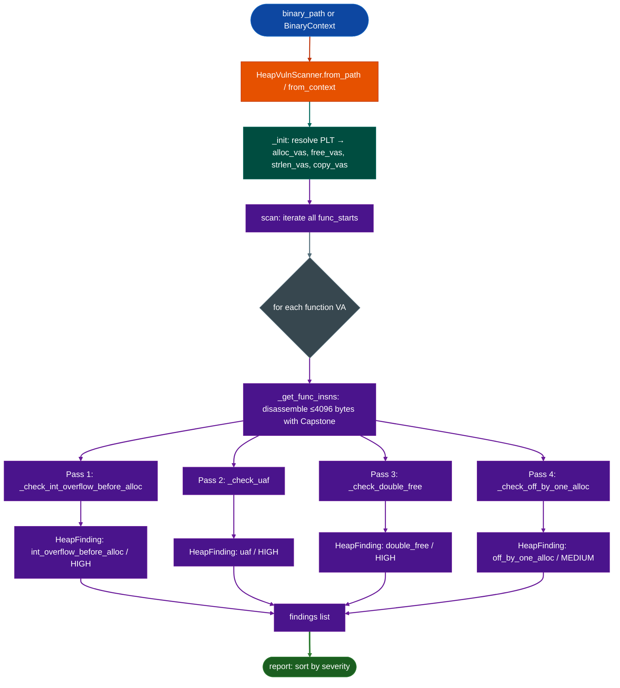

# HeapVulnScanner

  - [What is heap vulnerability scanning?](#what-is-heap-vulnerability-scanning)
  - [Why this exists](#why-this-exists)
  - [How it works](#how-it-works)
  - [HeapVulnScanner](#heapvulnscanner-1)
  - [Usage](#usage)
  - [Example output](#example-output)
  - [False positives](#false-positives)
  - [Pipeline position](#pipeline-position)
  - [Reading findings](#reading-findings)
  - [See also](#see-also)

**File:** `ablation/analyzers/heap_vuln_scanner.py`

---

## What is heap vulnerability scanning? <sup>[↑](#heapvulnscanner)</sup>

Heap memory corruption vulnerabilities arise when a program writes beyond the bounds of a dynamically allocated buffer, frees a pointer twice, uses memory after it has been freed, or miscalculates buffer sizes in a way that causes the allocator to return a buffer smaller than the caller expects. These errors produce undefined behavior that attackers can exploit to redirect control flow, escalate privileges, or achieve remote code execution.

The four primary heap vulnerability classes, as catalogued by Dowd, McDonald, and Schuh in *The Art of Software Security Assessment* (2006), are: (1) integer overflow before allocation, where `size * count` or `offset + length` wraps to a small positive integer, causing `malloc` to return a buffer smaller than subsequent writes expect; (2) use-after-free, where a pointer is dereferenced after the memory it points to has been returned to the allocator, allowing an attacker to control the freed memory's contents before the dereference; (3) double-free, where the same pointer is passed to `free()` twice, corrupting the allocator's internal free-list metadata; and (4) NUL-terminator off-by-one, where a string operation writes a NUL byte one position past the end of a buffer, overwriting the first byte of the next allocation or a metadata field.

`HeapVulnScanner` implements four independent static analysis passes, one per vulnerability class, using a combination of backward dataflow (for integer overflow detection before the allocation call), pattern matching over basic-block instruction sequences (for use-after-free and double-free), and string operation length analysis (for off-by-one). Each pass operates on the same `BinaryContext` and reports findings with the function VA, the specific instruction, the vulnerability class, and an estimated severity. The passes are independent so each can be run alone for targeted analysis without the overhead of the full scanner.

## Why this exists <sup>[↑](#heapvulnscanner)</sup>

1. **Heap vulnerabilities are the dominant vulnerability class in modern firmware and system software.** Integer overflows before allocations, use-after-free conditions, double-free corruptions, and NUL-terminator off-by-ones represent the majority of exploitable memory safety bugs found in production firmware: including in targets Ablation has analyzed Cisco ASA, FortiOS, TencentOS. A systematic, automated first pass over every function in a binary surfaces candidates that would otherwise require weeks of manual audit.

2. **Each vulnerability class requires a different detection strategy.** An integer overflow before `malloc` requires tracking multiplicative operations and checking whether the result reaches an allocator without an overflow guard. Use-after-free requires tracking which register was freed and flagging subsequent dereferences of that register. Double-free requires tracking the identity of freed pointers across the function body. Off-by-one requires recognizing the `strlen → malloc → strcpy` pattern where the allocation is one byte too small. A single generic scanner cannot cover all four, this tool runs four independent passes per function.

3. **Caller-saved register semantics must be understood to avoid false negatives.** A naive scanner that tracks freed register `R` will lose the association after the next `CALL`, because `CALL` clobbers caller-saved registers under the SysV AMD64 ABI. This scanner explicitly models ABI-mandated clobbering: it clears caller-saved registers `rax`, `rcx`, `rdx`, `rsi`, `rdi`, `r8`–`r11` from tracking state after every `CALL`, but preserves the source register identity for freed pointers that were moved from a callee-saved register before being passed to `free()`.

4. **The allocator set covers embedded and kernel contexts, not just userspace libc.** Standard `malloc`/`free` is only part of the picture. Firmware uses `kmalloc`/`kfree`, `vmalloc`, Windows kernel `ExAllocatePool`/`ExFreePool`, and GLib's `g_malloc`/`g_free`. This tool maintains the complete allocator and free symbol sets required for accurate detection across the full range of Ablation's targets.

---

## How it works <sup>[↑](#heapvulnscanner)</sup>

The scanner operates in a single pipeline: PLT resolution populates the symbol sets, then four independent detection passes run over every disassembled function.



### Pass 1: Integer Overflow Before Allocation TAOSSA Ch.6 §L6-2, L6-3, L6-4 <sup>[↑](#heapvulnscanner)</sup>

Tracks `IMUL`, `MUL`, `SHL`, `SAL`, `SHLX`, and `LEA` with a scale factor greater than 1 as multiplicative operations that can overflow. The result register is tracked through subsequent `MOV` instructions. If the result reaches an allocator size argument `rdi`, `rsi`, or `rdx` within 12 instructions without an intermediate `CMP`, `TEST`, `JO`, or `JNO`, a HIGH finding is raised.

The `LEA [reg*scale + base]` form is included because compilers frequently emit `lea rdi, [rax*4]` in place of `imul rdi, rax, 4`, this is a multiply-by-scale that carries the same overflow risk.

Any `CALL` between the multiply and the allocation clears caller-saved result registers from tracking the multiply result was not preserved across the call boundary.

### Pass 2: Use-After-Free TAOSSA Ch.5 <sup>[↑](#heapvulnscanner)</sup>

Tracks the source register at each `free()` call site. The source is the register that was moved into `rdi` immediately before the call, this is the pointer being freed. After `free()` returns, any subsequent dereference of that source register (`[reg+off]` memory operand) or any `CALL` that passes that register as an argument raises a HIGH finding.

Caller-saved registers are cleared after each non-`free()` `CALL`. Callee-saved registers are not cleared, correctly modeling that a freed pointer held in `rbx`, `r12`–`r15`, or `rbp` survives subsequent calls.

Reassignment of the freed register via `MOV`, `LEA`, `XOR`, `MOVZX`, `POP` clears its freed status, preventing false positives on correct code that re-uses the register slot for a new pointer.

### Pass 3: Double-Free TAOSSA Ch.5 <sup>[↑](#heapvulnscanner)</sup>

Independently tracks the same freed-register state as Pass 2, but looks specifically for a second `free()` call on the same source register without intervening reassignment. When a second `free()` is detected on an already-freed register, a HIGH finding is raised with both the current and original free addresses.

### Pass 4: Off-By-One in Allocation Size TAOSSA Ch.5 <sup>[↑](#heapvulnscanner)</sup>

Detects the classic `strlen(s) → malloc(len) → strcpydst, s` pattern where the allocation is one byte too small for the NUL terminator. After a `CALL strlen`, the result (`rax`) is tracked as a potential off-by-one allocation size. If that result reaches `malloc` without an intervening `ADD rax, N`, `INC rax`, or `LEA [rax+N]` any of which would account for the NUL byte, a MEDIUM finding is raised.

---

## HeapVulnScanner <sup>[↑](#heapvulnscanner)</sup>

```python
from ablation.analyzers.heap_vuln_scanner import HeapVulnScanner
from ablation.analyzers.binary_context import BinaryContext

# Preferred: share an existing BinaryContext
ctx = BinaryContext.load_or_build('/path/to/firmware')
scanner = HeapVulnScanner.from_context(ctx)

# Standalone: builds context internally
scanner = HeapVulnScanner.from_path('/path/to/firmware')

findings = scanner.scan()
print(scanner.report(findings))
```

### Covered allocators and free functions <sup>[↑](#heapvulnscanner)</sup>

| Category | Symbols |
|---|---|
| userspace | `malloc`, `calloc`, `realloc`, `xmalloc`, `xcalloc`, `xrealloc` |
| Linux kernel | `kmalloc`, `kzalloc`, `vmalloc`, `vzalloc`, `kcalloc`, `kvmalloc` |
| Windows kernel | `ExAllocatePool`, `ExAllocatePoolWithTag`, `ExAllocatePool2` |
| Windows userspace | `HeapAlloc`, `LocalAlloc`, `GlobalAlloc` |
| GLib | `g_malloc`, `g_malloc0`, `g_new` |
| OpenSSL pattern | `BUF_MEM_grow` TAOSSA L6-6 |
| Free | `free`, `kfree`, `vfree`, `kvfree`, `ExFreePool`, `ExFreePoolWithTag`, `HeapFree`, `LocalFree`, `GlobalFree`, `g_free` |

---

## Usage <sup>[↑](#heapvulnscanner)</sup>

```python
from ablation.analyzers.heap_vuln_scanner import HeapVulnScanner
from ablation.analyzers.binary_context import BinaryContext

ctx = BinaryContext.load_or_build('/fw/cisco/lina')
scanner = HeapVulnScanner.from_context(ctx)
findings = scanner.scan()

# Triage HIGH findings first
for f in sorted(findings, key=lambda x: (x.severity, x.func_va)):
    print(f.fmt())

# Filter to a specific class
int_overflows = [f for f in findings if f.kind == 'int_overflow_before_alloc']
uaf = [f for f in findings if f.kind == 'uaf']
double_frees = [f for f in findings if f.kind == 'double_free']

# Structured output
for f in findings:
    print({
        'kind': f.kind,
        'func_va': hex(f.func_va),
        'site_va': hex(f.site_va),
        'severity': f.severity,
        'alloc_sym': f.alloc_sym,
        'freed_at': hex(f.freed_at) if f.freed_at else None,
        'description': f.description,
    })
```

---

## Example output <sup>[↑](#heapvulnscanner)</sup>

```
[heap_vuln_scanner] 5 finding(s)  HIGH=4  MED=1

  HIGH    int_overflow_before_alloc       0x403200+0x18  IMUL result fed to malloc at 0x403218 without overflow check  alloc=malloc
  HIGH    uaf                             0x408100+0x44  Dereference of freed pointer at 0x408144 (mov [rax+0x8], rbx)  freed_at=0x408120
  HIGH    uaf                             0x408100+0x60  Dereference of freed pointer at 0x408160 (call 0x401040)  freed_at=0x408120
  HIGH    double_free                     0x40a000+0x90  Double-free at 0x40a090 (first free at 0x40a060)  freed_at=0x40a060
  MEDIUM  off_by_one_alloc                0x40c300+0x08  strlen result at 0x40c308 fed to malloc without +1: NUL terminator off-by-one  alloc=malloc
```

---

## False positives <sup>[↑](#heapvulnscanner)</sup>

**Pass 1: Integer overflow before allocation.** The most common false positive is a multiply that is provably bounded. For example, if `count` is validated against a maximum before the multiply (`count <= MAX_ITEMS`), and the constant `MAX_ITEMS * sizeof(item)` cannot overflow, the scanner still flags it because it does not track the range constraint. Verify by checking whether a bounds check on the multiplier appears anywhere in the calling path.

**Pass 2: Use-after-free.** Code that intentionally clears a freed pointer immediately after `free()` for example `free(p; p = NULL;`) is correctly suppressed because the `MOV` to `NULL` clears the freed-register tracking. Code that stores the pointer in a different variable before freeing for example `tmp = p; free(tmp;`) may not be detected if the original `p` variable is later used, this is a false negative, not a false positive.

**Pass 3: Double-free.** Patterns where a condition guarantees only one code path calls `free()` for example `if (owned free(p);`) can produce false positives because the scanner conservatively assumes both branches execute. Verify by reviewing the conditional structure of the containing function.

**Pass 4: Off-by-one.** `strdup(s)` is not in the copy function set. Code that allocates `strlen(s)+1` and then calls `strdup` will not generate a finding. Custom string duplication functions that lack the `+1` are caught only if they directly call `strcpy` or `memcpy`.

---

## Pipeline position <sup>[↑](#heapvulnscanner)</sup>

**Before this module:** `BinaryContext.load_or_build()` to supply `func_starts` and the PLT allocator/free symbol map.

**After this module:** Confirmed HIGH findings (especially `int_overflow_before_alloc` and `uaf`) should be traced with `TaintTracker` to verify that the size argument or freed pointer originates from attacker-controlled input. `PathSolver` can check feasibility of the path from entry to the finding.

---

## Reading findings <sup>[↑](#heapvulnscanner)</sup>

| Field | Content |
|:---|:---|
| `kind` | `int_overflow_before_alloc` / `uaf` / `double_free` / `off_by_one_alloc` |
| `func_va` | Virtual address of the containing function |
| `site_va` | Virtual address of the multiply, free, or strlen instruction that initiates the pattern |
| `severity` | `HIGH` for int_overflow, uaf, double_free; `MEDIUM` for off_by_one |
| `alloc_sym` | Name of the allocation function called int_overflow and off_by_one only |
| `freed_at` | VA of the first `free()` call uaf and double_free only |
| `description` | Human-readable explanation of what was found and where |

---

## See also <sup>[↑](#heapvulnscanner)</sup>

- [Taint Analysis](taint-analysis.md): trace HIGH findings back to attacker-controlled input sources
- [Path Solver](path-solver.md): symbolic path feasibility for confirmed candidates
- [Format String Scanner](format-string-scanner.md): companion scanner for the format string vulnerability class
- [Binary Context](binary-context.md): provides `func_starts` and PLT; run first
- [Length Underflow Scanner](length-underflow.md): complementary scanner for header-subtraction underflows before allocation
