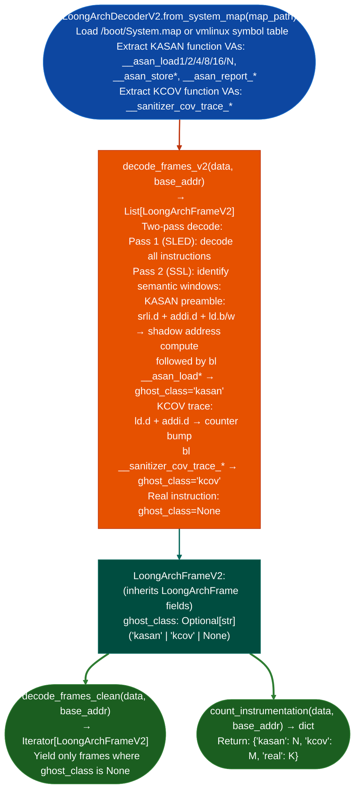

# LoongArch64 KASAN/KCOV-Aware Decoding

Extend LoongArch64 decoding with a two-pass semantic layer that identifies and strips KASAN shadow-address preamble sequences and KCOV trace instrumentation ghost calls: producing clean instruction frames for taint analysis of `CONFIG_KASAN=y` / `CONFIG_KCOV=y` debug kernels where instrumentation noise otherwise obscures real control flow.

---

## Why this exists

1. **TencentOS 4.6 kernel `6.6.119-52.9.tl4.loongarch64+debug` injects KASAN ghost calls before virtually every memory access.** Each real memory access is preceded by a multi-instruction shadow-address preamble that computes the KASAN shadow region address and a `bl __asan_load*`/`__asan_store*` call. Without stripping these, `TaintTrackerLA64` follows KASAN paths instead of real memory access paths: producing phantom taint chains.

2. **`LoongArchDecoderV2` is grounded in Cifuentes & Sendall 1998 SSL: Semantic Specification Language**: V1 is the SLED pass encoding → operands; V2 is the SSL pass instruction windows → named semantic units. KASAN shadow-address idioms and KCOV trace idioms are recognized as semantic units via fixed instruction-window patterns, then tagged on the `LoongArchFrameV2.ghost_class` field.

3. **`decode_frames_clean()` yields only non-ghost frames**: callers can use it as a drop-in replacement for V1 `decode_frames()`, receiving a clean instruction stream with no KASAN/KCOV noise. `count_instrumentation()` reports the noise density ghost calls per 1000 real instructions for a given binary, documenting how much instrumentation was stripped.

---

## How it works



---

## Usage

```python
from ablation.analyzers.loongarch_decoder_v2 import LoongArchDecoderV2

# Requires System.map or vmlinux symbols for KASAN function VA lookup
decoder = LoongArchDecoderV2.from_system_map('/boot/System.map')

with open('/path/to/tencentos_debug_module.ko', 'rb') as f:
    data = f.read()

# Full decode with ghost annotations
all_frames = decoder.decode_frames_v2(data, base_addr=0xffff000000000000)
ghost_count = sum(1 for f in all_frames if f.ghost_class is not None)

# Clean decode (no KASAN/KCOV noise)
clean_frames = list(decoder.decode_frames_clean(data, base_addr=0xffff000000000000))
print(f"Clean frames: {len(clean_frames)}")

# Instrumentation density
stats = decoder.count_instrumentation(data, base_addr=0xffff000000000000)
print(f"KASAN: {stats['kasan']}  KCOV: {stats['kcov']}  Real: {stats['real']}")
```

---

## Example output

The following illustrates KASAN-aware decoding output format. Actual counts are kernel-specific.

```
LoongArchDecoderV2: tencentos debug module

count_instrumentation():
  kasan: <K>  kcov: <C>  real: <R>
  instrumentation density: <K+C>/<R> per instruction

decode_frames_clean(): <R> clean frames
  (stripped <K+C> ghost frames)
```

---

## False positives

**KASAN preamble window recognition requires the shadow compute sequence to appear in a fixed 4–6 instruction window**: if the compiler reorders the shadow compute sequence for example due to scheduling, the window may not match and the preamble will pass through as real instructions. `count_instrumentation()` reports missed ghost frames if the resulting density is lower than expected for a full-debug kernel.

**`from_system_map()` requires a System.map matching the exact kernel build**: a System.map from a different build will have incorrect VAs for `__asan_load*` functions, causing KASAN calls to pass through as unrecognized real instructions.

---

## Pipeline position

Use `LoongArchDecoderV2` instead of `LoongArchDecoder` (V1) for all `CONFIG_KASAN=y` kernel targets. Pass `decode_frames_clean()` output to `TaintTrackerLA64` to avoid phantom taint paths from KASAN shadow accesses.

---

## Reading output

`LoongArchDecoderV2.count_instrumentation()` returns a dict:

| Key | Content |
|:---|:---|
| `kasan` | Count of KASAN instrumentation instructions |
| `kcov` | Count of KCOV instrumentation instructions |
| `real` | Count of non-instrumentation instructions |
| `density` | Float: `kasan + kcov / real` instrumentation density |

`LoongArchDecoderV2.decode_frames_clean()` returns `List[ARCFrame]` with instrumentation frames stripped.

---

## See also

- [LoongArch64 Taint Analysis](taint-analysis-2.md): `TaintTrackerLA64` that consumes clean frames
- [LoongArch64 Compiler Bug Detection](loongarch64-2.md): `LA64MaxNotMinScanner` for GCC 12.3.1.7 min/max bug detection
