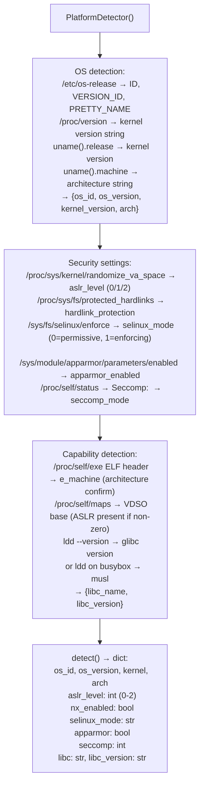

# Host Platform Inventory

Detect OS family, kernel version, CPU architecture, libc variant, and security capability settings (ASLR, NX bit, SELinux/AppArmor status, seccomp) on a live host — providing the platform baseline needed to select the correct exploit primitives — via `ablation/core/platform_detect.py` `PlatformDetector`.

---

## Why this exists

1. **Exploit primitive selection depends on exact platform details** — a kernel heap overflow exploit requires knowing whether the host runs glibc or musl, whether ASLR is enabled (`/proc/sys/kernel/randomize_va_space`), and whether the kernel was compiled with SMEP/SMAP. `PlatformDetector` extracts these facts from `/proc/version`, `/proc/sys/`, `/etc/os-release`, and `uname` without requiring root.

2. **`PlatformDetector` is architecture-aware** — it distinguishes x86-64, ARM64, ARMv7, MIPS32, PPC64, and RISC-V from `uname -m` and the ELF header of `/proc/self/exe`. This is relevant when the compromised host is an embedded Linux device (ARM-based network equipment, IoT gateway) where x86-64 shellcode will fail silently.

3. **Security capability detection** — ASLR level (0/1/2), NX (`/sys/devices/system/cpu/cpu0/topology/`), SELinux mode (`/sys/fs/selinux/enforce`), AppArmor status (`/sys/module/apparmor/parameters/enabled`), and seccomp filter status from `/proc/self/status` — all without executing privileged commands. This determines whether a found exploit is directly executable or requires a mitigation bypass step.

---

## How it works



---

## Usage

```python
from ablation.core.platform_detect import PlatformDetector

detector = PlatformDetector()
info = detector.detect()

print(f"OS: {info['os_id']} {info['os_version']}")
print(f"Kernel: {info['kernel']}  Arch: {info['arch']}")
print(f"ASLR: {info['aslr_level']}  NX: {info['nx_enabled']}")
print(f"SELinux: {info['selinux_mode']}  SecComp: {info['seccomp']}")
print(f"libc: {info['libc']} {info['libc_version']}")
```

---

## Example output

The following illustrates host platform inventory output format.

```
PlatformDetector:

OS: ubuntu 22.04  kernel: 5.15.0-91-generic  arch: x86_64
ASLR: 2 (full randomization)
NX: enabled
SELinux: permissive
AppArmor: enabled
Seccomp: 0 (not filtered for this process)
libc: glibc 2.35
```

---

## False positives

**`/sys/fs/selinux/enforce` absence does not mean SELinux is disabled** — some distributions compile SELinux into the kernel but mount the securityfs elsewhere, or use a different path. `PlatformDetector` returns `selinux_mode='unknown'` when the path is absent; verify with `getenforce` if available.

**`aslr_level=2` does not guarantee every region is randomized** — some applications disable ASLR for specific threads via `personality(ADDR_NO_RANDOMIZE)`. The `/proc/sys/kernel/randomize_va_space` value reflects the system-wide setting, not per-process enforcement.

---

## Pipeline position

Run `PlatformDetector` as the second step after gaining shell access (after `NetworkAnalyzer`). Platform details determine which exploit templates from `shellcode_utils.py` are applicable and whether ASLR bypass is needed before attempting stack overflows.

---

## See also

- [Crash Offset and ROP Helpers](crash-offset-and-rop-helpers.md) — `shellcode_utils.py` exploit helpers informed by platform detection results
- [Process and Memory Map Inventory](process-and-memory-map-inventory.md) — live process and memory layout analysis
