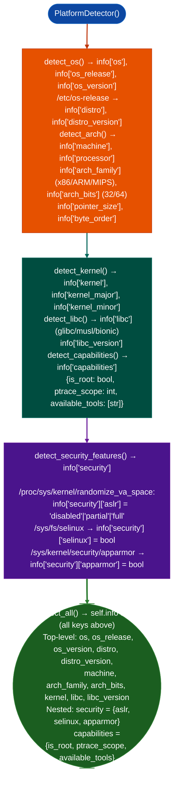

# Host Platform Inventory

Detect OS family, kernel version, CPU architecture, libc variant, and security capability settings ASLR, NX bit, SELinux/AppArmor status, seccomp on a live host: providing the platform baseline needed to select the correct exploit primitives: via `ablation/core/platform_detect.py` `PlatformDetector`.

---

## Why this exists

1. Exploit primitive selection depends on exact platform details: a kernel heap overflow exploit requires knowing whether the host runs glibc or musl, whether ASLR is enabled (`/proc/sys/kernel/randomize_va_space`), and whether the kernel was compiled with SMEP/SMAP. `PlatformDetector` extracts these facts from `/proc/version`, `/proc/sys/`, `/etc/os-release`, and `uname` without requiring root.

2. **`PlatformDetector` is architecture-aware**, it distinguishes x86-64, ARM64, ARMv7, MIPS32, PPC64, and RISC-V from `uname -m` and the ELF header of `/proc/self/exe`. This is relevant when the compromised host is an embedded Linux device ARM-based network equipment, IoT gateway where x86-64 shellcode will fail silently.

3. Security capability detection: ASLR level (0/1/2), NX (`/sys/devices/system/cpu/cpu0/topology/`), SELinux mode (`/sys/fs/selinux/enforce`), AppArmor status (`/sys/module/apparmor/parameters/enabled`), and seccomp filter status from `/proc/self/status`: all without executing privileged commands. This determines whether a found exploit is directly executable or requires a mitigation bypass step.

---

## How it works



---

## Usage

```python
from ablation.core.platform_detect import PlatformDetector

detector = PlatformDetector()
# detect_all() not detect() — populates and returns self.info dict
info = detector.detect_all()

print(f"OS: {info['os']} {info.get('distro', '')} {info.get('distro_version', '')}")
print(f"os_release: {info['os_release']}  os_version: {info['os_version']}")
print(f"machine: {info['machine']}  arch_family: {info.get('arch_family')}  bits: {info.get('arch_bits')}")
print(f"libc: {info.get('libc')} {info.get('libc_version', '')}")

# Security features are nested under info['security']
sec = info.get('security', {})
print(f"ASLR: {sec.get('aslr', 'unknown')}")
print(f"SELinux: {sec.get('selinux', False)}  AppArmor: {sec.get('apparmor', False)}")
```

---

## Example output

The following illustrates host platform inventory output format.

```
PlatformDetector.detect_all() → info

info['os']          = 'Linux'
info['distro']      = 'ubuntu'
info['distro_version'] = '22.04'
info['machine']     = 'x86_64'
info['arch_family'] = 'x86'
info['arch_bits']   = 64
info['kernel']      = '5.15.0-91-generic'
info['libc']        = 'glibc'
info['libc_version'] = '2.35'

info['security']['aslr']     = 'full'
info['security']['selinux']  = False
info['security']['apparmor'] = True

info['capabilities']['is_root']     = False
info['capabilities']['ptrace_scope'] = 1
info['capabilities']['available_tools'] = ['gdb', 'strings', 'readelf']
```

---

## False positives

**`info['security']['selinux']` is `True` when `/sys/fs/selinux` exists, not when SELinux is enforcing**: `detect_security_features()` checks `os.path.exists('/sys/fs/selinux')`, which is `True` even in permissive mode. It does not distinguish permissive from enforcing. To confirm enforcement, read `/sys/fs/selinux/enforce` separately value `1` = enforcing, `0` = permissive.

**`info['security']['aslr'] = 'full'` does not guarantee every region is randomized**: some applications disable ASLR for specific threads via `personalityADDR_NO_RANDOMIZE`. The `/proc/sys/kernel/randomize_va_space` value reflects the system-wide setting only; per-process enforcement must be verified separately.

---

## Pipeline position

Run `PlatformDetector` as the second step after gaining shell access (after `NetworkAnalyzer`). Platform details determine which exploit templates from `shellcode_utils.py` are applicable and whether ASLR bypass is needed before attempting stack overflows.

---

## Reading output

`PlatformDetector().detect_all()` returns a flat `dict`:

| Key | Content |
|:---|:---|
| `os` | OS name for example `'Linux'`, `'Windows'` |
| `os_release` | Platform release string |
| `os_version` | Full platform version string |
| `distro` | Linux distribution name for example `'ubuntu'`, or absent on non-Linux |
| `distro_version` | Distribution version string, or absent |
| `machine` | CPU architecture string for example `'x86_64'`, `'aarch64'` |
| `processor` | Processor identifier string |
| `pointer_size` | Integer: pointer size in bits 32 or 64 |
| `byte_order` | `'little'` or `'big'` |
| `arch_family` | Normalized family: `'x86'` / `'ARM'` / `'MIPS'` / raw machine string |
| `arch_bits` | Integer: 32 or 64 set for x86 and ARM |
| `kernel` | Kernel version string Linux only |
| `libc` | C library name (`'glibc'` / `'musl'` / `'uclibc'`), if detectable |
| `libc_version` | C library version string, if detectable |

---

## See also

- [Crash Offset and ROP Helpers](crash-offset-and-rop-helpers.md): `shellcode_utils.py` exploit helpers informed by platform detection results
- [Process and Memory Map Inventory](process-and-memory-map-inventory.md): live process and memory layout analysis
