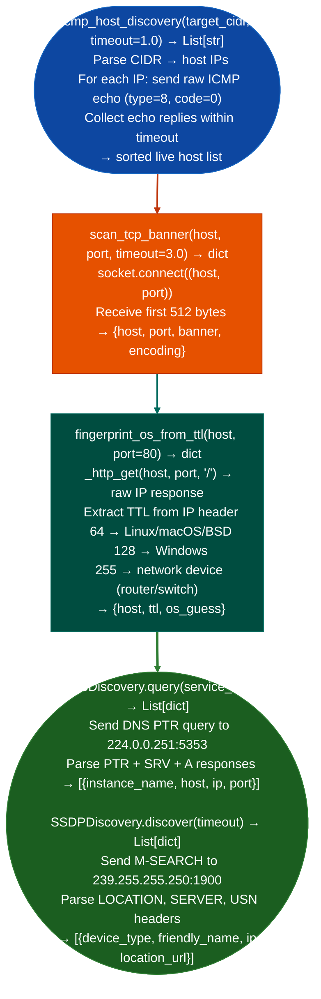

# Host/Service Discovery

Discover live hosts via ICMP echo requests, grab TCP service banners, enumerate mDNS and SSDP service announcements, and fingerprint OS from TTL/response characteristics: building an internal host map from a compromised network position: via `modules/net_sniffer.py`.

---

## Why this exists

1. **`icmp_host_discovery()` scans a full CIDR range with raw ICMP without `nmap` or `ping`.** It sends ICMP echo requests to every host in the target range and collects replies, returning a list of live IP addresses. The raw socket approach (`SOCK_RAW + IPPROTO_ICMP`) works without any external tools but requires root or `CAP_NET_RAW`. This is the primary host discovery method for lateral movement planning from a compromised Linux host.

2. **`scan_tcp_banner()` connects to a specific port and reads the service banner**: the first bytes returned after connection often identify the service and version without requiring protocol-specific probing. SSH banners (`SSH-2.0-OpenSSH_8.4`), SMTP banners (`220 mail.example.com Postfix`), and HTTP server headers are all returned in the first `recv()`. `fingerprint_os_from_ttl()` uses the TTL value in the IP header to infer OS (TTL ≈ 64 → Linux/macOS; TTL ≈ 128 → Windows; TTL ≈ 255 → network device).

3. **`MDNSDiscovery` and `SSDPDiscovery`** enumerate service types on the local network segment passively. `MDNSDiscovery.query('_http._tcp.local')` sends an mDNS PTR query and collects responses, identifying HTTP services management interfaces, embedded device dashboards without TCP scanning. `SSDPDiscovery.discover()` sends an M-SEARCH and collects UPnP device type and location responses.

---

## How it works



---

## Usage

```python
from modules.net_sniffer import (
    icmp_host_discovery, scan_tcp_banner,
    fingerprint_os_from_ttl, MDNSDiscovery, SSDPDiscovery
)

# Host discovery
live_hosts = icmp_host_discovery('10.0.0.0/24', timeout=0.5)
print(f"Live: {live_hosts}")

# Service banner + OS fingerprint
for host in live_hosts[:5]:
    banner = scan_tcp_banner(host, 22)
    os_info = fingerprint_os_from_ttl(host)
    print(f"  {host}  OS={os_info['os_guess']}  SSH={banner.get('banner','')[:40]}")

# mDNS/SSDP passive discovery
mdns = MDNSDiscovery()
http_services = mdns.query('_http._tcp.local')
ssdp = SSDPDiscovery()
devices = ssdp.discover(timeout=5.0)
```

---

## Example output

The following is a schematic example showing output structure and field names. Values are illustrative.

```
icmp_host_discovery: <subnet>/24

Live hosts: [<host-1>, <host-2>, <host-3>, <host-4>]

<host-1>  OS=network_device (TTL=255)  SSH=
<host-2>  OS=linux (TTL=64)  SSH=SSH-2.0-OpenSSH_8.x

mDNS services:
  DeviceA._http._tcp.local → <host-3>:80

SSDP devices:
  MediaServer (<host-4>): urn:schemas-upnp-org:device:MediaServer:1
```

---

## False positives

**TTL-based OS fingerprinting is a heuristic**: VPN tunnels, NAT, and SDN overlays alter TTL values in transit. A host behind a NAT that decrements TTL may appear as a different OS. Use banner grabbing to confirm OS identity independently.

**mDNS query responses may include cached records**: `MDNSDiscovery.query()` may receive responses from DNS cache on the local resolver rather than direct device responses. Verify that the returned IP addresses respond on the reported port.

---

## Pipeline position

Run host/service discovery after `local-network-inventory` reveals subnets. Discovery results feed banner grabbing, credential testing, and service-specific enumeration modules Docker, Kubernetes, IOS, and similar.

---

## Reading output

`icmp_host_discoverytarget_cidr, timeout` returns `List[dict]`:

| Field | Content |
|:---|:---|
| `host` | IP address string |
| `latency_ms` | Round-trip latency in milliseconds |
| `ttl` | IP TTL value from the ICMP reply 0 when TCP fallback was used |

`scan_tcp_bannerhost, port, timeout` returns a dict:

| Field | Content |
|:---|:---|
| `port` | Port number |
| `banner_raw` | First 256 bytes of response as a hex string |
| `service_guess` | Identified service name for example `'SSH'`, `'HTTP'`, `'Redis'`, `'unknown'` |
| `tls` | `True` if TLS was attempted on this port |

`MDNSDiscovery.queryservice_type` returns `List[dict]` with keys `instance_name`, `host`, `ip`, `port`.

`SSDPDiscovery.discover(timeout)` returns `List[dict]` with keys `device_type`, `friendly_name`, `ip`, `location_url`.

---

## See also

- [Local Network Inventory](local-network-inventory.md): `NetworkAnalyzer` for interface and subnet discovery before host scanning
- [PCAP Inspection](pcap-inspection.md): traffic analysis for communication patterns between discovered hosts
