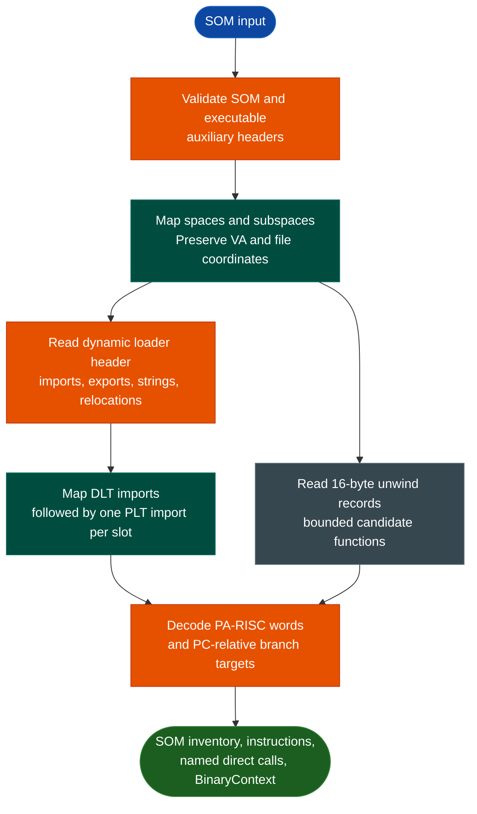

<a id="hpux-som"></a>
# HP-UX SOM and PA-RISC Analysis

`ablation.hpux` parses 32-bit big-endian HP-UX System Object Model (SOM) executables and decodes PA-RISC 1.0/1.1 instructions using only the Python standard library. It recovers subspaces, dynamic imports and exports, DLT/PLT linkage, dynamic relocations, and 16-byte unwind records. Direct calls can be attributed to import names and unwind owners, and the same data can populate `BinaryContext`.

## Why this exists

1. **SOM is not ELF.** Section headers, virtual addresses, dynamic symbols, and linkage tables use different structures and cannot be passed safely to the native ELF workflow.
2. **Stripped dynamic symbols must remain usable.** SOM imports are indexed through DLT and PLT tables rather than a conventional ELF dynamic-symbol/PLT layout. Ablation maps import `0..dlt_count-1` through the DLT and the remaining imports one-for-one through the PLT.
3. **Instruction recovery must be native and explicit.** `PaRiscDecoder` uses ordered opcode masks and operand encodings for PA-RISC 1.0/1.1. Unsupported words remain `.word`; they are never silently skipped or assigned guessed semantics.
4. **Function and call evidence must stay bounded.** Sixteen-byte unwind records provide candidate ranges. Direct branch-and-link calls use architectural PC-relative targets and can be labeled through recovered import stubs without executing the sample.

This workflow does not use a third-party disassembler, decompiler, loader, or emulator.

## How it works



The parser validates all table extents and requires `dlt_count + plt_count == import_list_count`. VA-to-file translation uses the containing subspace rather than assuming a single image-wide offset. Dynamic relocation entries are preserved but not applied, so recovered PLT procedure addresses describe the static image, not a loaded process.

## Usage

```bash
python3 -m ablation.hpux info INPUT
python3 -m ablation.hpux info INPUT --full
python3 -m ablation.hpux imports INPUT --external-code --json
python3 -m ablation.hpux disassemble INPUT 0xSTART --length 0x80 --json
python3 -m ablation.hpux calls INPUT 0xSTART --length 0x80 --json
python3 -m ablation.hpux functions INPUT --json
```

Python callers can use `read_som(path)` or `parse_som(data)`. `SomImage.instructions(start, end)` yields typed `Instruction` objects; `call_sites(start, end)` adds import names and unwind owners. `BinaryContext.load_or_build(path)` detects SOM before attempting ELF parsing.

## Validated evidence

For the recovered Lotus 1-2-3 `123_motif` image (SHA256 `42bdf512ad55cd7071acecba13cdae3ca4da90118f3ed41b0e24cbdb55cac218`):

- 31 subspaces, 2,321 imports, 819 exports, 445 DLT entries, 1,876 PLT entries, three dynamic relocations, and 4,586 unwind ranges;
- 91 external code imports;
- 302,965 decoded instructions with zero unknown encodings and 28,661 direct calls;
- Short five-bit operands are decoded from instruction bits 11–15, with regression vectors for zero and negative comparisons and byte, halfword, and word offsets; base-modify load/store immediates use low-bit sign extension;
- `execlp` at `0x2f9dc`, owned by `0x2f8f8`, and `execvp` at `0x2d560`;
- `systemcode_wrapper` and `output_of_wrapper` recovered through import-to-PLT mappings.

These are format and behavior observations, not a vulnerability verdict or proof of complete application coverage.

## Limits

- Only PA-RISC 1.0/1.1 instruction variants are selected. PA2.0 and wide encodings are not claimed.
- Unwind ranges are candidates, not complete function-boundary proof; indirect calls and dynamically relocated targets remain unresolved.
- `BinaryContext` gains architecture, symbols, strings, function candidates, and direct call edges. Generic ELF-only analyzers and pseudo-C backends are not implied to support PA-RISC.
- No dynamic HP-UX execution, loader simulation, or complete ABI emulator is provided.
